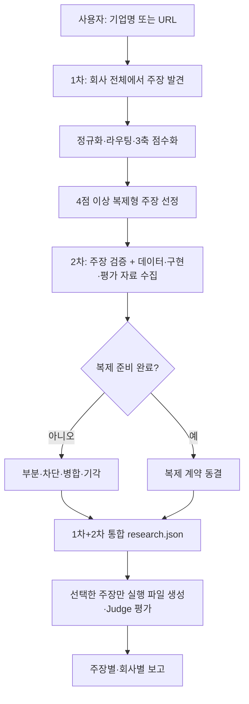

# Replica MVP

기업이 공개적으로 주장하는 AI 기능들을 넓게 조사하고, 점수 기준을 통과한 주장만
개별적으로 심층 검증한 뒤 테스트 가능한 입출력 계약과 프롬프트 기반 Replica로
구현 가능성을 평가하는 Codex 운영 하네스입니다.

사용자는 현재 Codex 대화에 기업명이나 공식 URL만 입력합니다. Codex가 공개
자료 조사, 기능 선정, 사양 작성, 테스트 설계, Replica 실행, Judge 판정,
보고서 생성을 맡습니다.

> [!IMPORTANT]
> 현재 Replica의 본체는 독립 애플리케이션이나 복제 모델이 아니라 공개 기능을
> 재구성한 시스템 프롬프트입니다. 테스트 통과는 해당 기능을 프롬프트 수준에서
> 구현할 수 있다는 의미이며 원제품을 복제했다는 의미가 아닙니다.

## 무엇을 검증하는가

이 프로젝트의 질문은 다음과 같습니다.

> 공개 자료에서 확인되는 기업의 AI 기능을 제한된 텍스트 입출력 기능으로
> 재구성했을 때, 명시적인 테스트 계약을 만족하는 결과를 만들 수 있는가?

예를 들어 기업이 “보험증권의 차이를 조항 근거와 함께 비교한다”고 주장한다면,
이를 다음과 같이 좁힙니다.

- 입력: 두 보험증권의 관련 조항과 endorsement
- 출력: 보장·면책·한도 차이, 조항 인용, 영향, 누락 정보
- 정상 사례: 명시적인 한도 차이
- 경계 사례: endorsement가 면책을 일부 복원하는 경우
- 정보 부족 사례: 참조된 endorsement가 누락된 경우

기업마다 주장하는 기능이 다르므로 입력 계약, 출력 계약, 통과 기준, 테스트도
매번 새로 작성합니다. 공개 근거 사용, 비공개 접근 주장 금지, 정보 부족 시
명시, 근거 수준에 맞는 결론 표현만 공통 규칙으로 유지합니다.

## 무엇을 만들지 않는가

기본 흐름에서는 다음을 만들거나 주장하지 않습니다.

- 원제품의 모델, 프롬프트, 코드 또는 학습 데이터 복제
- 원제품과 같은 UI, API, 플러그인 또는 시스템 통합
- 비공개 고객 데이터나 사내 지식베이스 접근
- 원제품과의 출력 동일성 또는 전체 제품 성능
- 공개 근거로 확인할 수 없는 정확도·속도·ROI의 독립 입증

독립 실행 가능한 제품 MVP가 필요하다면 이 평가 이후에 별도 CLI나 웹 앱을
구현해야 합니다.

## 사용자 경험

현재 Codex 대화에 다음 정도만 입력합니다.

```text
기업명: Acme AI
공식 사이트: https://example.com/
```

URL을 모르면 기업명만 입력해도 됩니다. 특정 기능을 지정하지 않으면 Codex가
공개 주장을 넓게 추출하고 `moat`, `business`, `separability`를 각각 0~2점으로
채점합니다. 복제형이면서 총점 4점 이상인 주장은 모두 2차 심층 조사로 보냅니다.

사용자가 직접 작성하지 않는 항목은 다음과 같습니다.

- 조사할 추가 URL
- 대상 기능과 입출력 계약
- 통과 기준과 테스트 사례
- Replica 프롬프트
- 모델 명령 또는 API 키
- Judge 판정과 보고서

이 저장소가 Codex CLI나 모델 API를 다시 호출하는 구조는 아닙니다. 현재 열려
있는 Codex 태스크가 오케스트레이터로서 작업을 수행합니다.

## 전체 파이프라인



### 1. 1차 주장 발견

회사 전체를 넓게 훑어 주장 누락을 줄입니다. 공식 사이트, 제품 설명, 문서, 공개
데모, 고객 사례와 기술 블로그를 우선 조사하고 주장 후보와 출처 URL을 기록합니다.
이 단계에서는 구현 데이터, 최종 입출력 계약이나 테스트를 확정하지 않습니다.

후보를 정규화·중복 제거하고 복제형과 소명-only로 라우팅합니다. 사람이 확정한
후보를 `moat`, `business`, `separability` 세 축으로 채점하고, 복제형이면서 총점
4점 이상인 주장을 모두 2차 조사 대상으로 선정합니다.

### 2. 2차 복제 자료 수집

선정된 주장 하나에서 시작해 관련 자료만 깊게 봅니다. 1차 출처를 다시 열고 정확한
기능명으로 공식 제품·기술 자료, 데모, 고객·파트너 발표, 인터뷰와 채용공고를
재검색합니다. 회사 전체를 다시 크롤링하지 않습니다.

목표는 원제품을 직접 써보는 것이 아니라, 공개 자료만으로 해당 주장을 복제할 수
있는지 판정하고 바로 구현할 수 있을 만큼 자료를 준비하는 것입니다. 각 주장에
대해 다음을 수집합니다.

- 공개 데이터셋, 샘플 문서와 입력 예시
- 필드·문서·출력 스키마와 파일 형식
- API·SDK·공개 구현, 논문·특허의 기술 단서
- 벤치마크, 참조 답안, 규칙과 합성 평가 사례
- 접근 방법, 라이선스·사용 제한과 공개 데이터가 없을 때의 합성 대안

조사는 두 번 나눠 수행하지만 결과 파일은 회사당
`work/<company-slug>/research.json` 하나입니다. 1차의 모든 후보 주장 가운데
선택된 주장에만 `second_pass` 결과를 덧붙입니다.

- 원 주장과 공개 근거로 확정한 canonical claim
- 정확한 입력, 처리, 출력과 기능 경계
- 공식·독립 근거와 반대 증거
- 사용할 데이터·스키마·구현 단서·평가 자료
- 최소 복제 방법과 `ready | partial | blocked` 준비도
- 공개되지 않은 부분, 한계와 미해결 질문
- `confirmed | refined | merged | rejected` 상태
- `build | merge | evidence_request | reject` handoff

통합 구조는 `templates/company-research.json`을 따릅니다.

모든 조사 질문이 답변되거나 공개적으로 알 수 없다고 표시되고, 필요한 입력마다
사용 가능한 공개 자료나 합성 대안이 있으며, 구현 경로와 평가 방법이 정해져야
`ready`입니다. `ready`인 주장은 같은 항목의 `replication_contract`에 근거 수준,
입출력 계약, acceptance criteria, output schema, 제외 범위와 최소 세 테스트를
동결합니다. 2차가 끝날 때 별도 dossier나 실행 파일을 만들지 않습니다. 임의의
최소 출처 수는 두지 않습니다.

### 3. 근거 수준 결정

근거 수준은 결론의 강도를 제한합니다.

| 수준 | 사용할 수 있는 근거 | 허용되는 결론 |
|---|---|---|
| `direct` | 동일 입력에 대한 원제품 출력 | 직접 비교한 범위에서 재현 |
| `public` | 공식 문서, 공개 데모, 제품 화면, 독립 자료 | 공개된 기능의 구현 가능 |
| `claim_only` | 기업의 기능 주장만 존재 | 공개 주장 기반 구현 가능 |

원제품 출력이 없으면 테스트를 모두 통과해도 동일성을 주장하지 않습니다.

### 4. 복제 계약 작성

선택한 기능을 `research.json`의
`claims[].second_pass.replication_contract`에 다음 항목으로 변환합니다.

- 입력 설명
- 출력 설명과 구조
- 기능별 acceptance criteria
- 제외 범위

통과 기준은 Judge가 실제로 확인할 수 있는 문장으로 작성합니다. “좋은 답변”처럼
주관적인 표현보다 “각 차이에 문서명과 조항 번호를 포함한다”처럼 관찰 가능한
조건을 사용합니다.

### 5. 테스트 설계

같은 `replication_contract.tests`에는 최소 세 사례를 먼저 고정합니다.

1. `normal`: 기능의 핵심 동작을 확인하는 정상 사례
2. `boundary`: 예외, 우선순위, 상충 규칙처럼 단순 패턴 매칭으로 틀리기 쉬운 사례
3. `insufficient-information`: 필수 자료가 없을 때 내용을 지어내지 않는지 보는 사례

각 사례에는 입력뿐 아니라 기대 동작과 판정에 사용할 참조 사실을 함께 기록합니다.
테스트와 기대값을 Replica 출력 이후에 수정하지 않습니다.

### 6. Replica 빌드

사용자가 실제 복제를 시작하면 해당 ready 주장 하나만
`work/<company-slug>/runs/<capability-slug>/`에 `evidence.json`, `spec.json`,
`tests.json`으로 펼친 뒤 `replica.json`을 만듭니다. 여기에는 다음이 포함됩니다.

- 대상 기업과 기능
- 공개 근거와 근거 수준
- 입력·출력 계약
- 통과 기준
- 비공개 정보 접근 및 환각 금지 지시

현재 Replica의 실체는 `replica.json` 안의 `system_prompt`입니다.

### 7. Replica 실행

Replica 패스는 고정된 시스템 프롬프트와 각 테스트 입력을 받아 후보 출력을
생성합니다. 결과는 `replica_outputs.jsonl`에 사례별로 저장합니다.

가능하면 별도 작업자가 Replica 출력만 담당하며 PASS/FAIL 판정에는 참여하지
않습니다.

### 8. Judge 평가

Judge 패스는 다음 자료를 사용합니다.

- acceptance criteria
- 테스트 입력과 기대 동작
- reference facts
- Replica 출력
- 공개 근거 수준

Judge는 `pass`와 구체적인 `reason`을 사례별로 `results.jsonl`에 기록합니다.
가능하면 Replica와 분리된 작업자가 판정하며 `replica.json`은 읽지 않습니다.
같은 Codex 세션에서 분리된 패스만 사용했다면 보고서에 독립성 한계를 밝힙니다.

### 9. 보고서 생성

실행이 끝난 주장의 `report.md`에는 다음이 포함됩니다.

- 대상 기업, 기능, 근거 수준, 통과 수
- 검토한 공개 주장과 출처
- 입력·출력 계약과 전체 통과 기준
- 평가 실행 방식과 Replica/Judge 분리 방법
- 사례별 입력, 기대 동작, 참조 사실, Replica 결과, Judge 결론
- 최종 판정이 지지하는 범위와 지지하지 않는 범위

## 산출물

기업별 1·2차 조사는 한 파일이고, 실제 실행 산출물만 별도 run 디렉터리에
생성됩니다.

```text
work/acme/
├── research.json                       # 1차 전수 주장 + 선택된 주장의 2차 결과
└── runs/                               # 실제 복제를 시작한 뒤에만 생성
    └── claim-a/
        ├── evidence.json
        ├── spec.json
        ├── tests.json
        ├── replica.json
        ├── replica_outputs.jsonl
        ├── results.jsonl
        └── report.md
```

`work/`는 실제 기업 분석 결과를 저장하는 로컬 작업 영역이며 Git에서 제외됩니다.
기업별 보고서를 공유하려면 내용과 공개 범위를 검토한 뒤 별도로 내보내야 합니다.

## 판정 해석

모든 테스트가 통과했을 때도 근거 수준에 따라 의미가 달라집니다.

- `direct`: 확보한 원제품 출력과 직접 비교한 범위에서 재현
- `public`: 공개 설명으로 정의한 제한된 기능을 구현할 수 있음
- `claim_only`: 공개 주장에 맞춘 기능을 만들 수 있음

일부만 통과하면 `부분 구현`, 모두 실패하면 `현재 Replica 미구현`으로 표시합니다.

예를 들어 `public` 수준에서 `3/3 PASS`는 다음만 의미합니다.

> 공개 자료에서 정의한 기능과 세 테스트의 범위 안에서 프롬프트가 요구 동작을
> 수행했다.

다음을 의미하지는 않습니다.

> 원제품과 같은 정확도, 모델, UI, 통합, 보안 또는 전체 워크플로를 재현했다.

세 테스트는 빠른 feasibility check입니다. 제품 수준의 신뢰도를 주장하려면 실제
도메인 데이터, 더 큰 고정 평가셋, 원제품 기준선, 블라인드 평가가 필요합니다.

## 내부 CLI

Python 3.12 이상이 필요하며 런타임 외부 의존성은 없습니다.

```bash
python -m pip install -e .
```

현재 Codex 운영 흐름에서는 Codex가 내부 명령을 실행하므로 사용자가 직접 실행할
필요는 없습니다.

### 프로젝트 골격 생성

```bash
replica-mvp init work/acme/runs/claim-a \
  --name acme-capability \
  --company "Acme AI" \
  --url "https://example.com" \
  --capability "공개적으로 확인한 기능" \
  --evidence-level public
```

이 명령은 실제 실행을 시작한 주장에만 `evidence.json`, `spec.json`,
`tests.json`의 골격을 만듭니다. 조사 단계에서는 호출하지 않습니다.

### Replica 프롬프트 빌드

```bash
replica-mvp build work/acme/runs/claim-a
```

### 보고서 재생성

```bash
replica-mvp report work/acme/runs/claim-a
```

### 선택적 외부 Runner

CI나 독립 재현에서 별도 stdin/stdout 모델 명령을 사용하려면 기존 Runner를
사용할 수 있습니다.

```bash
replica-mvp evaluate work/acme/runs/claim-a \
  --replica-command "YOUR_REPLICA_COMMAND" \
  --judge-command "YOUR_JUDGE_COMMAND"
```

각 명령은 stdin으로 프롬프트를 받고 stdout으로 답해야 합니다. Judge는 다음
형식의 JSON만 반환해야 합니다.

```json
{"pass": true, "reason": "한 문장의 구체적인 판정 이유"}
```

이 외부 Runner는 기본 Codex 대화 흐름에서는 사용하지 않습니다.

## 저장소 구조

```text
.
├── AGENTS.md                  # Codex 운영 규칙
├── README.md                  # 프로젝트 설명
├── pyproject.toml             # Python 패키지와 CLI 엔트리포인트
├── templates/                 # 회사 단위 통합 조사 계약
├── src/replica_mvp/
│   ├── cli.py                 # init/build/evaluate/report 명령
│   └── project.py             # 파일 생성, 실행, 판정, 보고서 로직
├── tests/test_import.py       # 최소 end-to-end 검사
├── .team-ai/                  # 프로젝트 결정과 로컬 컨텍스트
└── work/                      # 기업별 로컬 결과, Git 제외
```

## 검증

```bash
PYTHONPATH=src python -m unittest discover -s tests
team-ai guard
```

테스트는 프로젝트 생성부터 프롬프트 빌드, 가짜 Replica/Judge 실행, 상세 보고서
생성까지 이어지는 최소 end-to-end 흐름을 확인합니다.

## 안전과 데이터 경계

- API 키와 비밀값은 프로젝트 파일에 저장하지 않습니다.
- 공개 자료만 근거로 사용하며 비공개 시스템 접근을 주장하지 않습니다.
- 웹 자료는 신뢰하지 않은 입력으로 취급하고 출처와 실제 주장 범위를 기록합니다.
- 법률, 보험, 의료, 금융처럼 고위험 분야의 출력에는 사람 검토를 요구합니다.
- 실제 고객 문서가 필요한 평가는 별도 승인과 적절한 데이터 처리 환경 없이는
  수행하지 않습니다.

## 현재 한계와 다음 단계

현재 버전은 기능 구현 가능성을 빠르게 확인하는 프롬프트 평가 하네스입니다.
주요 한계는 다음과 같습니다.

- 기본 테스트 수가 세 개로 작음
- 공개 주장과 합성 입력을 중심으로 평가함
- 원제품 출력이 없는 경우가 많음
- Judge가 같은 모델 계열일 수 있음
- UI, 파일 처리, OCR, 데이터베이스, 외부 시스템 통합을 평가하지 않음
- 공개된 정확도·속도·비용 수치를 독립 재현하지 않음

다음 단계는 모든 기업에 공통으로 추가하지 않습니다. 특정 Replica가 실제 제품
후보로 선정됐을 때만 원제품 기준선 확보, 대규모 평가셋, 독립 모델 Judge,
실행 가능한 CLI 또는 웹 앱을 추가합니다.

## team-ai 연결

이 저장소는 `/Users/cho/team-ai`의 하네스에 연결되어 있지만 제품 방향과 기업별
분석은 프로젝트 로컬로 유지합니다.

```bash
team-ai context --mode implementation "MVP 구현"
team-ai guard
```
