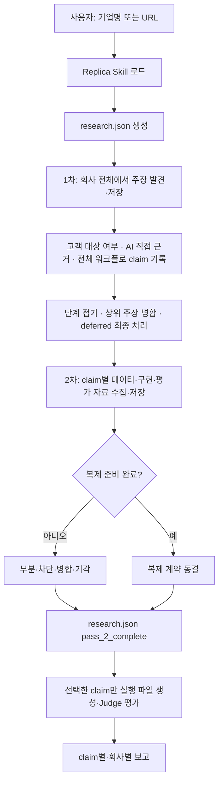

# Replica MVP

**프로젝트 목표(2026-10-02): 기술평가 보조 제품을 만들고, Replica를 기능의
모방·대체 가능성을 실험하는 핵심 기능으로 배치합니다.** 아래는 Replica 구성요소의
현재 사용법입니다. 상위 제품과의 역할, 확인된 현황, 다음 작업과 미결정 사항은
[프로젝트 목표와 방향](context/project-direction.md)에 정리했습니다.

기업이 고객에게 제공한다고 공개적으로 주장하는 AI 기능을 넓게 조사하고, 기능마다
전체 워크플로를 심층 검증한 뒤 테스트 가능한 계약과 실행 가능한 Replica 구현으로
재현 가능성을 평가하는 Codex·Claude 운영 하네스입니다.

사용자는 현재 Codex 대화에 기업명이나 공식 URL만 입력합니다. Codex가 공개
자료 조사, 기능 선정, 사양 작성, 테스트 설계, Replica 실행, Judge 판정,
보고서 생성을 맡습니다.

> [!IMPORTANT]
> 구현 경로는 세 가지가 공존합니다.
>
> | 경로 | 입력 | 상태 |
> |---|---|---|
> | Sol/Terra(Operator/Builder) Agent 번들 | 완료된 회사 `research.json` | 회사 조사의 기본 구현 경로. 봉인 평가 후 `final-results/`에 공개 |
> | JSON 전용 부품(`build-replica-operator`) | 단일 `replica-second-pass-result/v1` | 파일·네트워크가 필요 없는 순수 JSON 변환만 |
> | `init/build/evaluate` 프롬프트 하네스 | 수동 작성한 run 디렉터리 | 호환용으로만 유지 |
>
> 어느 경로의 테스트 통과도 원제품 전체를 복제했다는 의미는 아닙니다.

## 어떻게 작동하는가

이 프로젝트는 독립 실행형 크롤러가 아니라 **Codex가 실행하는 Skill 기반
하네스**입니다. 역할은 다음처럼 나뉩니다.

| 구성요소 | 역할 |
|---|---|
| `AGENTS.md` | Codex 세션에서 기업 조사·Replica 요청을 감지해 전용 Skill을 읽도록 라우팅 |
| `CLAUDE.md` | Claude Code 세션의 같은 라우팅. 런타임 모델 정책과 Codex 대비 차이를 함께 정의 |
| `skills/replica-research/SKILL.md` | 출처 정책, AI 기술 주장 판별, 1·2차 조사 순서, 준비도와 실행 경계를 정의하는 운영 로직 |
| `skills/replica-research/agents/` | 범위별 1차 조사와 claim별 2차 조사 서브에이전트의 입력·체크포인트·출력 계약 |
| `.agents/skills/`, `.claude/skills/` | 각각 Codex·Claude 런타임 전용 Replica 구현·하네스 Skill |
| 현재 Codex 태스크 | 웹 조사, 주장 판별, JSON 갱신과 선택적 Replica 실행을 수행하는 실행 주체 |
| `templates/company-research.json` | 회사별 조사 결과가 따라야 하는 최소 구조 |
| `src/replica_mvp/` | 1차 조사 결과 검증과 준비된 주장 실행·평가·보고를 담당하는 CLI |

동작 순서는 다음과 같습니다.

```text
기업명·URL 입력
→ AGENTS.md가 Replica Skill로 라우팅
→ Codex가 Skill의 출처·판별 규칙을 따라 조사
→ 조사 시작과 함께 research.json 생성
→ 5개 1차 조사 에이전트가 주장 발견 즉시 체크포인트 저장
→ 컨트롤러가 중복 정리·병합하고 research.json 확정
→ 모든 주장에 2차 결과, ready 주장에 복제 계약·단계 대응표·평가 데이터 추가
→ ready 주장을 Agent 번들로 구현·봉인 평가 (조사만 요청하면 2차에서 종료)
→ 모든 주장의 판정·미실행 사유·결과를 final-results/company-claims.json에 기록
```

Skill은 코드로 구현된 상태 머신이 아니라 에이전트가 따라야 하는 절차와 완료 조건을
정의합니다. 조사와 Agent 조율은 현재 열린 Codex·Claude 세션이 수행하며, 저장소
코드가 조사를 위해 모델을 호출하지는 않습니다. 다만 다음 경로는 모델을 직접
호출합니다.

- 구현 번들의 최종 평가 Judge: 하네스가 지정한 로컬 `codex` 또는 `claude` CLI
- 생성된 구현 번들: 계약이 모델 단계를 요구하면 같은 로컬 CLI를 실행
- `--use-model-adapter`를 명시한 grounded 대화 경로: `OPENAI_API_KEY`로 OpenAI API를
  직접 호출(`src/replica_mvp/openai_grounded_model.py`)

기본 사용법은 이 저장소를 연 Codex나 Claude Code 세션에 기업명이나 URL을 주는
것입니다.

## 무엇을 검증하는가

이 프로젝트의 질문은 다음과 같습니다.

> 공개 자료에서 확인되는 기업의 AI 기능을 사람이 웹 화면에서 직접 쓰는 고객
> 워크플로 전체로 재구성했을 때, 고정한 사례에서 어떤 결과를 내며 얼마가 드는가?

복제품의 목표 형태는 웹 앱입니다. 사람은 브라우저로 쓰고, AI 테스터는 같은
화면을 브라우저 자동화로 조작합니다([방향 문서](context/project-direction.md) 5절).
웹 앱 실행과 AI 사례 시연은 아래 "웹 앱 Replica 실행과 AI 사례 시연"의 독립
명령으로 제공합니다. 기업 평가 harness는 2차 조사의 선택 시나리오에 `demo_plan`이
있으면 그 계획을 구현 전에 고정하고, 웹 앱 복제품을 같은 화면의 AI 시연으로
최종 평가합니다. `demo_plan`이 없는 claim은 기존 JSON 번들과 봉인 시험 경로를 씁니다.

2차는 워크플로 단계마다 구현·외부 의존·제외·미확인을 기록합니다. 조사된 단계를
제외한 계약은 부분 범위로 표시되고, 모든 테스트를 통과해도 최종 결과는
`partially_reproduced`를 넘지 않습니다.

예를 들어 기업이 “보험증권의 차이를 조항 근거와 함께 비교한다”고 주장한다면,
이를 다음과 같이 좁힙니다.

- 입력: 두 보험증권의 관련 조항과 endorsement
- 출력: 보장·면책·한도 차이, 조항 인용, 영향, 누락 정보
- 정상 사례: 명시적인 한도 차이
- 경계 사례: endorsement가 면책을 일부 복원하는 경우
- 정보 부족 사례: 참조된 endorsement가 누락된 경우

기업마다 주장하는 기능이 다르므로 입력 계약, 출력 계약, 통과 기준, 테스트도
매번 새로 작성합니다. 공개 근거 사용, 비공개 접근 주장 금지, 정보 부족 시
명시, 근거 수준에 맞는 결론 표현만 공통 규칙으로 유지합니다.

## 무엇을 만들지 않는가

기본 흐름에서는 다음을 만들거나 주장하지 않습니다.

- 원제품의 모델, 프롬프트, 코드 또는 학습 데이터 복제
- 원제품과 같은 UI, API, 플러그인 또는 시스템 통합
- 비공개 고객 데이터나 사내 지식베이스 접근
- 원제품과의 출력 동일성 또는 전체 제품 성능
- 공개 근거로 확인할 수 없는 정확도·속도·ROI의 독립 입증

독립 실행 가능한 제품 MVP가 필요하다면 이 평가 이후에 별도 CLI나 웹 앱을
구현해야 합니다.

## 사용자 경험

현재 Codex 대화에 다음 정도만 입력합니다.

```text
기업명: Acme AI
공식 사이트: https://example.com/
```

URL을 모르면 기업명만 입력해도 됩니다. 특정 기능을 지정하지 않으면 Codex가
공개 자료에서 **AI 기술 주장만** 골라내고, 각 주장이 왜 AI인지를 출처 원문
인용으로 함께 저장합니다. 1차는 채점하거나 선별하지 않습니다. 중복을 정리한
주장 전부가 2차 심층 조사로 넘어가고, 복제 가능 여부는 2차에서 추가 근거와
함께 판단합니다.

사용자가 직접 작성하지 않는 항목은 다음과 같습니다.

- 조사할 추가 URL
- 대상 기능과 입출력 계약
- 통과 기준과 테스트 사례
- Replica 프롬프트
- 모델 명령 또는 API 키
- Judge 판정과 보고서

조사와 조율은 현재 열려 있는 Codex·Claude 세션이 오케스트레이터로서 수행합니다.
모델을 직접 호출하는 구현·평가 경로는 위 "어떻게 작동하는가"에 정리했습니다.

## 전체 파이프라인



### 1. 1차 AI 기술 주장 발견

1차가 가져오는 것은 **기업이 외부 고객에게 제공하는 AI 기술 주장**뿐입니다.
네 조건을 모두 만족해야 후보가 됩니다.

- **C0** — 출처가 작업을 회사·회사 제품·실제 고객 배포에 직접 귀속한다.
- **C1** — 외부 사용자가 공개 제품 또는 고객 배포를 통해 산출물을 받는다.
  회사가 사내에서 에이전트를 쓴다는 내용은 대상이 아닙니다.

- **A1** — 주장이 시스템이 수행하는 작업(무엇을 입력받아 무엇을 내놓는지)을
  명시한다. 성과 수치나 회사의 속성은 작업이 아닙니다.
- **A2** — 공개 출처가 그 작업을 AI 기계장치(모델·LLM·에이전트·머신러닝·NLP·
  파인튜닝·검색·임베딩·분류·추출·생성)에 **자기 문장으로** 귀속한다.

회사 귀속과 고객 전달 근거는 `customer_basis`, AI 판별 결과는 `ai_basis`에
남깁니다. `customer_basis.subject`는 인용 안에 실제로 등장하는 회사·제품·배포
고객 이름이어야 합니다.

| 필드 | 내용 |
|---|---|
| `mechanism` | AI가 수행하는 작업, 입력 → 출력 |
| `signals` | 출처가 실제로 쓴 AI 용어 |
| `work_signals` | 같은 인용에서 주장 작업을 지칭하는 원문 표현 |
| `source_index` | 그 근거를 담은 출처의 1-based 인덱스 |
| `quote` | 해당 출처에서 그대로 옮긴 원문 인용 |

`quote`는 인용 출처의 발췌 안에 실제로 존재해야 하고, 한 문장 안에 `signals`와
`work_signals`가 함께 있어야 합니다. 일반적인 AI 홍보 문장과 뒤쪽 기능 문장을
길게 이어 붙여도 검증을 통과하지 못합니다.

명확한 사내 활용은 `internal_workflow`로 탈락합니다. 워커 범위만으로 회사 귀속,
고객 제공 또는 워크플로 소속을 확정할 수 없는 경우에는 즉시 탈락시키지 않고
`deferred`에 `no_company_attribution`, `no_customer_delivery`, `not_workflow`로
보관하며, 컨트롤러가 모든 범위를 읽은 뒤 최종 처리합니다.

#### 수집 단위는 전체 워크플로 하나

Replica는 **한 기능의 전체 E2E 워크플로우**를 복제하므로 claim도 같은 단위로
기록합니다. 고객의 입력이 들어오고, 출처에 적힌 단계를 거쳐, 외부 사용자가
최종 산출물이나 판단을 받는 범위가 claim 하나입니다.

중간 산출물이 따로 관찰되거나 테스트 가능해도 같은 고객 업무 안에서 다음
단계가 소비하고 독립적으로 제공되지 않으면 별도 claim으로 세지 않고
`workflow.steps`에 둡니다. 회사가 별도 제품·API·독립 워크플로로 제공할 때만
분리합니다.

| `workflow` 필드 | 내용 |
|---|---|
| `input` | 워크플로에 들어오는 것 |
| `steps` | 문서화된 단계, 순서대로. 각각 `step`과 `source_index` |
| `output` | 워크플로에서 나오는 산출물 |

단계마다 그것을 문서화한 출처의 `source_index`가 필요합니다. 출처가 말한
단계만 기록하고, 워크플로가 완성돼 보이도록 중간 단계를 추론해 채우지
않습니다. 출처가 기능을 통째로만 설명하면 `steps`가 비는 것이 정직한 기록이며,
구현 세부는 2차가 채웁니다. 특정 단계의 성과 수치는 그 단계가 속한 워크플로
주장에 들어갑니다.

#### 조사 중 발견한 복제 단서는 함께 넘긴다

1차가 복제 자료를 완성하려고 별도 심층 조사를 하지는 않지만, 주장 판별을 위해
이미 읽은 자료에 입력 샘플, 출력 예시, 스키마·형식, API·SDK, 구현 단서나 평가
자산이 있으면 버리지 않고 해당 주장의 `replication_leads`에 즉시 저장합니다.

| 필드 | 내용 |
|---|---|
| `kind` | `input_sample`, `output_example`, `api_schema` 같은 자료 종류 |
| `source_index` | 자료를 담거나 연결하는 claim 출처의 1-based 인덱스 |
| `finding` | 이 자료가 복제에 어떻게 쓰일 수 있는지 |

발견된 단서가 없으면 `replication_leads: []`로 기록합니다. 단서 개수는 1차 통과
조건이나 선별 점수가 아닙니다. 2차는 이 목록부터 확인하고 부족한 자료만 추가로
조사합니다.

회사 전체를 다섯 범위로 나눕니다.

1. 공식 사이트의 제품·기능 페이지, 기술·API·도움말 문서, 공개 데모, 백서,
   릴리스 노트, 공식 GitHub와 SDK
2. 전체 기술·엔지니어링 블로그 목록과 각 글의 본문
3. 발견된 제품명·시스템명·기능명·내부 기술명의 개별 재검색
4. 경영진·엔지니어 인터뷰, 콘퍼런스 발표, 기술 채용공고, 고객·파트너 공식 발표
5. 공시·논문·특허·공식 데이터베이스와 보충 보도

각 서브에이전트는 자기 범위의 체크포인트를 먼저 만들고, 전체 워크플로 claim을
URL, `customer_basis`, `ai_basis`, `workflow`, `replication_leads`, `deferred`와 함께 다음
자료로 넘어가기 전에 저장하므로 컨텍스트가 compact되어도 이어갈 수 있습니다.

다섯 범위가 끝나면 컨트롤러만 체크포인트를 합칩니다. 사내 활용을 제거하고,
모든 `deferred`를 claim 승격·상위 claim 근거 첨부·최종 탈락 중 하나로 처리해
`deferred_resolutions`에 남깁니다. 같은 고객 목적의 하위 단계와 채널·산업·문서
유형 변형은 상위 워크플로의 `sources`, `workflow.steps`, `merged_from`으로
병합합니다. 사용자·입력·목적·최종 산출물이 다른 독립 업무만 분리합니다.
정규화 후 C0·C1·A1·A2와 모든 출처 인덱스를 다시 확인합니다. 채점이나 선별은
하지 않으며, 정리된 claim 전부가 2차로 넘어갑니다. 체크포인트의 모든 후보는
`candidate_resolutions`에 유지·병합·제외(사유) 중 하나로 남겨, 수집한 후보가
기록 없이 사라지지 않게 합니다.
`replica-mvp finalize-pass-1 work/<company>`가 체크포인트 완료 여부, 배정 항목의
완료·사유 있는 생략, 근거와 고객 전달 근거, AI 직접 인용, workflow 단계, 후보와
deferred 처리 완료, 최종 claim의 출처 후보를 검증한 뒤 `research.json`을
`pass_1_complete`로 확정합니다. 2차가 시작된 research에는 다시 실행할 수
없습니다.

### 2. 2차 복제 자료 수집

claim 하나에서 시작해 해당 전체 워크플로만 깊게 봅니다. `sources`,
`customer_basis`, `ai_basis`, `workflow`, `replication_leads`를 이어받고 부족한
부분만 정확한 기능명으로 재검색하며 회사 전체를 다시 크롤링하지 않습니다.

목표는 원제품을 직접 써보는 것이 아니라, 공개 자료만으로 해당 워크플로를 복제할
수 있는지 판정하고 바로 구현할 수 있을 만큼 자료를 준비하는 것입니다.
claim의 전체 E2E 테스트 계약을 준비합니다. 최종 복제 대상은 개별 단계가 아니라
claim에 담긴 전체 워크플로입니다. 다음을 수집합니다.

- 공개 데이터셋, 샘플 문서와 입력 예시
- 필드·문서·출력 스키마와 파일 형식
- API·SDK·공개 구현, 논문·특허의 기술 단서
- 벤치마크, 참조 답안, 규칙과 합성 평가 사례
- 접근 방법, 라이선스·사용 제한과 공개 데이터가 없을 때의 합성 대안

조사를 시작할 때 회사당 `work/<company-slug>/research.json`을 만듭니다.
1차 서브에이전트의 실시간 작업 상태는 `first_pass/` 체크포인트에 저장하고,
컨트롤러가 정규화·중복 정리한 결과만 `research.json`에 확정합니다.
2차에서는 각 주장에 `second_pass` 결과를 덧붙입니다.

- 원 주장과 공개 근거로 확정한 canonical claim
- 정확한 입력, 처리, 출력과 기능 경계
- 공식·독립 근거와 반대 증거
- 사용할 데이터·스키마·구현 단서·평가 자료
- 최소 복제 방법과 `ready | partial | blocked` 준비도
- 공개되지 않은 부분, 한계와 미해결 질문
- `confirmed | refined | merged | rejected` 상태
- `build | merge | evidence_request | reject` handoff

통합 구조는 `templates/company-research.json`을 따릅니다.

모든 조사 질문이 답변되거나 공개적으로 알 수 없다고 표시되고, 필요한 입력마다
사용 가능한 공개 자료나 합성 대안이 있으며, 구현 경로와 평가 방법이 정해져야
`ready`입니다. `ready`인 주장은 같은 항목의 `replication_contract`에 근거 수준,
입출력 계약, acceptance criteria, output schema, 제외 범위와 최소 세 테스트를
동결합니다. 2차가 끝날 때 별도 dossier나 실행 파일을 만들지 않습니다. 임의의
최소 출처 수는 두지 않습니다.

### 조사 내용은 어떻게 저장하는가

`research.json`은 정규화된 최종 조사 산출물이며, 1차 조사 중단 복구는 범위별
체크포인트가 담당합니다.

1. 조사 시작 시 템플릿으로 `work/<company-slug>/research.json`을 만듭니다.
2. 각 1차 에이전트가 claim, `customer_basis`, `ai_basis`,
   `workflow`, `replication_leads`, `deferred`, `excluded`를 자기
   `first_pass/*.json`에 저장합니다.
3. 컨트롤러가 하위 단계를 상위 워크플로에 병합하고 deferred 처리를 확정한 뒤 검증을 통과하면
   `workflow.status`를 `pass_1_complete`로 기록합니다.
4. 2차에서는 claim별 E2E 계약을 조사해 각각의 `second_pass`를 갱신합니다.
5. 모든 claim에 필요한 판단이 생기면 `pass_2_complete`로 마칩니다.

저장 범위는 다음과 같습니다.

| 저장함 | 기본적으로 저장하지 않음 |
|---|---|
| 조사 범위와 열어본 공식 페이지 수 | 웹페이지 전문 |
| 주장에 사용한 URL과 짧은 근거 발췌 | 검색 결과 전체 |
| 발견한 모든 후보 주장과 중복·분리 결과 | 모델의 내부 추론 과정 |
| 고객 전달·AI 판별 근거와 탈락·보류 처리 | 불필요한 원문 사본 |
| claim의 전체 입출력과 문서화된 단계 | 비공개·고객 데이터 |
| 데이터·스키마·구현 단서·평가 자산 | 접근 권한이 없는 자료 |
| 준비도, 한계, 미확인 사항과 복제 계약 | |

즉 “조사에 사용한 판단 근거”는 보존하지만 인터넷 자료 전체를 복사해 두지는
않습니다. 원문이 다시 열리지 않을 가능성이 높고 보존이 꼭 필요한 경우에만 별도
사본을 둘 수 있으며, 그 사본은 회사의 권위 있는 조사 결과로 취급하지 않습니다.

### 3. 근거 수준 결정

근거 수준은 결론의 강도를 제한합니다.

| 수준 | 사용할 수 있는 근거 | 허용되는 결론 |
|---|---|---|
| `direct` | 동일 입력에 대한 원제품 출력 | 직접 비교한 범위에서 재현 |
| `public` | 공식 문서, 공개 데모, 제품 화면, 독립 자료 | 공개된 기능의 구현 가능 |
| `claim_only` | 기업의 기능 주장만 존재 | 공개 주장 기반 구현 가능 |

원제품 출력이 없으면 테스트를 모두 통과해도 동일성을 주장하지 않습니다.

## 라벨과 상태값 읽는 법

한 주장에는 서로 다른 목적의 라벨이 여러 개 붙습니다. 앞 단계의 분류와 다음
단계의 실행 결정을 구분하기 위한 것입니다.

| 필드 | 질문 | 예시 |
|---|---|---|
| `customer_basis` | 왜 이것이 고객 대상 제품·배포인가? | 전달 유형, 외부 사용자, 출처 인용 |
| `ai_basis` | 왜 이것이 AI 기술 주장인가? | 메커니즘, AI 용어, 출처 인용 |
| `workflow` | 무엇이 들어와 어떤 단계를 거쳐 무엇이 나오는가? | `input`, `steps`, `output` |
| `replication_leads` | 1차 조사 중 어떤 복제 자료를 발견했는가? | 입력 샘플, 출력 예시, 스키마·API·평가 단서 |
| `routing` | 이 주장은 어떤 종류인가? | `도메인워크플로독특`, `고객연동깊음` |
| `merged_from` | 어떤 중복·하위 단계·변형 주장을 흡수했는가? | 임시 claim ID 목록 |
| `second_pass.replicable` | 공개·합성 입력으로 복제 가능한가? | `true`, `false` |
| `second_pass.status` | 2차에서 주장 문구가 어떻게 정리됐는가? | `confirmed`, `refined` |
| `readiness.status` | 공개 자료로 복제 계약을 준비할 수 있는가? | `ready`, `partial`, `blocked` |
| `handoff.action` | 다음 실제 작업은 무엇인가? | `build`, `evidence_request` |

### `routing`

`routing`은 주장 유형을 설명하는 사전분류이며 점수나 최종 결정 자체가 아닙니다.

| 값 | 의미 |
|---|---|
| `도메인워크플로독특` | 특정 산업 업무를 제한된 워크플로로 수행 |
| `정확도높음` | 정확성, 근거성 또는 평가 가능성이 핵심인 기능 |
| `HITL품질보장` | 사람에게 질문하거나 중단·재개해 품질을 보완 |
| `고객연동깊음` | 고객 시스템, 권한, 데이터와 깊은 통합이 필요 |
| `대규모운영·가용성` | 처리량, 가용성, 비용, ROI 같은 운영 성과 |
| `사용하며좋아짐` | 사용자 교정이나 장기 사용을 통해 개선 |
| `안전견고` | 보안 통제, 인증, 모델 라우팅 같은 시스템 속성 |
| `null` | 중복 병합되어 별도 분류하지 않은 주장 |

`routing`은 A1·A2를 통과한 주장에만 붙습니다. SOC 2 인증이나 ROI 수치처럼
수행 작업이나 AI 귀속이 없는 주장은 그 앞의 판별에서 `non_technical`·
`outcome_metric`으로 탈락하므로 여기까지 오지 않습니다. `routing`만으로 복제
가능성을 확정하지도 않으며, 그 판단은 2차의 `second_pass.replicable`입니다.

### 2차 상태와 준비도

- `second_pass.status: confirmed`: 1차 주장의 핵심 문구가 공개 근거로 유지됨
- `second_pass.status: refined`: 공개 근거가 지지하는 범위로 주장을 좁힘
- `merged | rejected`: 병합하거나 공개 근거 부족으로 기각
- `readiness: ready`: 공개 또는 합성 입력, 평가 자산과 완성된 계약이 있음
- `readiness: partial`: 일부는 만들 수 있지만 핵심 계약이나 평가 자료가 부족함
- `readiness: blocked`: 필수 자료가 없어 진행할 수 없음
- `handoff: build`: 실제 Replica 실행으로 이동
- `handoff: evidence_request`: 추가 공개 증거부터 확보

여기의 `confirmed`는 사람 승인 상태가 아니라 **공개 근거로 주장 범위를 확인했다는
2차 조사 상태**입니다. 현재 워크플로는 1차 결과를 2차로 넘기기 전에 사람
확정을 요구하지 않습니다.

### 4. 복제 계약 작성

선택한 기능을 `research.json`의
`claims[].second_pass.replication_contract`에 다음 항목으로 변환합니다.

- 입력 설명
- 출력 설명과 구조
- 기능별 acceptance criteria
- 제외 범위

통과 기준은 Judge가 실제로 확인할 수 있는 문장으로 작성합니다. “좋은 답변”처럼
주관적인 표현보다 “각 차이에 문서명과 조항 번호를 포함한다”처럼 관찰 가능한
조건을 사용합니다.

### 5. 테스트 설계

같은 `replication_contract.tests`에는 최소 세 사례를 먼저 고정합니다.

1. `normal`: 기능의 핵심 동작을 확인하는 정상 사례
2. `boundary`: 예외, 우선순위, 상충 규칙처럼 단순 패턴 매칭으로 틀리기 쉬운 사례
3. `insufficient-information`: 필수 자료가 없을 때 내용을 지어내지 않는지 보는 사례

각 사례에는 입력뿐 아니라 기대 동작과 판정에 사용할 참조 사실을 함께 기록합니다.
테스트와 기대값을 Replica 출력 이후에 수정하지 않습니다.

### 공개 자료로 평가 계약을 만드는 방법

`ready` 계약은 원제품의 비공개 테스트셋을 확보했다는 뜻이 아닙니다. 다음 순서로
공개 기능을 독립적으로 검사할 계약을 준비했다는 뜻입니다.

1. 공식 페이지에서 제품이 받는 입력과 반환한다고 주장하는 출력을 확인합니다.
2. 공개 근거가 지지하는 범위만 남겨 `canonical_claim`으로 좁힙니다.
3. 공개 양식·정책·매뉴얼·오픈소스가 있으면 입력 구조와 구현 단서로 사용합니다.
4. 실제 고객 자료를 사용할 수 없으면 알려진 값을 심은 합성 문서와 입력을
   만듭니다.
5. 합성 입력에 심은 값, 규칙과 누락 정보를 `reference_facts`로 고정합니다.
6. 추출 정확성, 충돌 표시, 출처 인용, 정보 부족 시 추측 금지처럼 직접 관찰할 수
   있는 acceptance criteria를 작성합니다.
7. 정상·경계·정보 부족 사례를 Replica 실행 전에 동결합니다.

예를 들어 증권 비교 테스트는 공개 제품 설명으로 “담보·한도·면책·endorsement를
조항 근거와 함께 비교한다”는 범위를 정하고, 합성 조항에 알려진 한도와
endorsement 효과를 심어 정답을 만듭니다. 이 테스트는 공개 기능을 구현할 수
있는지는 확인하지만 원제품의 내부 분류 체계, 실제 정확도나 원제품 출력과
동일한지는 확인하지 않습니다.

따라서 `ready`는 **공개 범위 Replica 테스트 준비 완료**이며 **원제품 동등성 검증
준비 완료**가 아닙니다. 원제품 출력이 없으면 근거 수준은 `public` 또는
`claim_only`에 머뭅니다.

### 6. Replica 빌드

사용자가 실제 복제를 시작하면 해당 ready 주장 하나만
`work/<company-slug>/runs/<capability-slug>/`에 `evidence.json`, `spec.json`,
`tests.json`으로 펼친 뒤 `replica.json`을 만듭니다. 여기에는 다음이 포함됩니다.

- 대상 기업과 기능
- 공개 근거와 근거 수준
- 입력·출력 계약
- 통과 기준
- 비공개 정보 접근 및 환각 금지 지시

새 Builder 경로의 Replica는 `replica.json`에 검증된 operation, configuration,
입출력 계약과 실행 계획을 저장합니다. 기존 수동 `init/build` 경로에서는
`system_prompt` 기반 Replica를 계속 지원합니다.

### 7. Replica 실행

Replica 패스는 고정된 시스템 프롬프트와 각 테스트 입력을 받아 후보 출력을
생성합니다. 결과는 `replica_outputs.jsonl`에 사례별로 저장합니다.

가능하면 별도 작업자가 Replica 출력만 담당하며 PASS/FAIL 판정에는 참여하지
않습니다.

### 8. Judge 평가

Judge 패스는 다음 자료를 사용합니다.

- acceptance criteria
- 테스트 입력과 기대 동작
- reference facts
- Replica 출력
- 공개 근거 수준

Judge는 `pass`와 구체적인 `reason`을 사례별로 `results.jsonl`에 기록합니다.
가능하면 Replica와 분리된 작업자가 판정하며 `replica.json`은 읽지 않습니다.
같은 Codex 세션에서 분리된 패스만 사용했다면 보고서에 독립성 한계를 밝힙니다.

### 9. 보고서 생성

실행이 끝난 주장의 `report.md`에는 다음이 포함됩니다.

- 대상 기업, 기능, 근거 수준, 통과 수
- 검토한 공개 주장과 출처
- 입력·출력 계약과 전체 통과 기준
- 평가 실행 방식과 Replica/Judge 분리 방법
- 사례별 입력, 기대 동작, 참조 사실, Replica 결과, Judge 결론
- 최종 판정이 지지하는 범위와 지지하지 않는 범위

## 산출물

기업별 1·2차 조사는 한 파일이고, 실제 실행 산출물만 별도 run 디렉터리에
생성됩니다.

```text
work/acme/
├── research.json                       # 1차 전수 주장 + 선택된 주장의 2차 결과
└── runs/                               # 실제 복제를 시작한 뒤에만 생성
    └── claim-a/
        ├── evidence.json
        ├── spec.json
        ├── tests.json
        ├── implementation/
        ├── replica.json
        ├── replica_outputs.jsonl
        ├── results.jsonl
        ├── completion-assessment.json
        └── report.md
```

`work/`는 실제 기업 분석 결과를 저장하는 로컬 작업 영역이며 Git에서 제외됩니다.
기업별 보고서를 공유하려면 내용과 공개 범위를 검토한 뒤 별도로 내보내야 합니다.

## 판정 해석

모든 테스트가 통과했을 때도 근거 수준에 따라 의미가 달라집니다.

- `direct`: 확보한 원제품 출력과 직접 비교한 범위에서 재현
- `public`: 공개 설명으로 정의한 제한된 기능을 구현할 수 있음
- `claim_only`: 공개 주장에 맞춘 기능을 만들 수 있음

빌드와 재현 판정은 분리합니다. `BUILT_AND_PASSED`는 구현과 고정 평가가
성공했다는 빌드 상태이고, 완료 기준 판정은 다음 용어를 사용합니다.

- `reproduced`: 공개 근거, 의존성, 실제 입력 자산, 구현, 최종 출력,
  `normal`·`boundary`·`insufficient_information`·`novel` 평가와 최종 보고서가 모두 있음
- `partially_reproduced`: 구현과 출력은 있으나 완료 기준 일부가 빠짐
- `not_reproduced_on_this_path`: 선택한 구현 경로의 평가를 통과하지 못함
- `execution_blocked`: 입력, 권한, 자격 증명 또는 실행 환경이 준비되지 않음

`completion-assessment.json`은 각 조건의 PASS/FAIL과 최종 재현 판정을 기록합니다.
평가 vault의 `completion-report.json`은 고정된 실제 입력, 생성된 최종 출력,
테스트 종류별 결과, 의존성, 최초 구현 scenario를 하나의 기계 검증 레코드로
묶습니다. private `report.md`에는 이 JSON을 그대로 포함하며, 둘이 일치하지 않으면
최종 보고서 조건은 통과하지 않습니다. 입력과 출력이 담긴 이 레코드는 공개 run으로
복사하지 않습니다.

현재 JSON-only Operator 경로의 `oss_only` 실행 증거는 실제 격리 실행 정책과 같은
`Python standard library`로 제한됩니다. 다른 OSS 이름을 계약에 적는 것만으로는
의존성 실행 조건을 통과할 수 없습니다. manifest entrypoint는 반드시
`implementation/` 내부에 있어야 하고, 평가에 사용한 generated component와 내용이
같아야 합니다. component와 request digest는 `replica.json` 및
`execution-plan.json`의 실행 입력과 일치해야 하고, manifest는 지원하는 canonical
재실행 명령을 기록해야 합니다. 최초 구현 scenario도 component 언어에 따라
`oss-generated-python` 또는 `oss-generated-expression`과 정확히 일치해야 합니다.

예를 들어 `public` 수준에서 `3/3 PASS`는 다음만 의미합니다.

> 공개 자료에서 정의한 기능과 세 테스트의 범위 안에서 프롬프트가 요구 동작을
> 수행했다.

다음을 의미하지는 않습니다.

> 원제품과 같은 정확도, 모델, UI, 통합, 보안 또는 전체 워크플로를 재현했다.

세 테스트는 빠른 feasibility check입니다. 제품 수준의 신뢰도를 주장하려면 실제
도메인 데이터, 더 큰 고정 평가셋, 원제품 기준선, 블라인드 평가가 필요합니다.

## Replica Builder CLI

Python 3.12 이상이 필요하며 런타임 외부 의존성은 없습니다.

```bash
python -m pip install -e .
```

현재 Codex 운영 흐름에서는 Codex가 내부 명령을 실행하므로 사용자가 직접 실행할
필요는 없습니다.

새 Builder의 정식 통합 진입점은 아래 네 명령입니다.

| 명령 | 공개 계약 |
|---|---|
| `replica-mvp prepare-operator SOURCE --workspace WORKSPACE --evaluation-vault VAULT` | 원본과 고정 테스트는 비공개 vault에 보관하고 Codex용 task 생성 |
| `replica-mvp finalize-operator TASK --workspace WORKSPACE --evaluation-vault VAULT [--report]` | Operator를 격리 실행·평가하고 성공한 Replica의 공개 사본 생성 |
| `replica-mvp agent-candidate-finalize REGISTRY CLAIM_ID CANDIDATE` | Terra의 `operator.json` 후보를 기존 평가·보고·공개 파이프라인으로 처리하고 최종 결과 경로와 해시를 Agent registry에 결속 |
| `replica-mvp run-replica RUN_DIR [--session] [--state-dir DIR]` | stdin의 JSON 객체를 생성된 Replica로 실행하고 결과 JSON 반환. 번들에서 `--session`은 JSON 배열을 한 세션에 순서대로 넣고, `--state-dir`는 실행 디렉터리를 보존해 다음 호출에서 같은 사용자 상태를 이어 연다 |
| `replica-mvp experience RUN_DIR [--question QUESTION]` | 대화형 Replica를 직접 실행하고 답변·출처·규칙·비교 수준 표시 |
| `replica-mvp experience RUN_DIR --input INPUT.json [--output PREVIEW.html] [--state-dir DIR]` | 구조화·문서·HTML Replica를 입력 파일로 실행해 결과 표시. 번들에서 `--state-dir`는 호출 사이 저장 상태를 이어가며, 대화형 번들 체험은 턴마다 같은 임시 상태를 공유 |

`prepare-operator`, `finalize-operator`, `run-replica`는 성공 시 exit code
`0`과 JSON을 stdout에 반환합니다. `experience`는 사람이 읽는 체험
결과를 stdout에 표시합니다. 입력, 계약 또는 실행 오류는 exit code `2`와
`error:` 메시지를 stderr에 반환합니다.
`python -m replica_mvp`도 같은 명령 계약을 제공합니다. Python 호출자는
`replica_mvp.prepare_codex_operator()`,
`replica_mvp.finalize_codex_operator()`와
`replica_mvp.run_built_replica()`를 사용할 수 있습니다.

구형 `replica-compiler/`, 등록 Operator 선택, OpenAI API generator,
외부 generator command 및 `replicate` CLI는 제거되었습니다.

### Second-pass 결과에서 전체 Replica 실행

Codex는 저장소 자동 발견 위치인
`.agents/skills/build-replica-operator/SKILL.md`를 통해 이 흐름을 실행합니다.
`WORKSPACE`와 `EVALUATION_VAULT`는 서로 포함되지 않는 별도 경로여야 합니다.
입력 Second-pass JSON도 공개 `WORKSPACE` 밖에 있어야 하며, 내부 경로를 주면
준비 단계가 거부합니다. 최초 구현 1회와 수정 최대 2회, 총 3회까지 시도합니다.

```bash
replica-mvp prepare-operator examples/second-pass-static-site.json \
  --workspace work/public \
  --evaluation-vault ../replica-evaluator-vault

# Codex가 반환된 operator-request.json을 읽고 operator.json을 새로 작성

replica-mvp finalize-operator TASK_DIR \
  --workspace work/public \
  --evaluation-vault ../replica-evaluator-vault \
  --report
```

Codex는 등록된 Operator를 고르지 않습니다. 공개 요청의 canonical claim,
입출력 계약, acceptance criteria, 지원·비지원 범위와 한계만 사용해 매번 새
generated component를 작성합니다. Second-pass의 `implementation`은 실행 대상이
아니라 비구속 evidence hint로만 취급합니다.

완료 판정을 요청하는 Second-pass Result는 선택적으로
`completion_contract`를 추가합니다. 이 계약이 없더라도 빌드는 가능하지만
`reproduced`로 판정되지 않습니다.

```json
{
  "completion_contract": {
    "dependency_level": "oss_only",
    "dependencies": ["Python standard library"],
    "public_sources": [
      {
        "url": "https://example.com/official-product",
        "finding": "공개 자료에서 확인한 입력과 최종 출력"
      }
    ],
    "input_assets": [
      {
        "id": "frozen-inputs",
        "kind": "structured_json",
        "location": "tests.json",
        "visibility": "evaluation_vault",
        "sha256": "0000000000000000000000000000000000000000000000000000000000000000",
        "case_ids": ["normal", "boundary", "insufficient", "novel"]
      }
    ],
    "implementation_scenario": "oss-generated-python"
  }
}
```

`dependency_level`은 `oss_only`, `commercial_api`, `proprietary_data` 중 하나입니다.
위 `sha256` 예시는 자리 표시자이며 실제 동결 `tests.json`의 SHA-256으로 바꿉니다.
완료 판정에는 기존 세 종류 테스트와 별도로 구현 전에 동결한 `novel` 사례가
필요합니다. 현재 JSON-only Operator 경로는 네트워크와 외부 자격 증명을 차단하므로
`oss_only`만 `reproduced`가 될 수 있습니다. `commercial_api`와
`proprietary_data`는 현재 구현 경로에서 지원하지 않으므로 부분 재현으로 남습니다.
`visibility: evaluation_vault`인 입력 경로는 공개 run 경로가 아니라 비공개 평가
Vault 기준임을 뜻합니다.

```json
{
  "schema_version": "replica-component-generation/v1",
  "generator_identity": "codex-skill/build-replica-operator/v1",
  "component": {
    "schema_version": "replica-generated-component/v1",
    "language": "replica-expression/v1",
    "input_contract": {},
    "output_contract": {},
    "expression": {}
  }
}
```

검증된 명세는 `generated-component.json`으로 해시 고정되고 Replica subprocess의
제한 interpreter에서 실행됩니다. 표현식 언어에는 shell, import, eval, 파일,
network 또는 subprocess 기능이 없습니다.

원본 Second-pass, `tests.json`, test lock, 사례별 출력과 `results.jsonl`은
evaluator vault의 private run에만 남습니다. 공개 workspace에는 계약이 정리된
요청, Codex Operator, 실행 가능한 Replica, pass count와 범위·한계만 게시됩니다.
동일 OS 사용자로 실행할 때 이 구분은 암호학적 보안 경계가 아니라 우발적
노출을 막는 구조적 경계입니다.

현재 제한 interpreter는 기존 조건·논리·산술 연산 외에도 다음 범용 Operator를
지원합니다.

- 텍스트: `lower`, `upper`, `trim`, `replace`, `split`, `join`,
  `starts_with`, `ends_with`
- 배열·객체: `length`, `contains`, `get`, `keys`, `values`, `merge`,
  `array_concat`
- 집계·fallback: `coalesce`, `is_null`, `sum`, `minimum`, `maximum`,
  `average`, `absolute`, `round`, `modulo`

모든 Operator는 전달된 JSON 값만 처리하며 외부 상태나 비공개 정보를 조회하지
않습니다. 잘못된 타입, 없는 key/index, 빈 최소·최대·평균 입력, 0으로 나누는
연산은 추정하거나 보정하지 않고 실행을 실패시킵니다. 중간 실행값도 1MB를
초과할 수 없어 중첩 문자열·배열 연산의 크기 증폭을 차단합니다.

표현식 Operator만으로 계약을 완전히 구현할 수 없으면 Agent는
`replica-python/v1`을 선택해 실제 `generated-component.py`를 작성할 수 있습니다.
공개 entrypoint는 `replicate(runtime_input)` 하나이며, Second-pass의 계약,
acceptance criteria, 지원 범위와 한계만 전달받습니다. 고정 테스트와 기대 출력은
Agent에게 전달하지 않습니다.

생성된 Python은 실행 전에 AST를 검사하여 import, 파일·네트워크·환경 접근,
프로세스 생성, `eval`/`exec`, class와 runtime introspection을 차단합니다. 통과한
소스만 `-I -S` 별도 Python 프로세스에서 허용 builtin/method, 5초 timeout,
실행 step 제한, 128MB OS process memory hard limit, 입력·출력 1MB 제한으로
실행됩니다. 소스와 Component record의 digest가 달라지면 재실행을 거부합니다.

첫 후보가 문법 검증, 제한 실행 또는 숨겨진 고정 테스트를 통과하지 못하면 오류
원문, 테스트 내용이나 정답을 공개하지 않고 실패 단계와 통과 개수만 전달합니다.
최초 구현 1회와 수정 최대 2회로 총 3회 시도하며, 각 후보의 언어, digest와 통과 수는
`generation-attempts.json`에 기록됩니다.

생성된 `replica.json`은 JSON 객체를 표준 입력으로 받아 직접 실행할 수 있습니다.
새 run의 `implementation/manifest.json`에는 실행 entrypoint와 동일한 재실행
명령이 기록됩니다.

```bash
echo '{"title":"Demo","headline":"Build safely","description":"Public facts only.","cta_text":"Start","cta_href":"/start"}' \
  | replica-mvp run-replica work/demo/runs/demo-static-landing-page/<digest>
```

### 사용자 직접 체험과 비교

`experience`는 자동 평가가 실행한 것과 동일한 `run_built_replica`
interface를 사용합니다. `--question`을 생략하면 질문을 반복해
입력할 수 있고 `/quit`나 `/exit`로 종료합니다.

```powershell
replica-mvp experience RUN_DIR
```

자동화나 재현을 위한 단일 질문은 다음처럼 실행합니다.

```powershell
replica-mvp experience RUN_DIR `
  --question "How should I start a study session using Mira's method?"
```

실제 원제품에 동일 질문을 입력해 기록한 출력이 있으면 별도 관찰 파일로
나란히 표시할 수 있습니다.

```powershell
replica-mvp experience RUN_DIR `
  --question "How should I start studying?" `
  --original-observations original-observations.json
```

관찰 파일은 `replica-original-observations/v1`이며 원본 이름과 하나 이상의
`question`, `output`, `source`, `captured_at`을 기록합니다. 질문은 실행 질문과
정확히 같아야 하고 관찰 시각에는 UTC offset이 있어야 합니다. 이 자료는 **사용자 제공
관찰**로 표시되며 독립 검증된 것으로 간주하지 않고, 기존 run의
`public`/`claim_only` 근거 수준도 `direct`로 바꾸지 않습니다.

대화형이 아닌 Replica는 JSON 객체를 입력합니다. 객체·배열 결과는 보기 좋은 JSON,
문자열 결과는 본문으로 표시합니다. HTML은 자동 실행하지 않고 게시된 run 폴더 밖에서
사용자가 지정한 새 파일에만 저장하며 기존 파일을 덮어쓰지 않습니다.

```powershell
# 분류·구조화 비교·JSON 결과
replica-mvp experience RUN_DIR --input input.json

# 웹사이트 생성 결과
replica-mvp experience RUN_DIR --input input.json --output preview.html
```

`replica-experience/v1` 프로필은 공개 또는 합성 runtime 입력, 질문 field,
예시, 비교 근거 수준을 기록합니다. `direct`는 동일 질문에 대한
원본 출력과 출처가 있어야 하며, 없는 경우 `public`이나 `claim_only`로
표시해 원본과 직접 비교했다는 인상을 주지 않습니다. 공개 프로필은
동결 평가 사례와 기대값을 포함하지 않아야 합니다. 성공한 finalize는 2차
결과의 최상위 `experience`를 공개 run의 `experience.json`으로 게시합니다.
기존 run을 위한 `--profile PROFILE` override는 호환용으로 유지합니다.

질문·답변형 Replica는 생성 코드가 먼저 실행되고, 답하지 못한 경우에만
공개 `creator_corpus`를 다시 대조합니다. MVP 견고성 계층은 제한된
한국어·영어 바꿔 말하기와 대표 오타를 정규화하고, 관련 특징이 두 개 이상
일치할 때만 출처 문장을 그대로 답합니다. 자료에 없는 개인 사실은 기존
fallback을 유지하며, 명시된 긴급 대응 규칙과 긴급 증상 표현이 함께 있을
때는 `handoff`로 전환합니다. 이는 범용 의미 이해 모델이 아니므로 더 넓은
표현은 선택적인 OpenAI 근거 제한 모델 Adapter가 처리합니다. Adapter는
`--use-model-adapter`를 명시한 경우에만 켜집니다. 규칙 기반 경로가 답하지
못했을 때만 API를 호출하며, 모델이 반환한 `source_id`와
`exact_quote`가 실제 corpus와 정확히 일치할 때만 답변을 채택합니다. 키가
없거나 API 호출·JSON·근거 검증이 실패하면 기존 fallback을 그대로 유지합니다.
MVP에서는 모델이 자유롭게 생성한 사실 문장을 사용하지 않고, 검증된
`exact_quote` 자체를 답변으로 표시합니다.

```powershell
$env:OPENAI_API_KEY="YOUR_KEY"
$env:REPLICA_MVP_OPENAI_MODEL="gpt-5.6-luna" # 선택 사항
replica-mvp experience RUN_DIR --use-model-adapter
```

API를 사용하는 질문에는 해당 run의 공개 또는 합성 `creator_corpus`, 질문,
스타일 규칙과 안전 규칙이 OpenAI로 전송됩니다. 프롬프트는 50KB로 제한되고,
호출 재시도나 대화 저장은 하지 않습니다. 동결 평가는 외부 상태와 과금에
의존하지 않도록 evaluator subprocess에서 `OPENAI_API_KEY`를 제거합니다.

현재 `replica-second-pass-result/v1` 예제 계약은 실제 팀 Second-pass 파일을 받기
전의 임시 입력 seam입니다. 실제 파일이 공유되면 intake 이후 정규화만 맞추고,
Builder·안전 게이트·실행·평가 interface는 유지합니다.

### 웹 앱 Replica 실행과 AI 사례 시연

웹 앱 복제품은 manifest에 실행 방식을 선언합니다. 나머지 필드(`files`의 sha256,
`command`, `environment_variables` 등)는 기존 번들 manifest와 같습니다.

```json
"runtime": {"transport": "web_app", "port_argument": "--port", "ready_path": "/"}
```

```bash
# 사람이 브라우저로 직접 사용. 저장 데이터는 --state-dir에 남음
replica-mvp serve-web path/to/manifest.json --state-dir work/demo-state --open

# 고정 사례를 AI 테스터가 같은 화면으로 실행 (선택 의존성 필요)
pip install -e '.[web]' && python -m playwright install chromium
replica-mvp web-demo plan.json --output work/demo-runs/run-001 [--manifest MANIFEST] [--provider claude|codex] [--model MODEL]
```

`plan.json`은 `replica-web-demo-plan/v1`입니다. 실행 전에 사례를 고정합니다.

| 필드 | 내용 |
|---|---|
| `manifest` | plan 파일 기준 상대 경로 |
| `case_design`, `case_author` | 구현 전 고정(`prospective`)인지, 기존 구현을 본 뒤 작성(`retrospective`)인지와 작성 주체 |
| `budget` | `time_limit_seconds`, `max_actions_per_case`, `model_call_timeout_seconds` |
| `cases[].goal`, `steps`, `facts`, `uploads` | 사용자 목표·단계, 테스터가 써도 되는 사실, 업로드할 파일 |
| `cases[].targeted_barrier` | 공개 출처가 있는 장벽 주장. 없으면 `null`과 `barrier_note`에 이유 |
| `cases[].covers_steps` | 사례가 지나는 워크플로 단계 번호. 어느 사례도 지나지 않는 구현 단계는 "미검증 범위"로 보고 |
| `cases[].variation` | 실행 때 바꿀 수 있는 것의 규칙 `{instruction}`. 없으면 `null`과 `variation_note` |
| `cases[].expectations[]` | `description`, `basis`(`public_rule`·`original_observation`·`separate_verification`·`our_condition`와 출처), 선택 `check` |

`check`는 `file_exists`, `file_absent`, `file_contains`, `files_unchanged`,
`page_contains`이고 앱 작업 디렉터리 기준 glob을 씁니다. 사례에 적힌 값은 기업이
주장하는 워크플로의 예시일 뿐입니다. `variation`이 있는 사례는 실행 때 별도 모델이
규칙에 따라 이번 실행의 값을 새로 만들고 그 값으로 한 번만 실행하며, 검사 문자열도
그 값으로 맞춥니다. 값 생성이 실패하면 예시로 돌아가지 않고 실행 불가로 남깁니다.
`variation: null`인 사례만 예시 그대로 실행합니다. harness 경로에서는 판정자가 소스를
읽어 시연 값에 맞춘 분기·가짜 효과·구현 안 된 워크플로 단계를 찾는 코드 검사도
합니다. 코드 검사가 통과하지 않으면 사례를 모두 통과해도 `reproduced`가 아닙니다. `check`가 없는 기대
결과는 별도 판정 호출이 이벤트·최종 화면·파일 변화를 보고 `passed`, `failed`,
`not_evaluated` 중 하나로 판정합니다. 사례가 끝나지 않았으면 없음·무변화 검사는
`not_evaluated`입니다. 테스터에게는 기대 결과를 보여 주지 않습니다.

`--output`은 새 디렉터리여야 하며 다음을 저장합니다.

- `demo-result.json`, `report.md`: 비용, 사례별 판정과 이유, 파일 변화
- `events.jsonl`, `cases/<사례>/screens/`: 행동마다 대상 요소·값·이유·오류와 스크린샷
- `cases/<사례>/workspace/`, `server.log`: 실행한 구현 사본과 앱이 저장한 데이터
- `receipts/<호출>/`: 테스터·판정 호출과, 앱이 PATH의 `claude`/`codex`로 한 내부
  호출의 원본 출력과 시작·종료 기록

비용은 단계(`tester`, `judge`, `replica_runtime`)별 호출 수, 상태, 호출 시간,
사용량(키별 합계), 관측 모델, CLI가 표시한 정가 환산 추정액입니다. 구독 사용에는
실행별 청구액이 없어 `billed_amount`는 `null`이며, 키 사이의 토큰 총합은 만들지
않습니다. 절대 경로로 부르는 CLI나 직접 HTTP 모델 호출은 계측하지 않습니다. 사람의
시간과 후보 구현의 제작 비용은 포함하지 않습니다.

harness 경로에서는 `agent-bundle-evaluate`(또는 `agent-candidate-finalize`)가 고정된
계획으로 이 시연을 실행해 `final-results/runs/<claim>/web-attempt-NNN-<해시>/`에
저장합니다. `agent-harness-finish`가 쓰는 `company-claims.json`에는 claim별 시연
결과·비용과 함께, 구현 에이전트의 세션 기록(Claude Code 세션·서브에이전트 기록,
Codex 세션 기록)에서 읽은 개발 사용량, `research.json`의 `agent_sessions`에 기록된
조사 에이전트 사용량이 들어갑니다. 기록을 찾지 못한 세션은 `unknown`입니다.

기업 평가의 기본 구현 구조는 claim마다 구현 에이전트 하나입니다(`single-harness-init`).
구현자는 시도마다 `development-log.jsonl`에 기록을 덧붙입니다. 최종 평가가 실패해
`agent-bundle-retry`를 하면 구현자 namespace에 `retry-feedback-NNN.json`이 생깁니다.
여기에는 기대 결과별 판정 이유, 코드 검사 지적, 미검증 단계만 들어가고 스크린샷·화면
글·이번 실행 값은 넣지 않습니다(기대 결과 설명은 계획의 문구를 씁니다). 제출은 최대 3회입니다. Operator/Builder 쌍 경로는 사용자가
요청할 때만 씁니다.

### 프로젝트 골격 생성

```bash
replica-mvp init work/acme/runs/claim-a \
  --name acme-capability \
  --company "Acme AI" \
  --url "https://example.com" \
  --capability "공개적으로 확인한 기능" \
  --evidence-level public
```

이 명령은 실제 실행을 시작한 주장에만 `evidence.json`, `spec.json`,
`tests.json`의 골격을 만듭니다. 조사 단계에서는 호출하지 않습니다.

### Replica 프롬프트 빌드

```bash
replica-mvp build work/acme/runs/claim-a
```

### 보고서 재생성

```bash
replica-mvp report work/acme/runs/claim-a
```

### 선택적 외부 Runner

CI나 독립 재현에서 별도 stdin/stdout 모델 명령을 사용하려면 기존 Runner를
사용할 수 있습니다.

```bash
replica-mvp evaluate work/acme/runs/claim-a \
  --replica-command '["python", "replica_runner.py"]' \
  --judge-command '["python", "judge_runner.py"]'
```

각 명령은 Windows 경로의 공백과 역슬래시가 손상되지 않도록 JSON 인자 배열로
전달합니다. 명령은 stdin으로 프롬프트를 받고 stdout으로 답해야 합니다.
Judge는 다음 형식의 JSON만 반환해야 합니다.

```json
{"pass": true, "reason": "한 문장의 구체적인 판정 이유"}
```

이 외부 Runner는 기본 Codex 대화 흐름에서는 사용하지 않습니다.

## 저장소 구조

```text
.
├── AGENTS.md                  # 요청을 Replica Skill로 보내는 라우팅 규칙
├── .agents/skills/build-replica-operator/
│   ├── SKILL.md               # Codex 구현·수정·비공개 평가 흐름
│   └── agents/openai.yaml     # 자동 발견 Skill UI 메타데이터
├── README.md                  # 프로젝트 설명
├── pyproject.toml             # Python 패키지와 CLI 엔트리포인트
├── skills/replica-research/
│   ├── SKILL.md               # 조사·판별·준비도·실행의 권위 있는 운영 로직
│   └── agents/                # 1·2차 조사 서브에이전트 계약과 Skill UI 메타데이터
├── templates/                 # 회사 단위 통합 조사 계약
├── examples/
│   ├── second-pass-static-site.json
│   ├── second-pass-policy-compare.json
│   └── second-pass-lead-qualification.json
├── src/replica_mvp/
│   ├── builder.py             # Second-pass → 계획 → 구현 → 평가 orchestration
│   ├── cli.py                 # prepare/finalize/run-replica CLI 진입점
│   ├── evaluation.py          # 동결 테스트와 독립 평가
│   ├── generated_component.py # 제한된 생성 명세 검증·실행
│   ├── operation_selection.py # Codex generated component 계획 고정
│   ├── python_component.py    # Agent 작성 Python 검증과 제한 runner adapter
│   ├── _python_component_runner.py # 격리 Python 실행 진입점
│   ├── intake.py              # 원본 보존과 digest 기반 수신
│   ├── plan_safety.py         # 실행 전 fail-closed 안전 게이트
│   ├── reporting.py           # 선택적 최종 보고서
│   └── project.py             # 1차 조사 검증과 기존 five-stage 프로젝트 흐름
├── tests/
│   ├── test_codex_operator.py # 공개 workspace/private vault end-to-end 검사
│   ├── test_python_component.py # Agent 작성 코드 안전·실행 검사
│   └── test_cli.py            # 공개 CLI와 레거시 제거 계약
├── context/                  # Codex·Claude Code의 공유 프로젝트 컨텍스트
└── work/                      # 기업별 로컬 결과, Git 제외
```

## 검증

```bash
PYTHONPATH=src python -m unittest discover -s tests
git diff --check
```

테스트는 Second-pass 수신부터 Codex Operator 작성 seam, 비공개 동결 평가,
선택적 공개 보고서와 공개 Replica 실행까지 확인합니다. 기존 five-stage
프로젝트 흐름의 회귀 검사도 유지합니다.

## 안전과 데이터 경계

- API 키와 비밀값은 프로젝트 파일에 저장하지 않습니다.
- 공개 자료만 근거로 사용하며 비공개 시스템 접근을 주장하지 않습니다.
- 웹 자료는 신뢰하지 않은 입력으로 취급하고 출처와 실제 주장 범위를 기록합니다.
- 법률, 보험, 의료, 금융처럼 고위험 분야의 출력에는 사람 검토를 요구합니다.
- 실제 고객 문서가 필요한 평가는 별도 승인과 적절한 데이터 처리 환경 없이는
  수행하지 않습니다.

## 현재 한계와 다음 단계

현재 버전은 기능 구현 가능성을 빠르게 확인하는 프롬프트 평가 하네스입니다.
주요 한계는 다음과 같습니다.

- 기존 합성 데모는 세 테스트만 사용하므로 `partially_reproduced`로 판정됨
- Agent 작성 코드는 단일 Python 기능 모듈만 지원하며 다중 파일 앱은 아직 지원하지 않음
- Operator 생성에는 이 저장소의 API 호출이 아니라 활성 Codex 세션이 필요함
- 실제 팀 Second-pass JSON과의 정규화 연결은 파일 공유 후 확정해야 함
- 새 Builder의 semantic criteria는 독립 Judge seam을 추가하기 전까지 실행 전 차단함
- 공개 주장과 합성 입력을 중심으로 평가함
- 원제품 출력이 없는 경우가 많음
- Judge가 같은 모델 계열일 수 있음
- harness 경로는 UI, 파일 처리, OCR, 데이터베이스, 외부 시스템 통합을 평가하지 않음. 웹 앱 화면은 `web-demo`로만 시험함
- 공개된 정확도·속도·비용 수치를 독립 재현하지 않음

다음 단계는 모든 기업에 공통으로 추가하지 않습니다. 특정 Replica가 실제 제품
후보로 선정됐을 때만 원제품 기준선 확보, 대규모 평가셋, 독립 모델 Judge,
실행 가능한 CLI 또는 웹 앱을 추가합니다.

## 공유 컨텍스트

Codex와 Claude Code는 작업 시작 시
[프로젝트 목표와 방향](context/project-direction.md)을 읽습니다.
현재 `context/`에는 이 방향 문서만 두며, 방향이 바뀌면 같은 파일을 갱신합니다.
조사·구현의 실행 절차는 `skills/`와 각 도구의 에이전트 지침에서 관리합니다.
