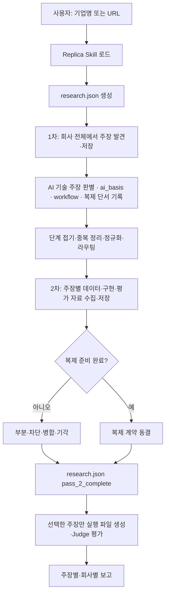

# Replica MVP

기업이 공개적으로 주장하는 AI 기능들을 넓게 조사하고, 점수 기준을 통과한 주장만
개별적으로 심층 검증한 뒤 테스트 가능한 입출력 계약과 프롬프트 기반 Replica로
구현 가능성을 평가하는 Codex 운영 하네스입니다.

사용자는 현재 Codex 대화에 기업명이나 공식 URL만 입력합니다. Codex가 공개
자료 조사, 기능 선정, 사양 작성, 테스트 설계, Replica 실행, Judge 판정,
보고서 생성을 맡습니다.

> [!IMPORTANT]
> 현재 Replica의 본체는 독립 애플리케이션이나 복제 모델이 아니라 공개 기능을
> 재구성한 시스템 프롬프트입니다. 테스트 통과는 해당 기능을 프롬프트 수준에서
> 구현할 수 있다는 의미이며 원제품을 복제했다는 의미가 아닙니다.

## 어떻게 작동하는가

이 프로젝트는 독립 실행형 크롤러가 아니라 **Codex가 실행하는 Skill 기반
하네스**입니다. 역할은 다음처럼 나뉩니다.

| 구성요소 | 역할 |
|---|---|
| `AGENTS.md` | 기업 조사·Replica 요청을 감지해 전용 Skill을 읽도록 라우팅 |
| `skills/replica-research/SKILL.md` | 출처 정책, 1·2차 조사 순서, 점수화, 준비도와 실행 경계를 정의하는 운영 로직 |
| `skills/replica-research/agents/` | 범위별 조사 서브에이전트의 입력·체크포인트·출력 계약 |
| 현재 Codex 태스크 | 웹 조사, 주장 추출, 점수화, JSON 갱신과 선택적 Replica 실행을 수행하는 실행 주체 |
| `templates/company-research.json` | 회사별 조사 결과가 따라야 하는 최소 구조 |
| `src/replica_mvp/` | 조사 결과 검증과 준비된 주장 실행·평가·보고를 담당하는 CLI |

동작 순서는 다음과 같습니다.

```text
기업명·URL 입력
→ AGENTS.md가 Replica Skill로 라우팅
→ Codex가 Skill의 출처·선별 규칙을 따라 조사
→ 조사 시작과 함께 research.json 생성
→ 5개 1차 조사 에이전트가 주장 발견 즉시 체크포인트 저장
→ 컨트롤러가 중복 제거·점수화하고 research.json 확정
→ 선택된 주장에 2차 결과와 복제 계약 추가
→ 사용자가 복제를 요청한 ready 주장만 실행
```

Skill은 코드로 구현된 상태 머신이 아니라 Codex가 따라야 하는 절차와 완료 조건을
정의합니다. 따라서 저장소 자체가 Codex나 모델 API를 호출하지 않습니다. 기본
사용법은 이 저장소를 연 Codex 태스크에 기업명이나 URL을 주는 것입니다.

## 무엇을 검증하는가

이 프로젝트의 질문은 다음과 같습니다.

> 공개 자료에서 확인되는 기업의 AI 기능을 제한된 텍스트 입출력 기능으로
> 재구성했을 때, 명시적인 테스트 계약을 만족하는 결과를 만들 수 있는가?

예를 들어 기업이 “보험증권의 차이를 조항 근거와 함께 비교한다”고 주장한다면,
이를 다음과 같이 좁힙니다.

- 입력: 두 보험증권의 관련 조항과 endorsement
- 출력: 보장·면책·한도 차이, 조항 인용, 영향, 누락 정보
- 정상 사례: 명시적인 한도 차이
- 경계 사례: endorsement가 면책을 일부 복원하는 경우
- 정보 부족 사례: 참조된 endorsement가 누락된 경우

기업마다 주장하는 기능이 다르므로 입력 계약, 출력 계약, 통과 기준, 테스트도
매번 새로 작성합니다. 공개 근거 사용, 비공개 접근 주장 금지, 정보 부족 시
명시, 근거 수준에 맞는 결론 표현만 공통 규칙으로 유지합니다.

## 무엇을 만들지 않는가

기본 흐름에서는 다음을 만들거나 주장하지 않습니다.

- 원제품의 모델, 프롬프트, 코드 또는 학습 데이터 복제
- 원제품과 같은 UI, API, 플러그인 또는 시스템 통합
- 비공개 고객 데이터나 사내 지식베이스 접근
- 원제품과의 출력 동일성 또는 전체 제품 성능
- 공개 근거로 확인할 수 없는 정확도·속도·ROI의 독립 입증

독립 실행 가능한 제품 MVP가 필요하다면 이 평가 이후에 별도 CLI나 웹 앱을
구현해야 합니다.

## 사용자 경험

현재 Codex 대화에 다음 정도만 입력합니다.

```text
기업명: Acme AI
공식 사이트: https://example.com/
```

URL을 모르면 기업명만 입력해도 됩니다. 특정 기능을 지정하지 않으면 Codex가
공개 자료에서 **AI 기술 주장만** 골라내고, 각 주장이 왜 AI인지를 출처 원문
인용으로 함께 저장합니다. 1차는 채점하거나 선별하지 않습니다. 중복을 정리한
주장 전부가 2차 심층 조사로 넘어가고, 복제 가능 여부는 2차에서 추가 근거와
함께 판단합니다.

사용자가 직접 작성하지 않는 항목은 다음과 같습니다.

- 조사할 추가 URL
- 대상 기능과 입출력 계약
- 통과 기준과 테스트 사례
- Replica 프롬프트
- 모델 명령 또는 API 키
- Judge 판정과 보고서

이 저장소가 Codex CLI나 모델 API를 다시 호출하는 구조는 아닙니다. 현재 열려
있는 Codex 태스크가 오케스트레이터로서 작업을 수행합니다.

## 전체 파이프라인



### 1. 1차 AI 기술 주장 발견

1차가 가져오는 것은 **기업이 적용한 AI 기술에 대한 주장**뿐입니다. 두 조건을
모두 만족해야 후보가 됩니다.

- **A1** — 주장이 시스템이 수행하는 작업(무엇을 입력받아 무엇을 내놓는지)을
  명시한다. 성과 수치나 회사의 속성은 작업이 아닙니다.
- **A2** — 공개 출처가 그 작업을 AI 기계장치(모델·LLM·에이전트·머신러닝·NLP·
  파인튜닝·검색·임베딩·분류·추출·생성)에 **자기 문장으로** 귀속한다.

판별 결과는 주장마다 `ai_basis`에 남깁니다.

| 필드 | 내용 |
|---|---|
| `mechanism` | AI가 수행하는 작업, 입력 → 출력 |
| `signals` | 출처가 실제로 쓴 AI 용어 |
| `source_index` | 그 근거를 담은 출처의 1-based 인덱스 |
| `quote` | 해당 출처에서 그대로 옮긴 원문 인용 |

`quote`는 `source_index`가 가리키는 출처의 발췌 안에 실제로 존재해야 하고
`signals`를 포함해야 합니다. 검증기가 이를 기계적으로 확인하므로, 제품명이나
사이트 태그라인만 보고 AI라고 추정할 수 없습니다. "AI-powered platform" 같은
포괄 수식어는 수행 작업을 명시하지 않으므로 A1에서 탈락합니다.

탈락 사유는 `outcome_metric`(성과 수치 재진술), `non_technical`(투자·고객·가격·
채용·인증 등), `no_ai_attribution`(작업은 있으나 AI 귀속 인용 없음) 셋으로
기록합니다. 탈락 목록도 "회사가 무엇을 문서화하지 않았는가"라는 근거이므로
체크포인트에 남깁니다.

#### 수집 단위는 워크플로 하나

Replica는 **한 기능의 전체 워크플로우**를 복제하므로, 1차도 같은 단위로
수집합니다. 주장 하나 = 워크플로 하나입니다. 실제 입력이 들어가고, 시스템이
작업하고, 누군가 그것을 가지고 다음 행동을 하는 산출물이 나옵니다.

**단계 판정.** 주장 X의 출력이 같은 기능 안에서 주장 Y에 소비되고 단독으로
제공되지 않으면 X는 Y의 단계입니다. Y의 `workflow.steps`에 접어 넣고 별도
주장으로 세우지 않습니다. 회사가 그 출력을 단독 제품·API·별도 구매 항목으로
제공하면 그때는 그 자체가 워크플로입니다.

분리는 워크플로 경계에서만 합니다 — 입력이 다르고, 산출물이 다르고, 그것을
쓰는 사람이 다를 때. "제출물·클레임·갱신을 위한 AI"는 워크플로 셋입니다.
테스트하기 쉽게 만들려고 워크플로 안을 쪼개면 단계가 나오는데, 단계는 복제
대상이 아닙니다.

| `workflow` 필드 | 내용 |
|---|---|
| `input` | 워크플로에 들어오는 것 |
| `steps` | 문서화된 단계, 순서대로. 각각 `step`과 `source_index` |
| `output` | 워크플로에서 나오는 산출물 |

단계마다 그것을 문서화한 출처의 `source_index`가 필요합니다. 출처가 말한
단계만 기록하고, 워크플로가 완성돼 보이도록 중간 단계를 추론해 채우지
않습니다. 출처가 기능을 통째로만 설명하면 `steps`가 비는 것이 정직한 기록이며,
구현 세부는 2차가 채웁니다. 특정 단계의 성과 수치는 그 단계가 속한 워크플로
주장에 들어갑니다.

#### 조사 중 발견한 복제 단서는 함께 넘긴다

1차가 복제 자료를 완성하려고 별도 심층 조사를 하지는 않지만, 주장 판별을 위해
이미 읽은 자료에 입력 샘플, 출력 예시, 스키마·형식, API·SDK, 구현 단서나 평가
자산이 있으면 버리지 않고 해당 주장의 `replication_leads`에 즉시 저장합니다.

| 필드 | 내용 |
|---|---|
| `kind` | `input_sample`, `output_example`, `api_schema` 같은 자료 종류 |
| `source_index` | 자료를 담거나 연결하는 claim 출처의 1-based 인덱스 |
| `finding` | 이 자료가 복제에 어떻게 쓰일 수 있는지 |

발견된 단서가 없으면 `replication_leads: []`로 기록합니다. 단서 개수는 1차 통과
조건이나 선별 점수가 아닙니다. 2차는 이 목록부터 확인하고 부족한 자료만 추가로
조사합니다.

회사 전체를 다섯 범위로 나눕니다.

1. 공식 사이트의 제품·기능 페이지, 기술·API·도움말 문서, 공개 데모, 백서,
   릴리스 노트, 공식 GitHub와 SDK
2. 전체 기술·엔지니어링 블로그 목록과 각 글의 본문
3. 발견된 제품명·시스템명·기능명·내부 기술명의 개별 재검색
4. 경영진·엔지니어 인터뷰, 콘퍼런스 발표, 기술 채용공고, 고객·파트너 공식 발표
5. 공시·논문·특허·공식 데이터베이스와 보충 보도

각 서브에이전트는 자기 범위의 체크포인트를 먼저 만들고, 주장을 찾을 때마다 URL,
근거 발췌, `ai_basis`, `workflow`와 조사 중 발견한 `replication_leads`를 즉시
저장합니다. 다음 자료로 넘어가기 전에 조사 완료·남은 범위와 발견된 명칭도
갱신하므로 컨텍스트가 compact되어도 파일에서 이어서 조사할 수 있습니다. 이
단계에서는 복제 자료를 완성하기 위한 추가 심층 조사, 최종 입출력 계약이나
테스트 확정은 하지 않습니다.

다섯 범위가 끝나면 컨트롤러만 체크포인트를 합칩니다. 범위를 가로질러 단계
판정을 적용해 단계급 주장을 해당 워크플로의 `workflow.steps`로 접고, 흡수한
주장은 `merged_from`에 남깁니다. 워커는 각자 한 범위만 보므로 같은 워크플로가
한쪽에서는 마케팅 문장으로, 다른 쪽에서는 단계 설명으로 도착하는 것이
보통이고, 이를 합치는 것이 컨트롤러의 일입니다. 병합으로 문장이 바뀌므로
A1·A2를 다시 적용하고, 합쳐진 출처 중 가장 직접적인 인용을 `ai_basis`로 남긴 뒤
`ai_basis`, 각 단계와 각 복제 단서의 `source_index`를 통합된 `sources` 기준으로
다시 맞춥니다.
입력·출력·AI 메커니즘이 같으면 같은 주장입니다. 분리는 워크플로가 실제로 다를
때만 합니다. 여기서 채점이나 선별은 하지 않고, 정리된 주장 전부가 2차로
넘어갑니다.
`replica-mvp finalize-pass-1 work/<company>`가 체크포인트 완료 여부, 근거와
`ai_basis` 인용의 출처 일치를 검증한 뒤 `research.json`을 `pass_1_complete`로
확정합니다.

### 2. 2차 복제 자료 수집

주장 하나에서 시작해 관련 자료만 깊게 봅니다. 해당 주장의 1차 `sources`,
`ai_basis`, `workflow`, `replication_leads`를 그대로 입력으로 이어받습니다. 먼저
이미 발견된 단서를 깊게 확인하고, 부족한 부분만 정확한 기능명으로 공식 제품·기술
자료, 데모, 고객·파트너 발표, 인터뷰와 채용공고에서 재검색합니다. 회사 전체를
다시 크롤링하지 않습니다.

목표는 원제품을 직접 써보는 것이 아니라, 공개 자료만으로 해당 워크플로를 복제할
수 있는지 판정하고 바로 구현할 수 있을 만큼 자료를 준비하는 것입니다.
`workflow.steps`의 각 단계를 깊게 파되 단위는 유지합니다 — 복제 대상은
end-to-end 기능이지 그 안의 한 단계가 아닙니다. 각 주장에 대해 다음을
수집합니다.

- 공개 데이터셋, 샘플 문서와 입력 예시
- 필드·문서·출력 스키마와 파일 형식
- API·SDK·공개 구현, 논문·특허의 기술 단서
- 벤치마크, 참조 답안, 규칙과 합성 평가 사례
- 접근 방법, 라이선스·사용 제한과 공개 데이터가 없을 때의 합성 대안

조사를 시작할 때 회사당 `work/<company-slug>/research.json`을 만듭니다.
1차 서브에이전트의 실시간 작업 상태는 `first_pass/` 체크포인트에 저장하고,
컨트롤러가 정규화·중복 정리한 결과만 `research.json`에 확정합니다.
2차에서는 각 주장에 `second_pass` 결과를 덧붙입니다.

- 원 주장과 공개 근거로 확정한 canonical claim
- 정확한 입력, 처리, 출력과 기능 경계
- 공식·독립 근거와 반대 증거
- 사용할 데이터·스키마·구현 단서·평가 자료
- 최소 복제 방법과 `ready | partial | blocked` 준비도
- 공개되지 않은 부분, 한계와 미해결 질문
- `confirmed | refined | merged | rejected` 상태
- `build | merge | evidence_request | reject` handoff

통합 구조는 `templates/company-research.json`을 따릅니다.

모든 조사 질문이 답변되거나 공개적으로 알 수 없다고 표시되고, 필요한 입력마다
사용 가능한 공개 자료나 합성 대안이 있으며, 구현 경로와 평가 방법이 정해져야
`ready`입니다. `ready`인 주장은 같은 항목의 `replication_contract`에 근거 수준,
입출력 계약, acceptance criteria, output schema, 제외 범위와 최소 세 테스트를
동결합니다. 2차가 끝날 때 별도 dossier나 실행 파일을 만들지 않습니다. 임의의
최소 출처 수는 두지 않습니다.

### 조사 내용은 어떻게 저장하는가

`research.json`은 정규화된 최종 조사 산출물이며, 1차 조사 중단 복구는 범위별
체크포인트가 담당합니다.

1. 조사 시작 시 템플릿으로 `work/<company-slug>/research.json`을 만듭니다.
2. 각 1차 에이전트가 AI 기술 주장 판별 즉시 `ai_basis`, `workflow`, 조사 중
   발견한 `replication_leads`와 함께 자기 `first_pass/*.json`에 저장하고, 탈락
   후보는 `excluded`에 사유와 함께 남깁니다.
3. 컨트롤러가 체크포인트를 병합·중복 정리하고 검증을 통과하면
   `workflow.status`를 `pass_1_complete`로 기록합니다.
4. 2차에서는 주장을 하나씩 조사하고 해당 주장의 `second_pass`만 갱신합니다.
5. 모든 주장에 준비도 판단이 생기면 `pass_2_complete`로 마칩니다.

저장 범위는 다음과 같습니다.

| 저장함 | 기본적으로 저장하지 않음 |
|---|---|
| 조사 범위와 열어본 공식 페이지 수 | 웹페이지 전문 |
| 주장에 사용한 URL과 짧은 근거 발췌 | 검색 결과 전체 |
| 발견한 모든 후보 주장과 중복·분리 결과 | 모델의 내부 추론 과정 |
| AI 판별 근거(`ai_basis`)와 탈락 후보·사유 | 불필요한 원문 사본 |
| 워크플로 입력·문서화된 단계·산출물 | 비공개·고객 데이터 |
| 데이터·스키마·구현 단서·평가 자산 | 접근 권한이 없는 자료 |
| 준비도, 한계, 미확인 사항과 복제 계약 | |

즉 “조사에 사용한 판단 근거”는 보존하지만 인터넷 자료 전체를 복사해 두지는
않습니다. 원문이 다시 열리지 않을 가능성이 높고 보존이 꼭 필요한 경우에만 별도
사본을 둘 수 있으며, 그 사본은 회사의 권위 있는 조사 결과로 취급하지 않습니다.

### 3. 근거 수준 결정

근거 수준은 결론의 강도를 제한합니다.

| 수준 | 사용할 수 있는 근거 | 허용되는 결론 |
|---|---|---|
| `direct` | 동일 입력에 대한 원제품 출력 | 직접 비교한 범위에서 재현 |
| `public` | 공식 문서, 공개 데모, 제품 화면, 독립 자료 | 공개된 기능의 구현 가능 |
| `claim_only` | 기업의 기능 주장만 존재 | 공개 주장 기반 구현 가능 |

원제품 출력이 없으면 테스트를 모두 통과해도 동일성을 주장하지 않습니다.

## 라벨과 상태값 읽는 법

한 주장에는 서로 다른 목적의 라벨이 여러 개 붙습니다. 앞 단계의 분류와 다음
단계의 실행 결정을 구분하기 위한 것입니다.

| 필드 | 질문 | 예시 |
|---|---|---|
| `ai_basis` | 왜 이것이 AI 기술 주장인가? | 메커니즘, AI 용어, 출처 인용 |
| `workflow` | 무엇이 들어와 어떤 단계를 거쳐 무엇이 나오는가? | `input`, `steps`, `output` |
| `replication_leads` | 1차 조사 중 어떤 복제 자료를 발견했는가? | 입력 샘플, 출력 예시, 스키마·API·평가 단서 |
| `routing` | 이 주장은 어떤 종류인가? | `도메인워크플로독특`, `고객연동깊음` |
| `merged_from` | 중복 정리·단계 접기로 어떤 주장을 흡수했는가? | 원 주장 문구 목록 |
| `second_pass.replicable` | 공개·합성 입력으로 복제 가능한가? | `true`, `false` |
| `second_pass.status` | 2차에서 주장 문구가 어떻게 정리됐는가? | `confirmed`, `refined` |
| `readiness.status` | 공개 자료로 복제 계약을 준비할 수 있는가? | `ready`, `partial`, `blocked` |
| `handoff.action` | 다음 실제 작업은 무엇인가? | `build`, `evidence_request` |

### `routing`

`routing`은 주장 유형을 설명하는 사전분류이며 점수나 최종 결정 자체가 아닙니다.

| 값 | 의미 |
|---|---|
| `도메인워크플로독특` | 특정 산업 업무를 제한된 워크플로로 수행 |
| `정확도높음` | 정확성, 근거성 또는 평가 가능성이 핵심인 기능 |
| `HITL품질보장` | 사람에게 질문하거나 중단·재개해 품질을 보완 |
| `고객연동깊음` | 고객 시스템, 권한, 데이터와 깊은 통합이 필요 |
| `대규모운영·가용성` | 처리량, 가용성, 비용, ROI 같은 운영 성과 |
| `사용하며좋아짐` | 사용자 교정이나 장기 사용을 통해 개선 |
| `안전견고` | 보안 통제, 인증, 모델 라우팅 같은 시스템 속성 |
| `null` | 중복 병합되어 별도 분류하지 않은 주장 |

`routing`은 A1·A2를 통과한 주장에만 붙습니다. SOC 2 인증이나 ROI 수치처럼
수행 작업이나 AI 귀속이 없는 주장은 그 앞의 판별에서 `non_technical`·
`outcome_metric`으로 탈락하므로 여기까지 오지 않습니다. `routing`만으로 복제
가능성을 확정하지도 않으며, 그 판단은 2차의 `second_pass.replicable`입니다.

### 2차 상태와 준비도

- `second_pass.status: confirmed`: 1차 주장의 핵심 문구가 공개 근거로 유지됨
- `second_pass.status: refined`: 공개 근거가 지지하는 범위로 주장을 좁힘
- `merged | rejected`: 병합하거나 공개 근거 부족으로 기각
- `readiness: ready`: 공개 또는 합성 입력, 평가 자산과 완성된 계약이 있음
- `readiness: partial`: 일부는 만들 수 있지만 핵심 계약이나 평가 자료가 부족함
- `readiness: blocked`: 필수 자료가 없어 진행할 수 없음
- `handoff: build`: 실제 Replica 실행으로 이동
- `handoff: evidence_request`: 추가 공개 증거부터 확보

여기의 `confirmed`는 사람 승인 상태가 아니라 **공개 근거로 주장 범위를 확인했다는
2차 조사 상태**입니다. 현재 워크플로는 1차 점수화 전에 사람 확정을 요구하지
않습니다.

### 4. 복제 계약 작성

선택한 기능을 `research.json`의
`claims[].second_pass.replication_contract`에 다음 항목으로 변환합니다.

- 입력 설명
- 출력 설명과 구조
- 기능별 acceptance criteria
- 제외 범위

통과 기준은 Judge가 실제로 확인할 수 있는 문장으로 작성합니다. “좋은 답변”처럼
주관적인 표현보다 “각 차이에 문서명과 조항 번호를 포함한다”처럼 관찰 가능한
조건을 사용합니다.

### 5. 테스트 설계

같은 `replication_contract.tests`에는 최소 세 사례를 먼저 고정합니다.

1. `normal`: 기능의 핵심 동작을 확인하는 정상 사례
2. `boundary`: 예외, 우선순위, 상충 규칙처럼 단순 패턴 매칭으로 틀리기 쉬운 사례
3. `insufficient-information`: 필수 자료가 없을 때 내용을 지어내지 않는지 보는 사례

각 사례에는 입력뿐 아니라 기대 동작과 판정에 사용할 참조 사실을 함께 기록합니다.
테스트와 기대값을 Replica 출력 이후에 수정하지 않습니다.

### 공개 자료로 평가 계약을 만드는 방법

`ready` 계약은 원제품의 비공개 테스트셋을 확보했다는 뜻이 아닙니다. 다음 순서로
공개 기능을 독립적으로 검사할 계약을 준비했다는 뜻입니다.

1. 공식 페이지에서 제품이 받는 입력과 반환한다고 주장하는 출력을 확인합니다.
2. 공개 근거가 지지하는 범위만 남겨 `canonical_claim`으로 좁힙니다.
3. 공개 양식·정책·매뉴얼·오픈소스가 있으면 입력 구조와 구현 단서로 사용합니다.
4. 실제 고객 자료를 사용할 수 없으면 알려진 값을 심은 합성 문서와 입력을
   만듭니다.
5. 합성 입력에 심은 값, 규칙과 누락 정보를 `reference_facts`로 고정합니다.
6. 추출 정확성, 충돌 표시, 출처 인용, 정보 부족 시 추측 금지처럼 직접 관찰할 수
   있는 acceptance criteria를 작성합니다.
7. 정상·경계·정보 부족 사례를 Replica 실행 전에 동결합니다.

예를 들어 증권 비교 테스트는 공개 제품 설명으로 “담보·한도·면책·endorsement를
조항 근거와 함께 비교한다”는 범위를 정하고, 합성 조항에 알려진 한도와
endorsement 효과를 심어 정답을 만듭니다. 이 테스트는 공개 기능을 구현할 수
있는지는 확인하지만 원제품의 내부 분류 체계, 실제 정확도나 원제품 출력과
동일한지는 확인하지 않습니다.

따라서 `ready`는 **공개 범위 Replica 테스트 준비 완료**이며 **원제품 동등성 검증
준비 완료**가 아닙니다. 원제품 출력이 없으면 근거 수준은 `public` 또는
`claim_only`에 머뭅니다.

### 6. Replica 빌드

사용자가 실제 복제를 시작하면 해당 ready 주장 하나만
`work/<company-slug>/runs/<capability-slug>/`에 `evidence.json`, `spec.json`,
`tests.json`으로 펼친 뒤 `replica.json`을 만듭니다. 여기에는 다음이 포함됩니다.

- 대상 기업과 기능
- 공개 근거와 근거 수준
- 입력·출력 계약
- 통과 기준
- 비공개 정보 접근 및 환각 금지 지시

현재 Replica의 실체는 `replica.json` 안의 `system_prompt`입니다.

### 7. Replica 실행

Replica 패스는 고정된 시스템 프롬프트와 각 테스트 입력을 받아 후보 출력을
생성합니다. 결과는 `replica_outputs.jsonl`에 사례별로 저장합니다.

가능하면 별도 작업자가 Replica 출력만 담당하며 PASS/FAIL 판정에는 참여하지
않습니다.

### 8. Judge 평가

Judge 패스는 다음 자료를 사용합니다.

- acceptance criteria
- 테스트 입력과 기대 동작
- reference facts
- Replica 출력
- 공개 근거 수준

Judge는 `pass`와 구체적인 `reason`을 사례별로 `results.jsonl`에 기록합니다.
가능하면 Replica와 분리된 작업자가 판정하며 `replica.json`은 읽지 않습니다.
같은 Codex 세션에서 분리된 패스만 사용했다면 보고서에 독립성 한계를 밝힙니다.

### 9. 보고서 생성

실행이 끝난 주장의 `report.md`에는 다음이 포함됩니다.

- 대상 기업, 기능, 근거 수준, 통과 수
- 검토한 공개 주장과 출처
- 입력·출력 계약과 전체 통과 기준
- 평가 실행 방식과 Replica/Judge 분리 방법
- 사례별 입력, 기대 동작, 참조 사실, Replica 결과, Judge 결론
- 최종 판정이 지지하는 범위와 지지하지 않는 범위

## 산출물

기업별 1·2차 조사는 한 파일이고, 실제 실행 산출물만 별도 run 디렉터리에
생성됩니다.

```text
work/acme/
├── first_pass/                         # 실시간 저장되는 범위별 체크포인트
│   ├── official-surfaces.json
│   ├── engineering-blog.json
│   ├── discovered-names.json
│   ├── people-and-organizations.json
│   └── supplementary-sources.json
├── research.json                       # 1차 전수 주장 + 선택된 주장의 2차 결과
└── runs/                               # 실제 복제를 시작한 뒤에만 생성
    └── claim-a/
        ├── evidence.json
        ├── spec.json
        ├── tests.json
        ├── replica.json
        ├── replica_outputs.jsonl
        ├── results.jsonl
        └── report.md
```

`work/`는 실제 기업 분석 결과를 저장하는 로컬 작업 영역이며 Git에서 제외됩니다.
기업별 보고서를 공유하려면 내용과 공개 범위를 검토한 뒤 별도로 내보내야 합니다.

## 판정 해석

모든 테스트가 통과했을 때도 근거 수준에 따라 의미가 달라집니다.

- `direct`: 확보한 원제품 출력과 직접 비교한 범위에서 재현
- `public`: 공개 설명으로 정의한 제한된 기능을 구현할 수 있음
- `claim_only`: 공개 주장에 맞춘 기능을 만들 수 있음

일부만 통과하면 `부분 구현`, 모두 실패하면 `현재 Replica 미구현`으로 표시합니다.

예를 들어 `public` 수준에서 `3/3 PASS`는 다음만 의미합니다.

> 공개 자료에서 정의한 기능과 세 테스트의 범위 안에서 프롬프트가 요구 동작을
> 수행했다.

다음을 의미하지는 않습니다.

> 원제품과 같은 정확도, 모델, UI, 통합, 보안 또는 전체 워크플로를 재현했다.

세 테스트는 빠른 feasibility check입니다. 제품 수준의 신뢰도를 주장하려면 실제
도메인 데이터, 더 큰 고정 평가셋, 원제품 기준선, 블라인드 평가가 필요합니다.

## 내부 CLI

Python 3.12 이상이 필요하며 런타임 외부 의존성은 없습니다.

```bash
python -m pip install -e .
```

현재 Codex 운영 흐름에서는 Codex가 내부 명령을 실행하므로 사용자가 직접 실행할
필요는 없습니다.

### 프로젝트 골격 생성

```bash
replica-mvp init work/acme/runs/claim-a \
  --name acme-capability \
  --company "Acme AI" \
  --url "https://example.com" \
  --capability "공개적으로 확인한 기능" \
  --evidence-level public
```

이 명령은 실제 실행을 시작한 주장에만 `evidence.json`, `spec.json`,
`tests.json`의 골격을 만듭니다. 조사 단계에서는 호출하지 않습니다.

### Replica 프롬프트 빌드

```bash
replica-mvp build work/acme/runs/claim-a
```

### 보고서 재생성

```bash
replica-mvp report work/acme/runs/claim-a
```

### 선택적 외부 Runner

CI나 독립 재현에서 별도 stdin/stdout 모델 명령을 사용하려면 기존 Runner를
사용할 수 있습니다.

```bash
replica-mvp evaluate work/acme/runs/claim-a \
  --replica-command "YOUR_REPLICA_COMMAND" \
  --judge-command "YOUR_JUDGE_COMMAND"
```

각 명령은 stdin으로 프롬프트를 받고 stdout으로 답해야 합니다. Judge는 다음
형식의 JSON만 반환해야 합니다.

```json
{"pass": true, "reason": "한 문장의 구체적인 판정 이유"}
```

이 외부 Runner는 기본 Codex 대화 흐름에서는 사용하지 않습니다.

## 저장소 구조

```text
.
├── AGENTS.md                  # 요청을 Replica Skill로 보내는 라우팅 규칙
├── README.md                  # 프로젝트 설명
├── pyproject.toml             # Python 패키지와 CLI 엔트리포인트
├── skills/replica-research/
│   ├── SKILL.md               # 조사·점수화·준비도·실행의 권위 있는 운영 로직
│   └── agents/openai.yaml     # Skill UI 메타데이터
├── templates/                 # 회사 단위 통합 조사 계약
├── src/replica_mvp/
│   ├── cli.py                 # init/build/evaluate/report 명령
│   └── project.py             # 파일 생성, 실행, 판정, 보고서 로직
├── tests/test_import.py       # 최소 end-to-end 검사
└── work/                      # 기업별 로컬 결과, Git 제외
```

## 검증

```bash
PYTHONPATH=src python -m unittest discover -s tests
```

테스트는 프로젝트 생성부터 프롬프트 빌드, 가짜 Replica/Judge 실행, 상세 보고서
생성까지 이어지는 최소 end-to-end 흐름을 확인합니다.

## 안전과 데이터 경계

- API 키와 비밀값은 프로젝트 파일에 저장하지 않습니다.
- 공개 자료만 근거로 사용하며 비공개 시스템 접근을 주장하지 않습니다.
- 웹 자료는 신뢰하지 않은 입력으로 취급하고 출처와 실제 주장 범위를 기록합니다.
- 법률, 보험, 의료, 금융처럼 고위험 분야의 출력에는 사람 검토를 요구합니다.
- 실제 고객 문서가 필요한 평가는 별도 승인과 적절한 데이터 처리 환경 없이는
  수행하지 않습니다.

## 현재 한계와 다음 단계

현재 버전은 기능 구현 가능성을 빠르게 확인하는 프롬프트 평가 하네스입니다.
주요 한계는 다음과 같습니다.

- 기본 테스트 수가 세 개로 작음
- 공개 주장과 합성 입력을 중심으로 평가함
- 원제품 출력이 없는 경우가 많음
- Judge가 같은 모델 계열일 수 있음
- UI, 파일 처리, OCR, 데이터베이스, 외부 시스템 통합을 평가하지 않음
- 공개된 정확도·속도·비용 수치를 독립 재현하지 않음

다음 단계는 모든 기업에 공통으로 추가하지 않습니다. 특정 Replica가 실제 제품
후보로 선정됐을 때만 원제품 기준선 확보, 대규모 평가셋, 독립 모델 Judge,
실행 가능한 CLI 또는 웹 앱을 추가합니다.

## 팀 협업

프로젝트 메모리·결정·회의 자료는 Notion Agent Tasks DB에서 관리합니다. 사람이
회의록을 올리고 Status를 Ready로 바꾸면 각자의 로컬 에이전트가 자기 몫을 읽어
`agent/` 브랜치에서 구현하고 결과를 Notion에 남깁니다. 설치와 동작 방식은
`AGENTS.md`의 협업 규칙 절과 거기 링크된 온보딩 문서를 따릅니다.

Replica 조사 규칙의 권위 있는 원본은 `skills/replica-research/SKILL.md`입니다.
