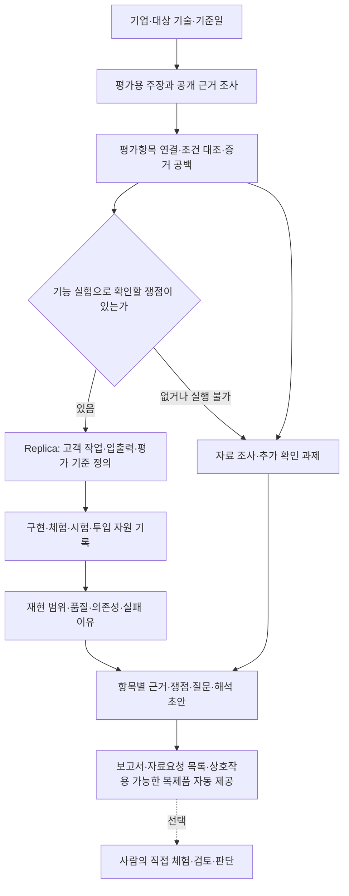

# 기술평가 보조 제품의 목표와 Replica의 역할

기준일: 2026-10-02 (Asia/Seoul). 2026-10-05 피드백과 모방 가능성 평가 논의, 토론 이후 사용자의 완전 자동화·공통 체험 경로 정정, 2026-10-06 웹 앱 결정을 반영했다.

**목표는 기업의 기술 주장을 조사하고, 필요한 기능을 직접 재현·시험한 근거까지 연결해, 사람이 기술평가의 판단과 추가 질문을 더 정확하고 효율적으로 만들 수 있도록 돕는 제품을 만드는 것이다. Replica는 이 제품에서 기능의 모방·대체 가능성을 실험하는 핵심 기능이다.**

이 상하 관계는 2026-10-02 사용자가 직접 선택했다. 인수 실사는 기술평가에 포함되는 용도 중 하나다. Replica의 방법은 Bain & Company의 인수 실사 방식, 즉 생성형 AI로 대상 기업의 핵심 기능 시제품을 만들어 써 보고 구현 난도·대체 가능성과 경쟁력의 원천(코드인지, 데이터·고객 업무 결합인지)을 가르는 방식에서 왔다.

이 문서는 프로젝트 방향의 기준 문서이며 계속 수정·추가한다. 아래에서 **확정**은 사용자 요구와 현재 운영 규칙, **현황**은 문서·코드·보존된 실행 기록에서 확인한 내용, **제안**은 이번에 종합한 제품 설계를 뜻한다. 제품 방향을 정리한 문서이며, 제안된 평가 방식이나 실행 경로가 이미 구현됐다는 뜻은 아니다.

## 1. 풀려는 문제와 제품의 쓰임

기업이 기술이나 성능을 설명하더라도 평가자는 그 설명이 어떤 제품·조건·자료에서 확인되는지 다시 조사해야 한다. 자료에 수치가 있어도 현재 제품에 적용되는지, 경쟁제품과 비교 가능한지, 핵심 기능을 외부 자원으로 다시 만들 수 있는지는 별도의 질문이다.

제품은 이 작업을 **주장 → 근거 → 조건 대조 → 필요한 실험 → 쟁점 → 추가 질문 → 사람의 판단**으로 연결한다. 평가자가 결과의 출처와 한계를 확인하고 판단을 수정할 수 있어야 한다.

- **확정된 상위 용도:** 기술평가 보조. Replica의 재현 결과를 이 목적에 사용한다.
- **사용자 정의는 보류한다:** 2026-10-05 피드백에 따라 평가기관과 투자자 중 누구를 첫 사용자로 둘지 먼저 정하지 않는다. 사용자와 무관하게 완비성 있는 결과물을 먼저 낸다. 기업 기술을 검토하는 평가·실사 담당자와 이를 준비하는 팀은 후보로만 남긴다. 정확한 도입 주체와 유료 고객은 아직 검증하지 않았다.
- **현재 시작 방식:** 회사명이나 URL, 필요하면 대상 제품·기술과 기준일을 정하고 공개자료로 시작한다. 자료에 없는 사실은 추가 질문으로 남긴다.
- **확정된 자동화 범위:** 사용자가 처음 기업을 입력하면 조사·사례 작성·구현·시험·비용 기록·보고서와 체험 산출물 생성까지 자동으로 수행한다. 중간 자료 준비·코드 수정·판정·승인을 사람에게 맡기지 않는다. 자동으로 해결하지 못한 부분은 사유와 미실행·미평가 상태를 결과에 남긴다.
- **현재 제품 경계:** 공식 등급·상장 가능성을 자동 판정하는 기능은 기존 기술평가 MVP 범위에 없다. 공개 항목의 분류와 자체 검토 방법론을 기관의 실제 채점모델로 표현하지 않는다.

제품이 제공해야 하는 가치는 문서 수나 구현한 기능 수로 끝나지 않는다. **평가자가 중요한 쟁점을 놓치지 않고, 근거가 부족한 결론을 피하며, 다음에 확인할 자료와 질문을 구체화하는 것**이 중심이다.

## 2. 기존 목표에서 달라진 점

| 구분 | 기존 기록의 중심 | 지금의 목표와 방향 |
|---|---|---|
| 최종 목적 | 기업 입력부터 조사·Replica·보고서까지 실행 | 그 결과로 기술평가자의 판단 업무를 지원 |
| Replica의 위치 | 독립적인 기능 재현 프로젝트 | 기술평가 제품의 핵심 실험 기능 |
| 조사 대상 | 고객 대상 AI 기능 주장 | 상위 제품은 평가에 필요한 주장 전체를 다루고, Replica는 재현 가능한 고객 기능을 담당 |
| 결과물 | 코드, 입출력, 평가 파일 | 자동 생성한 주장별 근거·실험·한계·쟁점·질문, 실행 코드와 직접 상호작용할 수 있는 체험. 사람의 후속 검토는 선택 |
| 완성 기준 | 실행과 동결 테스트를 끝냈는가 | 고객 작업을 실제로 수행하고, 평가자가 그 결과로 무엇을 판단할 수 있는가 |
| 구현 구조 | Operator/Builder 프로토콜 중심의 기본 경로 | 기능마다 구현 에이전트 하나가 기록을 남기며 구현·자체 시험·수정을 반복(2026-10-06 결정). 최종 시험·판정은 별도. 쌍 경로는 선택 |

기업 정보만으로 전체 흐름을 시작한다는 기존 목표는 유지한다. 이제 그 흐름의 목적을 **기술평가에 쓸 수 있는 근거와 판단 자료를 만드는 것**으로 명확히 한다.

## 3. 제품과 Replica의 책임

아래는 현재 두 프로젝트를 상위 목표에 연결하는 **통합 설계 제안**이다. 이미 연결된 자동 실행 흐름을 설명하는 그림이 아니다.

**기술평가 보조 제품**은 기업의 주장과 근거를 평가항목에 연결하고, 조건 차이·상충·누락을 찾아 기업별 쟁점과 질문을 자동으로 만든다. 결과 생성은 사람 검토를 기다리지 않는다. 사람이 이후 결과를 검토하고 판단한 이력은 선택적으로 보존할 수 있다.

**Replica**는 고객 대상 AI 기능 하나의 전체 작업을 원기업 자원에 의존하지 않고 자동으로 구현하고 시험한다. 무엇을 재현했고, 어떤 조건에서 어느 품질까지 작동했으며, 어떤 모델·데이터·도구·시간·비용이 들었는지를 기록한다.

상위 평가용 주장과 Replica의 기능 단위는 다르다. 예를 들어 “이 문서 검토 기능은 정확하고 경쟁사보다 우수하다”에는 신뢰성과 차별성에 관한 여러 판단이 들어 있다. Replica에서는 문서 입력부터 검토 결과까지를 하나의 기능으로 유지하되, 실험 결과를 해당 평가 주장들에 각각 연결한다.

따라서 **복제할 수 없다는 이유로 평가용 주장을 삭제하지 않는다.** 조직·권리·자체 개발 여부처럼 기능 복제만으로 확인할 수 없는 사항도 상위 제품에서 근거와 추가 질문을 남긴다. 반대로 상위 제품이 모든 주장을 다룬다는 이유로 Replica의 고객 대상 AI 기능 선정 규칙을 폐기하지 않는다.

## 4. 먼저 다룰 평가 범위

기존 기술평가 MVP의 9개 항목 분류를 출발점으로 삼는다. 아래 우선순위는 **통합 제품을 위한 제안**이며 공식 평가 배점이나 기관 기준의 재현이 아니다.

| 항목 | 첫 제품에서 제공할 판단 자료 | Replica의 기여와 한계 |
|---|---|---|
| 진행 정도 | 제품·실증·출시·운영 주장과 날짜·버전·근거의 연결 | 원기업 자료 조사 중심. 우리의 구현 성공은 원기업의 개발 진척 증거가 아님 |
| 신뢰성 | 성능 주장에 쓰인 입력·지표·시험조건·시험주체 대조 | 시험 구조를 활용할 수 있으나 Replica 성능을 원제품 성능으로 옮기지 않음 |
| 차별성 | 비교대상과 조건이 맞는지, 확인된 차이가 무엇인지 | 일반 모델·대안 구현과의 비교를 보강. 원제품 우열에는 원제품 근거가 필요 |
| 모방난이도 | 외부 팀이 공개 자원으로 재현한 범위·투입·막힌 지점, 관련 특허·규제, 같은 기능으로 사업하는 경쟁사 | Replica의 핵심 실험. 결과는 경쟁사 능력의 하한선으로 읽고, 특정 기능·조건·시도에 한정해 해석 (5절) |
| 확장성 | 다른 입력·업무에 적용한 관측과 추가 수정 부담 | 재현 실험을 확장할 수 있으나 원기업의 규모·다른 산업 성능까지 입증하지 않음 |
| 자립도·연구개발·경영진·기술인력 관리 | 공개 근거, 미확인 사항, 필요한 자료와 질문 | 별도 조사 영역. 복제품의 의존성을 원기업의 의존성으로 간주하지 않음 |

우선 **기존 앱의 진행 정도·신뢰성·차별성 검토에 Replica의 모방난이도 실험을 연결**하는 안을 권한다. 9개 항목마다 에이전트를 하나씩 늘리는 것은 현재 목표의 완료 조건이 아니다.

## 5. 최근 대화에서 유지해야 할 요구

### 기업 입력 이후 자동으로 완료하고, 같은 복제품을 AI와 사람이 사용한다

2026-10-05 토론 이후 사용자는 "첫 기업 입력빼고 사람 안들어갈" 것이라고 명시했다. 정상 실행에는 사람의 중간 개입이 없다. 사례와 기대 결과도 AI가 공개 근거에서 작성해 구현 전에 고정한다. 사람이 계획 파일을 작성하거나 결과를 승인해야 다음 단계가 진행되는 구조를 두지 않는다.

"사람이 테스트할 수 있다"는 말은 최종 산출물을 시각적으로 확인하고 직접 입력·클릭·파일 업로드 등으로 상호작용할 수 있다는 뜻이다. 사람이 실제로 테스트를 마쳐야 자동 실행이 완료되는 것은 아니다. AI 테스터도 이 복제품의 같은 사용자 작업 경로를 사용하며, 별도의 사람용 기능을 구현하지 않는다. 원제품의 화면 디자인을 그대로 복제해야 한다는 요구는 아니다.

AI와 사람의 조작 도구는 다를 수 있지만, 동일한 구현 버전·입출력·상태·업무 단계가 연결돼야 한다. 내부 엔진/API 호출만 확인했다면 공통 체험 인터페이스까지 검증한 것으로 세지 않는다. 엔진 수준 검증은 개발 중간 단계로 사용할 수 있으며, 최종 완료에는 AI가 실제 체험 경로를 사용한 기록과 사람이 바로 사용할 수 있는 산출물이 필요하다.

### 복제품은 웹 앱으로 제공하고, 평가도 웹 화면에서 한다

2026-10-06 사용자는 다른 사람에게 보여 줄 데모에 터미널은 적합하지 않다고 보고, 복제품을 웹 앱으로 사용하도록 결정했다. 사용자는 정해진 JSON 요청을 그대로 실행하는 방식이 "너무 딱 정해져있는걸 그냥 실행하는 느낌"이며 방향이 아니라고 명시했다.

- **복제품은 웹 앱이다.** 사람은 브라우저에서 입력·클릭·파일 업로드·승인 등으로 직접 사용하고, AI 테스터는 브라우저 자동화로 같은 화면을 조작한다. 화면 구성은 기능에 맞게 구현 단계에서 정한다. 원제품 화면 디자인의 복제는 요구하지 않는다.
- **계약과 평가의 기준은 사용자 작업 단계와 관측이다.** 사례는 사용자 행동 대본과 기대 결과로 고정하고, 결정적 검사는 화면 관측과 저장소·파일 변화로 한다. 내부 JSON 요청·응답 형식과 JSON 경로 검사는 계약이나 평가 기준이 아니며, 구현이 내부에서 쓰거나 개발 중 점검에만 쓸 수 있다.
- **AI 테스터는 CLI로 브라우저를 조작해도 되지만, 사람이 쓰는 화면을 거쳐야 한다.** 페이지를 요소 번호가 붙은 텍스트 스냅샷으로 받고 그 번호로 클릭·입력하는 방식이면 화면 이미지를 모델에 넣지 않아도 된다. 스크린샷은 증거 파일로 저장한다.
- **HTTP API·상태·파일 검사는 보조 검사다.** 비용이 낮고 결과가 결정적이므로 함께 실행하고, 화면 시연이 실패했을 때 원인이 화면 쪽인지 서버 로직 쪽인지 가르는 데 쓴다. API 검사만으로 화면 검증을 대신하지 않는다. Ralph-to-Ralph도 QA 에이전트가 `ever` CLI로 실제 Chrome을 조작하는 것을 주 검증으로 두고, `curl` API 계약 검사와 자동 테스트를 별도 단계로 더한다(`ralph/qa/base.md`, `ralph/qa/api.md`, 2026-10-06 저장소 기본 브랜치를 읽어 확인. 설치·실행하지 않음).
- **인터페이스와 무관한 기록은 유지한다.** 상태·파일 효과 관측, 구현 버전·해시, 자원 영수증과 미측정 표시, 미평가와 실패의 구분, 전체 주장 집계는 웹 앱 경로에서도 그대로 필요하다.

### 고객이 하는 작업을 끝까지 보존한다

조사에서 확인한 대화·파일·승인·저장 과정을 계약과 구현으로 넘길 때 잃지 않아야 한다. 인터뷰를 답변 배열의 일회 요약으로 바꾸거나, 파일 파싱을 사용자에게 맡기면 고객 작업의 일부가 빠진 것이다. 방법을 단순화한 것과 기능을 삭제한 것을 구분한다.

원제품과 같은 화면을 만드는 일보다 실제 입력과 상호작용을 보존하는 것이 우선이다. 대화가 필요한 기능은 턴과 상태가 이어져야 한다. 사람이 내부 JSON이나 식별자를 조립하지 않고 새 입력으로 직접 써 볼 수 있는 인터페이스를 제공하고, AI 테스터도 그 사용자 작업 경로를 검증한다. 인터페이스는 웹 앱이다(아래 절). 프런트엔드 프레임워크 등 세부 기술은 구현 단계에서 정한다.

### 내부 구현을 알아내는 일은 필요에 따라 한다

모방·대체 가능성의 질문은 “접근 가능한 자원으로 고객에게 필요한 결과를 다시 제공할 수 있는가”이다. 원기업과 같은 모델·프롬프트·알고리즘을 복원하는 것을 모든 기능의 필수 목표로 삼지 않는다. 공개된 기술 자료나 원제품 관찰은 구현과 평가에 필요한 만큼 사용한다.

### 구현과 판단을 구분한다

체험 가능한 시제품, 평가가 완료된 구현, 원제품을 대체할 가능성이 확인된 결과는 다른 상태다. 핵심 품질을 평가하지 못했다면 동작하는 코드가 있어도 그 부분의 판단을 보류한다. 구현 후 합격 기준을 낮추지 않으며, 액션은 “실행했다”는 응답과 실제 실행 결과를 구분한다.

평가 결과를 사람이 이해할 수 있어야 한다는 방향은 유지한다. **공개된 테스트에 통과한 사실만으로 일반적인 대체 가능성을 주장하지 않는다.**

### 봉인하지 않고 자동 평가 결과와 체험을 제공한다

이전 구현은 봉인 평가와 AI끼리의 구현·판정을 함께 강화하면서 "사람이 복제품을 써 보고 판단할 수 있는가"가 뒤로 밀렸다. 이를 두 원칙으로 나눠 지킨다.

1. **기본 경로에서 봉인하지 않는다.** 테스트는 구현 전에 원본 근거로 고정하고, 구현을 본 뒤 바꾸지 않는다. 대신 숨기지 않고 공개해 어떤 case가 왜 실패했는지 사람이 볼 수 있게 한다. 봉인을 선택 옵션으로 남길지는 로드맵 D3에서 정한다.
2. **AI가 시험·판정·보고를 자동으로 끝내고, 사람은 결과를 선택적으로 체험한다.** 비용·사례 시연·된 것과 안 된 것, 판단 근거와 한계를 자동으로 제공한다. 이후 사람이 기술평가나 투자 판단에 활용할 수 있지만, 사람의 검토·채점·승인을 자동 실행의 완료 조건으로 두지 않는다.

### 구현은 에이전트 하나가 하고, 시험·판정은 분리한다

2026-10-06 사용자는 Operator/Builder 쌍 대신 "에이전트 하나로 그냥 기록 남기면서 하는게 나을 것 같다"고 정했다. 기능마다 구현 에이전트 하나가 구현 → 자체 시험(브라우저 포함) → 수정을 반복하고, 시도마다 무엇을 바꿨고 무엇이 실패했는지 덮어쓰지 않고 기록한다(`development-log.jsonl`). Ralph-to-Ralph의 QA처럼 시험한 쪽이 고치고 합격까지 정하는 구조는 따르지 않는다. 최종 시연(실행 때 뽑은 값)·코드 검사·판정은 구현 에이전트 밖에서 한다. Operator/Builder 쌍 경로는 사용자가 요청할 때만 쓴다.

공개된 시연 사례만 맞추는 복제품을 막기 위해 다음 세 가지를 둔다(같은 날 사용자 결정). 회사의 특정 워크플로가 있어도 한 가지 사례만 가정하고 만들면 안 된다는 판단이다.

1. **코드 검사:** 제출마다 판정자가 소스를 읽어 시연 값에 맞춘 분기, 가짜 저장·전송, 실제 코드 경로가 없는 워크플로 단계를 찾는다. 통과하지 못하면 사례를 모두 통과해도 `reproduced`가 아니다.
2. **실행 때 값 뽑기:** 사례에 적힌 값은 기업이 주장하는 워크플로의 예시일 뿐이다. 사용자는 2026-10-08 "기업이 주장하는 내용은 워크플로우고 거기서 특별한 어떤 한가지 케이스를 보여주는거지 그 케이스에 맞게 구현을 하는게 아니"라며, 예시 사례와 변형을 둘 다 돌리는 대신 실행 때 뽑은 값으로 한 번만 실행하는 방식을 골랐다. 사례마다 바꿀 수 있는 것의 규칙을 구현 전에 공개로 고정하고, 평가 때 별도 모델이 그 규칙으로 이번 실행의 값을 만든다. 값 생성이 실패해도 예시로 돌아가지 않는다. 사용한 값과 seed를 기록한다. 실행마다 값이 달라지는 것은 받아들인다.
3. **범위 대조:** 사례가 지나는 워크플로 단계를 표시하고, 어느 사례도 지나지 않은 구현 단계는 "미검증 범위"로 결과에 남긴다. 사례 범위는 기업과 조사에 따라 다르므로 막지 않고 표시한다.

최종 평가가 실패하면 같은 구현 에이전트가 고쳐 다시 제출한다(최대 3회). 재시도 때는 기대 결과별 판정 이유, 코드 검사 지적, 미검증 단계만 준다. 스크린샷은 최종 결과에만 남긴다.

AI가 복제품을 직접 써 보는 방식을 사용한다. 기업 입력 이후 사람 개입 없이 완료하는 것이 목표이며, 구현과 평가의 역할 구분은 유지한다. 이전 문서의 "사람 개입 0을 목표로 두지 않는다"와 사람 검토를 필수로 둔 해석은 이번 사용자 정정으로 대체됐다.

### 자동 실행의 자원과 실패를 판단 자료로 남긴다

조사·구현·복제품 실행·AI 테스터·판정에 사용한 모델, 데이터, 외부 API, 시간, 사용량, 비용, 재시도와 미측정 항목을 기록한다. 미측정은 0이 아니다. 사람의 작업 시간·인건비는 정상 실행의 기본 비용 항목에서 제외한다. 최종 산출물을 사람이 선택적으로 써 보는 시간도 자동 제작비에 포함하지 않는다.

과거 또는 예외적으로 사람이 개입한 실행을 참고한다면 자동 실행과 구분해 사실만 남긴다. 이를 정상 경로의 필수 단계로 만들거나 완전 자동화된 실행으로 표시하지 않는다.

성공은 해당 조건에서 가능한 경로가 존재한다는 근거다. 실패나 실행 차단은 우리 조사·도구·예산·접근의 한계일 수도 있다. 이를 곧바로 기업의 기술 장벽으로 바꾸지 않는다. 코드·데이터·업무 통합 중 무엇이 경쟁력의 원천인지는 비교 근거가 충분한 범위에서 해석한다.

### 모방 가능성 결과물은 실측 세 가지와 조사 두 가지로 구성한다

기술특례상장 전문평가기관의 모방난이도 판단은 공개된 종합의견을 기준으로 보면 서술형 예측이다. 기술사업계획서, 공인시험, 특허, 연구 기간과 노하우를 근거로 "~이 필요하고, 이로 인해 경쟁기업이 모방하는 것은 다소 어려울 것으로 판단됨"처럼 쓴다. 재현 시도나 시간·비용 수치는 없다. AI 기술특례 상장사 7곳의 증권신고서에서 확인했다(10절). Replica는 이 판단에 실측 근거를 더한다.

2026-10-05 피드백에 따라 결과물은 다음 다섯 가지로 구성한다.

| 구성 | 방법 | 내용 |
|---|---|---|
| 투입 비용 | Replica 실측 | 자동 조사·구현·실행·테스터·판정의 시간, 비용, 사용 모델·사용량·재시도. 측정하지 못한 항목은 미측정으로 남긴다 |
| 된 것과 안 된 것 | Replica 실측 | 된 것 / 일부만 된 것 / 안 된 것과 막힌 원인(데이터, 도메인, 노하우, 규제 등). 막힌 지점을 기업이 공개적으로 주장한 장벽과 대조한다 |
| AI 사례 시연 | Replica 실측 | AI 테스터가 사람이 직접 쓰는 웹 앱 복제품의 같은 화면에서 고정 예시를 실행하고, 입력 → 단계별 화면·상태 변화 → 출력 → 판단 이유를 모두 보여 준다 |
| 특허·규제 | LLM 조사 | 관련 특허 목록과 공개된 규제·인허가 요건. 소프트웨어는 특허가 적으므로 목록 정리 수준으로 한다 |
| 경쟁 사업 | LLM 조사 | 같은 기능으로 이미 사업하는 회사가 있는지, 매출을 내는지, 특허가 있는지. 따라 할 수 있다는 시장 증거가 된다 |

고객 업무 결합(특정 고객군의 요구 반영과 유지보수 관계)은 우선순위가 낮다고 보고 기본 구성에서 뺀다.

### 구현은 공개 정보로 하고, 결과를 경쟁사 능력의 하한선으로 읽는다

모방 가능성의 질문은 "경쟁사가 따라올 수 있는가"이다. 기업 내부 문서(기술사업계획서 등)를 보고 구현하면 "설계도가 있으면 만들 수 있다"를 재게 되므로 경쟁사의 조건이 아니다. 구현 입력은 공개 자료, 공개 벤치마크, 고객으로서 원제품을 써 본 관찰로 한다.

실제 경쟁사는 인력 이동이나 정보 유출로 공개 정보보다 많이 알 수 있다(2026-10-05 피드백). 그래서 공개 정보만으로 얻은 성공은 **하한선**이다. 공개 정보만으로 이만큼 됐다면 실제 경쟁사는 적어도 그만큼 할 수 있다. 반대로 실패는 하한선이 아니므로 판정하지 않고 막힌 원인과 질문으로 남긴다.

기업 문서는 과장될 수 있으므로 정답이 아니라 대조할 주장으로 다룬다. 내부 정보를 얻게 되더라도 구현이 아니라 비교·대조에만 쓰고, 비교 결과를 구현자에게 돌려주지 않는다.

### 사례 시연은 구현 전에 고정한 예시로 한다

많은 case의 점수를 내는 벤치마크 대신, 대표 입출력 예시를 하나씩 AI 평가자가 실행하고 전체 과정과 결과를 공개한다. 공개 벤치마크(예: NIST FRVT)나 시험 데이터가 있을 때만 벤치마크를 선택적으로 더한다.

- **예시는 구현 전에 고정한다.** 결과를 본 뒤 고르면 유리한 사례만 남는다.
- **기업이 공개적으로 주장한 장벽을 겨냥한 예시를 넣는다.** 예를 들어 자체 형태소 분석기와 공공 도메인 특화를 주장하는 기업이라면, 띄어쓰기가 틀리고 행정 줄임말이 섞인 민원 질문을 넣는다. 장벽은 공개 자료에서만 뽑고, 어떤 예시가 어떤 장벽을 겨냥하는지 표시한다. 기존 정상·경계·정보 부족 테스트 중 경계 유형과 겹치므로 새 유형 대신 표시를 붙인다.
- **할 수 있는 말은 "이 예시들에서 이렇게 동작했다"까지다.** 벤치마크 없이 "기업 제품 수준의 몇 %"라고 말하지 않는다. 실행 횟수와 AI 판단 근거를 공개하고 사람이 원하면 같은 복제품을 직접 써 볼 수 있게 한다. 사람 검토는 필수가 아니다.
- 원본 출력을 얻으면 같은 예시에 나란히 놓고, 얻지 못하면 그 예시를 기업에 보낼 질문으로 넘긴다.

## 6. 사용자에게 제공할 결과

**통합 결과물의 제안 형식**은 다음과 같다.

1. **기업·기술 요약:** 누가 어떤 일을 하려고 쓰는 제품이며 이번 검토는 무엇을 확인했는가.
2. **평가항목별 주장과 근거:** 회사 설명, 직접 확인한 사실, 해석, 상충·미확인 사항을 구분한다.
3. **모방 가능성 결과:** 5절의 실측 세 가지(투입 비용, 된 것과 안 된 것, AI 사례 시연)와 조사 두 가지(특허·규제, 경쟁 사업). 보존하거나 제외한 단계, 실행 코드와 체험 방법도 함께 제공한다.
4. **판단의 범위:** 이 결과로 말할 수 있는 것, 말할 수 없는 것, 필요한 비교·추가 실험을 적는다.
5. **자료요청·질문:** 해당 회사의 구체적인 근거 공백, 재현이 막힌 지점, 기업 주장과 재현 결과가 다른 지점에서 질문을 만들고, 담당자의 검토·수정 이력을 남긴다.

모든 조사 주장의 처리 결과를 보존한다. 실험하지 않은 주장에는 사유를 남긴다. 보고서는 **제품의 목적 → 확인하려던 질문 → 시험과 관측 → 결과의 의미 → 다음 확인사항** 순서로 읽혀야 한다. “부분 재현”, “보완 필요”라는 상태명만으로 설명을 끝내지 않는다.

## 7. 2026-10-02 현재 확인한 위치

현황은 대화, 문서, 관련 코드와 보존된 결과 설명을 대조했다. 문서 변경 후 `team-ai guard`와 그 과정의 기존 테스트 313개는 통과했다. 새 기업 조사·모델 실행·앱 실행은 하지 않았으므로 통합 제품의 실제 사용 검증으로 해석하지 않는다.

| 구성 | 확인한 현황 | 남은 차이 |
|---|---|---|
| 기술평가 앱 | 별도 `replica-review-mvp`에 Codex 조사 스킬과 로컬 React 검토 앱이 있다. 문서상 주장·근거·쟁점·질문·사람 검토 흐름을 제공 | 실제 평가자의 정확도·시간 절약은 검증 전. Replica 실험 결과를 평가항목으로 연결하는 통합은 확인되지 않음 |
| Replica 전체 결과 | `company-claims.json`에 전체 조사 주장과 미실행 사유를 남기고, 웹 claim에는 시연 결과(충족·불충족·미평가, 코드 검사, 미검증 단계, 비용)와 구현 시도 기록을 붙인다 | 이를 기술평가용 설명·쟁점·질문으로 바꾸는 통합 결과물이 필요. 특허·규제·경쟁 사업 조사는 아직 없음 |
| 구현 경로 | 2026-10-06부터 기본 경로는 단일 구현자(`single-harness-init`). 쌍 경로 코드와 Skill은 선택 경로로 남아 있다. 기능당 Astra low 단일 구현 실행 기록이 있다 | 두 구조의 같은 조건 비용·품질 비교는 없다. 기본 경로 결정은 단순성과 기록 방식에 따른 것이다 |
| 체험 | 공식 체험 프로필은 아직 `question_answer`. Delphi에는 별도 턴 기반 `demo-session`이 있다 | 10월 6일 웹 앱으로 결정하고 `serve-web`(사람 사용)·`web-demo`(AI 브라우저 테스터, 비용 영수증, 행동·화면·파일 저장)를 구현해 harness의 `demo_plan` claim에 연결했다. 실제 기업으로는 아직 실행하지 않았다 |
| 측정 | 2026-10-06부터 웹 시연의 호출별 영수증(테스터·판정·값 생성·코드 검사·복제품 내부 호출)과, Claude·Codex 세션 기록에서 읽은 조사·구현·오케스트레이션 사용량을 `company-claims.json`에 모은다. JSON 경로의 `experiment_record`도 유지 | 조사를 지휘하는 루트 세션, 기록되지 않은 조사 에이전트, 경로 형태로 기록된 Codex ID는 미측정. 실행별 청구액은 없고 금액은 CLI 정가 환산 추정치 |
| 보고서 | 비전공자용 Delphi 보고서 개정본이 존재 | 개별 수작업 보고서를 반복 가능한 기술평가 결과 생성으로 연결해야 함 |

특히 데모 세션은 변경 후 봉인 평가를 다시 받지 않았다고 자체 문서에 명시돼 있다. 이전 일회 호출 엔진의 점수를 세션 버전의 성능으로 사용하지 않는다.

### 현재 규칙·문서와 방향의 충돌 (2026-10-06 확인)

방향 문서는 실행 규칙을 자동으로 바꾸지 않는다. 아래는 웹 앱·봉인 제외·완전 자동화 방향과 어긋나는 현재 규칙과 문서다. 사람의 승인이나 검토를 기다리게 하는 규칙은 찾지 못했다.

| 위치 | 현재 내용 | 충돌하는 방향 | 상태 |
|---|---|---|---|
| `skills/replica-research/SKILL.md` "Freeze the contract" 절 (Codex·Claude 공용) | 브라우저 UI 생성 금지, JSON 입력 하나로 체험 | 웹 앱 | 2026-10-06 수정. `demo_plan`이 있는 claim은 웹 앱으로 구현하고 공개 계획으로 평가한다. `demo_plan`이 없는 claim의 평가 입력 비공개와 evaluator vault는 그 경로에 남아 있다 |
| `AGENTS.md`, `CLAUDE.md` 기업 평가 기본 경로 | 기업 평가 기본 경로에 sealed bundle evaluation | 기본 경로에서 봉인하지 않음 | 2026-10-06 수정. `demo_plan`이 있으면 공개 웹 시연, 없으면 봉인 평가. 2차 조사 Skill이 `demo_plan` 작성을 지시하므로 새 조사는 웹 경로로 간다 |
| `README.md` "무엇을 검증하는가", "현재 한계" | 프로젝트 질문이 "UI를 제외한 고객 워크플로 전체", UI는 평가하지 않음 | 웹 앱 화면에서 사람과 AI가 같은 작업 수행 | 2026-10-06 수정. "원제품과 같은 UI는 복제하지 않음"은 방향과 일치해 유지 |
| `.claude/skills/replica-builder-agent/SKILL.md:224`, `.agents/skills/replica-builder-agent/SKILL.md:232` 등 구현 Skill | `stdio_json`/`http_json` 런타임과 `input_contract`·`output_contract` 복사 | 웹 앱 실행 계약 | 2026-10-06 웹 앱 구현·브라우저 자체 점검 지시를 추가(`.claude`·`.agents` 두 벌과 단일 구현자). `demo_plan`이 없는 claim에는 JSON 런타임 지시가 그대로 적용된다 |
| `.claude/skills/build-replica-operator/SKILL.md:114`, `.agents/skills/build-replica-operator/SKILL.md:114` | 단독 JSON 경로에서 브라우저 UI 금지 | 웹 앱 | 미수정. 단독 JSON 경로를 유지할지 함께 정한다 |
| `context/tasks/cost-demo-outcomes-241765ec/conclusion.md` | 첫 검증을 엔진 JSON 다중 턴으로 권고 | 웹 앱 화면에서 AI 시험 | 웹 앱 결정 전의 토론 기록. 서두에 엔진 시험은 중간 단계라는 정정만 있다 |

## 8. 다음 작업의 우선순위와 완료 기준

**Replica 자체 개선은 [로드맵](../docs/replica-roadmap.md) 단계 0부터 순서대로 진행한다.** 로드맵은 Delphi 세 기능을 터미널 세션으로 직접 써 본 결과(`work/delphi-ai-v2/demo-session/`)를 바탕으로 정했다.

2026-10-05 피드백에 따라 사용자를 정하기 전에 **한 기업에 대한 모방 가능성 결과물 세트를 완성하는 일**을 1순위로 둔다. 대상 기업과, 로드맵 단계 순서와의 조정은 아직 정하지 않았다(9절).

아래 표는 기술평가 제품 쪽 우선순위이며 **제안**이다. 3·4는 로드맵 단계 1~3이 담당한다.

| 순서 | 할 일 | 완료 기준 |
|---|---|---|
| 1 | 한 기업에 대해 5절의 모방 가능성 결과물 세트를 완성 | 투입 비용, 된 것과 안 된 것과 그 원인, 장벽 겨냥 예시를 포함한 사례 시연, 특허·규제 정리, 경쟁 사업 탐색이 한 결과물에 모이고, 말할 수 있는 것과 없는 것, 질문이 붙음 |
| 2 | 두 저장소 사이의 최소 연결을 정함 | 회사·제품·기준일·주장·실험 버전과 결과 경로가 연결되고, 원기업 근거와 Replica 관측이 구분됨. 저장소 통합은 전제하지 않음 |
| 3 | 실제 작업을 보존하는 공통 체험·평가를 보강 | AI 테스터가 사람이 쓰는 같은 복제품·사용자 작업 경로에서 파일·발화부터 최종 결과까지 실행. 내부 엔진 검사만으로 체험 경로 검증을 대신하지 않음 |
| 4 | 평가 해석에 필요한 비교·측정을 채움 | 정답 근거, 핵심 미평가 영역, 필요한 기준선, 자동 실행의 자원 기록을 보여 줌 |
| 5 | 기업 입력부터 결과 제공까지 자동 파일럿을 수행 | 중간 사람 개입 없이 보고서·실행 근거·직접 상호작용할 수 있는 복제품 제공. 누락·실패·미평가도 자동으로 기록 |

**첫 통합 MVP는 기업 입력 이후 근거 조사·재현·AI 시험·쟁점·질문·보고서·체험 산출물까지 자동으로 제공한다. 사람이 원문과 실행 결과를 확인하고 같은 복제품을 직접 사용할 수 있어야 하지만, 실제 사람 체험이나 승인을 기다리지 않는다.** 재현 실패나 실험 불가도 이유와 다음 행동이 남으면 평가 지원 흐름의 결과가 된다.

수치 목표는 파일럿 전에 별도로 정한다. 기존 실행 수치만으로 정확도나 시간 절약 목표를 달성했다고 간주하지 않는다.

### 웹 앱 경로를 기업 평가에 연결하는 작업 (2026-10-06 사용자 범위 결정)

웹 앱 실행(`serve-web`)과 AI 사례 시연·시연 비용 기록(`web-demo`)은 독립 명령으로 구현돼 있었으나 harness 경로는 이를 쓰지 않았다. 2026-10-06 점검에서 확인한 빈틈과, 사용자가 이번 작업 범위로 정한 1~5번은 다음과 같다. **같은 날 1~5번을 구현했다.** 검증은 테스트용 웹 앱과 가짜 모델 CLI·가짜 세션 기록을 쓴 자동 테스트, 실제 Claude·Codex 세션 기록 두 건에서의 사용량 읽기까지다. 실제 기업 조사부터 시작하는 실행은 사용자 지시에 따라 하지 않았다.

| 순서 | 할 일 | 점검 당시 동작 (확인 위치) | 완료 기준 |
|---|---|---|---|
| 1 | 구현 산출물을 웹 앱으로 받는다 | manifest 키가 고정돼 `runtime` 키를 거부(`agent_harness.py` `_validate_implementation_bundle`). 평가 준비는 `stdio_json`·`http_json`만 허용(`bundle_evaluation.py` `prepare_bundle_evaluation`). 구현 Skill이 JSON 런타임을 지시 | `web_app` 런타임 manifest가 harness를 통과하고, Operator·Builder Skill 두 벌(`.claude`, `.agents`)이 웹 앱 구현과 브라우저 자체 점검을 지시 |
| 2 | 2차 조사가 구현 전에 시연 계획을 고정한다 | 시나리오 시험은 JSON `input` 중심이고 `replica-web-demo-plan`을 만들라는 지시가 없음 | 선택 시나리오마다 사용자 단계·허용 사실·기대 결과와 근거·`targeted_barrier`가 있는 계획이 구현 전에 작성되고 해시가 기록됨 |
| 3 | 최종 평가를 같은 화면의 AI 시연으로 한다 | `agent-bundle-evaluate`가 봉인된 JSON 시험만 실행. `AGENTS.md`·`CLAUDE.md`도 기본 경로에 봉인 평가를 둠 | 웹 앱 후보를 고정된 계획으로 `web-demo`가 실행하고 결과가 claim에 결속됨. 봉인 vault를 쓰지 않음 |
| 4 | 기업 결과에 시연과 비용을 연결한다 | `company-claims.json`은 재현 상태만 연결(`agent_harness.py` `_company_results`). `unknown_resources()`가 사람 시간을 미측정으로 넣음 | 모든 조사 주장에 시연 결과 경로, 충족·불충족·미평가 수, 비용 요약 또는 미실행 사유가 붙고, 미평가가 실패로 바뀌지 않음. 사람 시간은 미측정 목록에 나오지 않음 |
| 5 | 조사·구현 비용을 세션 기록으로 잰다 | 구현 비용은 Builder 자기보고 또는 `unknown`, 조사 비용은 기록하지 않음 | harness가 기록한 agent ID로 Claude Code 서브에이전트 기록(`~/.claude/projects/.../subagents/agent-<id>.jsonl`, 메시지별 `usage`·`model`)과 Codex 세션 기록(누적 `token_count`)을 읽어 단계별 사용량을 남김. 읽지 못한 구간은 미측정 |

5번의 가정은 실제 기록으로 확인했다. 기존 실행의 단일 구현자 ID(Claude 세션 UUID, Codex 스레드 UUID)로 각 세션 기록 파일을 찾았고, Agent 도구가 돌려준 ID는 서브에이전트 기록 파일 이름과 같았다. Claude 기록은 한 응답이 여러 줄로 반복돼(한 세션에서 45줄, 고유 메시지 25개) 메시지 ID로 중복을 제거한다. 예전 Codex 실행처럼 `/root/...` 형태 경로를 ID로 기록한 경우는 기록 파일을 찾을 수 없어 `unknown`이다. 조사 단계 루트 세션 자체의 사용량은 기록할 ID가 없어 아직 미측정이다.

구현 위치: 계획 고정 `agent_harness.freeze_web_claim`·`web_demo.freeze_demo_plan`, manifest `runtime` 허용 `_validate_implementation_bundle`, 최종 평가 `web_evaluation.evaluate_web_bundle`(`agent-bundle-evaluate`가 분기), 기업 결과 `_company_results`, 세션 사용량 `session_usage.py`. Skill은 조사 Skill·2차 작업자 계약(`demo_plan`, `agent_sessions`), Operator·Builder·단일 구현자 지시, 프로토콜 Skill의 평가 단계, `AGENTS.md`·`CLAUDE.md`의 기본 경로 문구를 바꿨다. `demo_plan`이 없는 claim은 기존 JSON·봉인 경로를 그대로 쓴다.

특허·규제 정리와 경쟁 사업 탐색(5절의 조사 두 가지)도 현재 파이프라인에 없다. 위 작업과 별개로 조사 Skill에 추가한다(2026-10-06 보류).

같은 날 이어서 단일 구현자 기본 경로와 사례 맞추기 방지 장치를 구현했다. 구현 위치는 다음과 같다.
- 실행 때 값 뽑기와 코드 검사: `web_demo.run_web_demo`, `_instance_case`, `_review_prompt` (2026-10-08 변형 추가 실행에서 실행 때 값으로 한 번 실행하는 방식으로 변경)
- 범위 대조: `agent_harness._demo_scope`
- 재시도 피드백: `web_evaluation.write_retry_feedback`
- 시도 기록 결속: `single_agent.bind_single_implementation`
- 구현자 지시: `.claude/agents/replica-implementer.md`, `.agents/skills/replica-implementer/SKILL.md`
- 기본 경로 문구: 조사 Skill의 실행 절, `AGENTS.md`·`CLAUDE.md`

검증은 자동 테스트와, 테스트용 승인 앱을 실제 Claude로 돌린 실행 한 번이다. 그 실행에서 값 생성기가 새 물품 이름을 만들어 검사 문자열까지 바꿨고, 코드 검사는 소스를 읽고 통과시켰다. 실제 기업 실행은 하지 않았다.

## 9. 아직 확정하지 않은 결정

- 첫 사용자(평가기관, 투자자 등). 2026-10-05 피드백에 따라 보류한다. 첫 산업과 제품을 구매할 주체도 미정이다.
- 결과물 세트를 완성할 첫 기업. 기존 Delphi 결과를 쓸지, 새 기업에 실행할지. 2026-10-06 보류.
- 결과물 세트를 먼저 완성하는 순서와 로드맵 단계 순서의 조정.
- 특허·규제 정리와 경쟁 사업 탐색을 LLM으로 할 때 출처를 확인하는 방법.
- 원본 출력과의 직접 비교, 사람 블라인드 채점, 비열등성 허용폭. 원본 출력을 얻을 수 있게 되면 다시 논의한다.
- 평가기관이 제3자 재현 보고서를 참고 자료로 받는지, 평가 기간(30영업일 안팎) 안에 들어가는지. 확인하지 않았다.
- 첫 버전에서 깊게 검토할 평가항목과 각 항목의 충분한 근거·판단 보류 조건.
- 두 저장소의 연결 방식과 공통 결과 형식. 별도 앱의 존재가 통합 완료를 뜻하지 않는다.
- 봉인을 선택 옵션으로 남길지(로드맵 D3), 새 입력 확인, AI 판정자의 모델·독립성. 사람 검토는 자동 실행의 필수 단계로 두지 않는다.
- 웹 앱의 실행 계약(시작 명령·포트·상태 디렉터리), 공통 스타일 템플릿 여부, AI 테스터의 브라우저 조작 방식. 웹 앱과 공통 화면 사용은 확정이며, 테스터와 판정자의 분리·실행 기록 검증·추가 비용은 구체화가 필요하다.
- 현재 JSON 중심 계약·실행기·봉인 시험을 웹 앱 기준으로 전환하는 순서와 범위.
- 구현 예산(시간·제출·모델)의 기본값. 기본 구조는 단일 구현자로 정했다(5절). 단일 구현자의 성공만으로 쌍 구조보다 일반적으로 낫다고 확정하지 않는다.
- 일반 모델 기준선(지침만 준 일반 모델과 실제 구현을 같은 사례로 비교). 2026-10-06 제안, 사용자가 보류했다.
- 특허·규제 정리와 경쟁 사업 탐색을 파이프라인에 넣는 시점. 2026-10-06 보류.
- 자동으로 접근 가능한 원제품 관찰의 범위. 사람+AI 공동 제작은 정상 자동 실행 경로에 포함하지 않는다.

2026-10-02까지의 결정은 상위 제품과 Replica의 관계, 기본 봉인 제외, 로드맵 단계 0부터의 개선 순서였다. 2026-10-05에는 사용자 정의 보류와 완비성 있는 결과물 우선, 실측 세 가지와 특허·규제·경쟁 사업, 공개 정보 기반 구현, 고정 예시와 장벽 겨냥 사례가 추가됐다. 같은 날 토론 후 사용자는 **기업 입력 이후 완전 자동화**, **사람의 체험·검토는 선택**, **AI와 사람이 같은 복제품의 사용자 작업 경로를 사용**한다는 점을 명시했다. 2026-10-06에는 **복제품을 웹 앱으로 제공하고 JSON 요청 실행을 계약·평가 기준으로 두지 않는다**는 점, **기능마다 구현 에이전트 하나가 기록을 남기며 구현하고 시험·판정은 분리한다**는 점, **코드 검사·실행 때 값 바꾸기·범위 대조로 공개 사례 맞추기를 막는다**는 점을 결정했다. 이 후속 정정은 사람 개입을 정상 경로로 두거나 사람 검토를 완료 관문으로 해석한 이전 문구보다 우선한다. 모델 간 토론 결과나 D1~D8 전체가 일괄 승인된 것은 아니다. 현재 코드·AGENTS·Skill에 필요한 전환은 구현 작업에서 명시적으로 반영하며, 이번 방향 정리를 구현 완료로 취급하지 않는다.

## 10. 근거와 기존 문서의 해석

### 대화 근거

| 대화 (Codex 대화 제목, 또는 출처) | 확인한 사용자 의도 |
|---|---|
| 실행 때 값 뽑기로 변경, 2026-10-08 (Claude Code 대화) | "기업이 주장하는 내용은 워크플로우고 거기서 특별한 어떤 한가지 케이스를 보여주는거지 그 케이스에 맞게 구현을 하는게 아니잖아". 예시+변형 2회 실행 대신 실행 때 뽑은 값으로 1회 실행(B안) |
| 구현 구조·사례 맞추기 방지 결정, 2026-10-06 (Claude Code 대화) | 공개 사례만 통과하도록 만들면 안 되고 기업이 제공하는 범위를 커버해야 함. 코드 검사·실행 때 값 바꾸기·범위 대조를 "다 넣는거는 맞고". "에이전트 하나로 그냥 기록 남기면서 하는게 나을 것 같다". 재시도는 "사례별 이유만", 스크린샷은 "마지막에 결과에만". 기준선·첫 기업·특허/경쟁 조사 시점은 보류 |
| 웹 앱 결정, 2026-10-06 (Claude Code 대화) | 다른 사람에게 보여 줄 데모에 터미널은 적합하지 않음. 웹 앱이 더 범용적. JSON은 "너무 딱 정해져있는걸 그냥 실행하는 느낌"이며 방향이 아님. 웹 앱으로 사용하도록 반영 지시 |
| 비용·AI 사례 시연·된 것과 안 된 것 토론 이후 사용자 정정, 2026-10-05 (현재 대화) | "첫 기업 입력빼고 사람 안들어갈" 완전 자동화. 사람이 테스트한다는 것은 최종 산출물에 시각적으로 직접 상호작용할 수 있다는 뜻. 중간 사람 개입·필수 사람 검토를 뜻하지 않으며 AI 테스터와 같은 복제품·사용자 작업 경로를 사용 |
| 사용자가 전달한 피드백, 2026-10-05 | 사용자를 정의하기 전에 완비성 있는 결과물 우선. 비용, AI 사례 시연, 된 것과 안 된 것 세 가지로 진행. 특허는 목록 정리, 규제는 LLM 조사, 고객 도메인은 후순위. 대상 기술로 사업하는 경쟁사를 찾아 매출·특허 확인. 보고서는 과장될 수 있고 경쟁사도 내부 정보를 얻을 수 있다 |
| Ralph-to-Ralph 분석과 모방 가능성 평가 방식 논의 (Claude Code), 2026-10-03~05 | 모방성은 경쟁사가 따라올 수 있는가이므로 내부 정보를 아는 상태로 구현하면 안 된다는 사용자 결론. 벤치마크 대신 입출력 예시를 하나씩 AI 평가자가 실행하는 사례 시연 제안. 평가기관이 문서 위주로 판단하므로 재현 결과 보고서가 객관성을 더한다는 판단 |
| 프로젝트 목표 확인, 2026-10-02 | 최근 대화·문서로 목표를 재정리하고, “기술평가 보조 제품을 상위 목표로 두고 Replica를 핵심 기능으로 배치” 선택 |
| 기술평가 AI 제품 방향 검토, 2026-09-22 | 단순 Replica 자료 뷰어가 아니라 실제 조사·분석 MVP 요구. 스킬+로컬 React 형태, 방법론 출처와 판단 로직 확인 요구 |
| 기술특례상장 평가 기준 선정, 2026-09-23 | 외부 팀이 접근 가능한 한국 자료와 평가방법을 기준으로 범위 선정 요구. 답변의 항목 순위는 제안 |
| 델파이 Replica 구현수준 평가, 2026-09-23~26 | 전체 고객 작업 보존, 조사부터 결과까지 품질 검토, 실제 산출물 요구. 기능당 Astra low 단일 구현 실험 요청 |
| Delphi run-2 구현 현황 확인, 2026-09-26 | 현재 실제로 테스트할 수 있는 수준인지 확인 요구 |
| 관련 논문과 도구 조사, 2026-09-28 | “기업의 모방가능성을 평가하기 위한 툴”이라는 목적 명시. 내부 역공학의 필요성과 평가 신뢰성 검토, 실질적인 보강안 요구 |
| 개정 보고서의 비전공자 가독성 높이기, 2026-09-22 | 비전공자가 목적·내용·결과를 처음부터 이해할 수 있는 보고서 요구 |

대화 제목이나 이전 AI 답변만으로 사용자 결정을 추정하지 않았다. 특히 “Replica는 기업의 내부 구현을 역추론하는 것이 핵심”이라는 9월 28일의 초기 AI 설명은 같은 대화의 후속 답변에서 정정됐다. 이를 현재 목표로 채택하지 않는다.

### 문서·코드 근거

- [기존 완료 기준](../docs/replica-completion-standard.md): 고객 가치 재현, 투자 실사, 전체 작업·새 입력·자원·한계의 기존 요구.
- [2차 계약 개편안](../docs/pass2-interaction-redesign.md): 사람이 써 보는 복제품과 상호작용 보존. 여전히 초안.
- [AI 테스터 평가 방식 제안](../docs/ai-tester-evaluation-proposal.md): 10월 2일 새로 작성된 미확정 대안. 자연어 대본과 실제 조작 기록으로 평가하고 형태별 실행기를 대체하자는 제안이며, 기존 개편안의 채택 완료로 읽지 않는다.
- [Replica 고도화 로드맵](../docs/replica-roadmap.md): 비교 기준선, 계측, 파일럿 등 세부 제안. 작성일은 9월 29일, 저장소 반영 커밋은 `e91c3b6`(10월 2일).
- [전체 품질 검토](../docs/replica-workflow-quality-review-2026-09-24.md): 조사·계약에서 고객 작업이 축소되는 문제와 수정 기록.
- 기술평가 MVP 요구 문서(저장소 루트의 `tech-evaluation-ai.html`, 미커밋), 별도 저장소 `replica-review-mvp`의 `README.md`와 `skills/tech-evaluation/references/methodology.md`: 상위 제품의 조사·검토 흐름과 한계.
- [단일 구현자 코드](../src/replica_mvp/single_agent.py), [체험 코드](../src/replica_mvp/experience.py), [실험 기록 코드](../src/replica_mvp/bundle_evaluation.py): 이번에 확인한 현재 구현 범위.
- AI 기술특례 상장사 7곳의 증권신고서(DART) 중 「전문평가기관의 종합의견」: [와이즈넛](https://dart.fss.or.kr/dsaf001/main.do?rcpNo=20250114000177), [코난테크놀로지](https://dart.fss.or.kr/dsaf001/main.do?rcpNo=20220527000232), [노타](https://dart.fss.or.kr/dsaf001/main.do?rcpNo=20251015000291), [루닛](https://dart.fss.or.kr/dsaf001/main.do?rcpNo=20220705000066), [뷰노](https://dart.fss.or.kr/dsaf001/main.do?rcpNo=20210129000599), [딥노이드](https://dart.fss.or.kr/dsaf001/main.do?rcpNo=20210730000420), [알체라](https://dart.fss.or.kr/dsaf001/main.do?rcpNo=20201111000306). 모방난이도 결론이 투입 요소를 근거로 한 서술형 예측이고 재현 시도가 없음을 확인했다. 종합의견은 요약본이며 통과한 기업만 공개된다.
- [한국거래소, 2025 코스닥 상장심사 이해와 실무](https://kind.krx.co.kr/external/dst/reference/11242/2025%20%EC%BD%94%EC%8A%A4%EB%8B%A5%20%EC%83%81%EC%9E%A5%EC%8B%AC%EC%82%AC%20%EC%9D%B4%ED%95%B4%EC%99%80%20%EC%8B%A4%EB%AC%B4.pdf): 기술성·시장성 평가항목, 표준기술평가모델, 평가 신청 경로. 평가 인력(4명 이상)과 실사(2회 이상)는 운영지침 원문이 아니라 [보도](https://www.hitnews.co.kr/news/articleView.html?idxno=53255)로 확인했다.
- 해외 모방 가능성 평가 방식: [IVS 210](https://www.ivsc.org/wp-content/uploads/2021/10/IVS210IntangibleAssets.pdf) 원가법 적용 조건(130.2)과 대체원가(140), Mansfield 외(1981)의 모방 비용·시간 측정, 미국·영국 경쟁당국의 진입 분석, Bain의 AI 복제 실사 보도. IVS는 공개 초안본을 직접 읽었고 나머지는 초록·요약·보도로 확인했다.
- Astra 실행 설명(`work/delphi-ai-v2/astra-low-run/README.md`), 세션 데모 설명(`work/delphi-ai-v2/demo-session/README.md`), 보고서 개정 본문(`output/pdf/delphi-readability-revised/보고서_수정본.md`): 로컬 산출물. `work/`·`output/`은 Git에서 제외되므로 다른 체크아웃에는 없다.

예전 `state.yaml`은 7월 29일 목표를 유지하고 있었다. 9월 29일 로드맵의 “아직 어떤 단계도 반영하지 않았다” 역시 현재 전체 구현 현황을 대신할 수 없다. 목표는 본 문서, 실행 규칙은 현재 AGENTS·Skill, 구현 여부는 현재 코드와 해당 실행 기록을 각각 근거로 확인한다. 외부 논문·기관 규정의 최신성은 이번 문서 정리에서 새로 검증하지 않았다.
