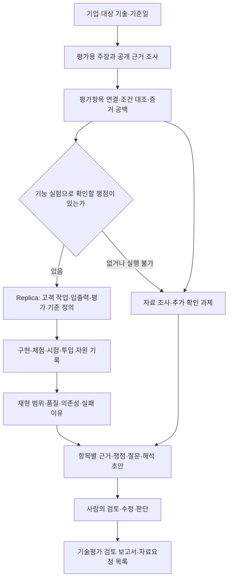

# 기술평가 보조 제품의 목표와 Replica의 역할

기준일: 2026-10-02 (Asia/Seoul)

**목표는 기업의 기술 주장을 조사하고, 필요한 기능을 직접 재현·시험한 근거까지 연결해, 사람이 기술평가의 판단과 추가 질문을 더 정확하고 효율적으로 만들 수 있도록 돕는 제품을 만드는 것이다. Replica는 이 제품에서 기능의 모방·대체 가능성을 실험하는 핵심 기능이다.**

이 상하 관계는 2026-10-02 사용자가 직접 선택했다. 인수 실사는 기술평가에 포함되는 용도 중 하나다. Replica의 방법은 Bain & Company의 인수 실사 방식, 즉 생성형 AI로 대상 기업의 핵심 기능 시제품을 만들어 써 보고 구현 난도·대체 가능성과 경쟁력의 원천(코드인지, 데이터·고객 업무 결합인지)을 가르는 방식에서 왔다.

이 문서는 프로젝트 방향의 기준 문서이며 계속 수정·추가한다. 아래에서 **확정**은 사용자 요구와 현재 운영 규칙, **현황**은 문서·코드·보존된 실행 기록에서 확인한 내용, **제안**은 이번에 종합한 제품 설계를 뜻한다. 제품 방향을 정리한 문서이며, 제안된 평가 방식이나 실행 경로가 이미 구현됐다는 뜻은 아니다.

## 1. 풀려는 문제와 제품의 쓰임

기업이 기술이나 성능을 설명하더라도 평가자는 그 설명이 어떤 제품·조건·자료에서 확인되는지 다시 조사해야 한다. 자료에 수치가 있어도 현재 제품에 적용되는지, 경쟁제품과 비교 가능한지, 핵심 기능을 외부 자원으로 다시 만들 수 있는지는 별도의 질문이다.

제품은 이 작업을 **주장 → 근거 → 조건 대조 → 필요한 실험 → 쟁점 → 추가 질문 → 사람의 판단**으로 연결한다. 평가자가 결과의 출처와 한계를 확인하고 판단을 수정할 수 있어야 한다.

- **확정된 상위 용도:** 기술평가 보조. Replica의 재현 결과를 이 목적에 사용한다.
- **첫 사용자 가설:** 기업 기술을 검토하는 평가·실사 담당자와 이를 준비하는 팀. 정확한 도입 주체와 유료 고객은 아직 검증하지 않았다.
- **현재 시작 방식:** 회사명이나 URL, 필요하면 대상 제품·기술과 기준일을 정하고 공개자료로 시작한다. 자료에 없는 사실은 추가 질문으로 남긴다.
- **현재 제품 경계:** 공식 등급·상장 가능성을 자동 판정하는 기능은 기존 기술평가 MVP 범위에 없다. 공개 항목의 분류와 자체 검토 방법론을 기관의 실제 채점모델로 표현하지 않는다.

제품이 제공해야 하는 가치는 문서 수나 구현한 기능 수로 끝나지 않는다. **평가자가 중요한 쟁점을 놓치지 않고, 근거가 부족한 결론을 피하며, 다음에 확인할 자료와 질문을 구체화하는 것**이 중심이다.

## 2. 기존 목표에서 달라진 점

| 구분 | 기존 기록의 중심 | 지금의 목표와 방향 |
|---|---|---|
| 최종 목적 | 기업 입력부터 조사·Replica·보고서까지 실행 | 그 결과로 기술평가자의 판단 업무를 지원 |
| Replica의 위치 | 독립적인 기능 재현 프로젝트 | 기술평가 제품의 핵심 실험 기능 |
| 조사 대상 | 고객 대상 AI 기능 주장 | 상위 제품은 평가에 필요한 주장 전체를 다루고, Replica는 재현 가능한 고객 기능을 담당 |
| 결과물 | 코드, 입출력, 평가 파일 | 주장별 근거·실험·한계·쟁점·질문과 사람의 검토 결과. 코드와 체험도 함께 제공 |
| 완성 기준 | 실행과 동결 테스트를 끝냈는가 | 고객 작업을 실제로 수행하고, 평가자가 그 결과로 무엇을 판단할 수 있는가 |
| 구현 구조 | Operator/Builder 프로토콜 중심의 기본 경로 | 목표 달성에 필요한 수단. 단일 구현자도 실제 실행됐으며 기본 구조 변경은 별도 결정 |

기업 정보만으로 전체 흐름을 시작한다는 기존 목표는 유지한다. 이제 그 흐름의 목적을 **기술평가에 쓸 수 있는 근거와 판단 자료를 만드는 것**으로 명확히 한다.

## 3. 제품과 Replica의 책임

아래는 현재 두 프로젝트를 상위 목표에 연결하는 **통합 설계 제안**이다. 이미 연결된 자동 실행 흐름을 설명하는 그림이 아니다.

**기술평가 보조 제품**은 기업의 주장과 근거를 평가항목에 연결하고, 조건 차이·상충·누락을 찾아 기업별 쟁점과 질문을 만든다. 사람이 그 결과를 검토하고 판단한 이력을 보존한다.

**Replica**는 고객 대상 AI 기능 하나의 전체 작업을 원기업 자원에 의존하지 않고 구현하고 시험한다. 무엇을 재현했고, 어떤 조건에서 어느 품질까지 작동했으며, 어떤 데이터·도구·시간·사람의 도움이 필요했는지를 기록한다.

상위 평가용 주장과 Replica의 기능 단위는 다르다. 예를 들어 “이 문서 검토 기능은 정확하고 경쟁사보다 우수하다”에는 신뢰성과 차별성에 관한 여러 판단이 들어 있다. Replica에서는 문서 입력부터 검토 결과까지를 하나의 기능으로 유지하되, 실험 결과를 해당 평가 주장들에 각각 연결한다.

따라서 **복제할 수 없다는 이유로 평가용 주장을 삭제하지 않는다.** 조직·권리·자체 개발 여부처럼 기능 복제만으로 확인할 수 없는 사항도 상위 제품에서 근거와 추가 질문을 남긴다. 반대로 상위 제품이 모든 주장을 다룬다는 이유로 Replica의 고객 대상 AI 기능 선정 규칙을 폐기하지 않는다.

## 4. 먼저 다룰 평가 범위

기존 기술평가 MVP의 9개 항목 분류를 출발점으로 삼는다. 아래 우선순위는 **통합 제품을 위한 제안**이며 공식 평가 배점이나 기관 기준의 재현이 아니다.

| 항목 | 첫 제품에서 제공할 판단 자료 | Replica의 기여와 한계 |
|---|---|---|
| 진행 정도 | 제품·실증·출시·운영 주장과 날짜·버전·근거의 연결 | 원기업 자료 조사 중심. 우리의 구현 성공은 원기업의 개발 진척 증거가 아님 |
| 신뢰성 | 성능 주장에 쓰인 입력·지표·시험조건·시험주체 대조 | 시험 구조를 활용할 수 있으나 Replica 성능을 원제품 성능으로 옮기지 않음 |
| 차별성 | 비교대상과 조건이 맞는지, 확인된 차이가 무엇인지 | 일반 모델·대안 구현과의 비교를 보강. 원제품 우열에는 원제품 근거가 필요 |
| 모방난이도 | 외부 팀이 접근 가능한 자원으로 재현한 범위·품질·부담 | Replica의 핵심 실험. 특정 기능·조건·시도에 한정해 해석 |
| 확장성 | 다른 입력·업무에 적용한 관측과 추가 수정 부담 | 재현 실험을 확장할 수 있으나 원기업의 규모·다른 산업 성능까지 입증하지 않음 |
| 자립도·연구개발·경영진·기술인력 관리 | 공개 근거, 미확인 사항, 필요한 자료와 질문 | 별도 조사 영역. 복제품의 의존성을 원기업의 의존성으로 간주하지 않음 |

우선 **기존 앱의 진행 정도·신뢰성·차별성 검토에 Replica의 모방난이도 실험을 연결**하는 안을 권한다. 9개 항목마다 에이전트를 하나씩 늘리는 것은 현재 목표의 완료 조건이 아니다.

## 5. 최근 대화에서 유지해야 할 요구

### 고객이 하는 작업을 끝까지 보존한다

조사에서 확인한 대화·파일·승인·저장 과정을 계약과 구현으로 넘길 때 잃지 않아야 한다. 인터뷰를 답변 배열의 일회 요약으로 바꾸거나, 파일 파싱을 사용자에게 맡기면 고객 작업의 일부가 빠진 것이다. 방법을 단순화한 것과 기능을 삭제한 것을 구분한다.

원제품과 같은 화면을 만드는 일보다 실제 입력과 상호작용을 보존하는 것이 우선이다. CLI도 가능하지만 대화가 필요한 기능은 턴과 상태가 이어져야 한다. 사람이 새 입력으로 직접 써 볼 수 있는 산출물이 필요하다.

### 내부 구현을 알아내는 일은 필요에 따라 한다

모방·대체 가능성의 질문은 “접근 가능한 자원으로 고객에게 필요한 결과를 다시 제공할 수 있는가”이다. 원기업과 같은 모델·프롬프트·알고리즘을 복원하는 것을 모든 기능의 필수 목표로 삼지 않는다. 공개된 기술 자료나 원제품 관찰은 구현과 평가에 필요한 만큼 사용한다.

### 구현과 판단을 구분한다

체험 가능한 시제품, 평가가 완료된 구현, 원제품을 대체할 가능성이 확인된 결과는 다른 상태다. 핵심 품질을 평가하지 못했다면 동작하는 코드가 있어도 그 부분의 판단을 보류한다. 구현 후 합격 기준을 낮추지 않으며, 액션은 “실행했다”는 응답과 실제 실행 결과를 구분한다.

평가 결과를 사람이 이해할 수 있어야 한다는 방향은 유지한다. **공개된 테스트에 통과한 사실만으로 일반적인 대체 가능성을 주장하지 않는다.**

### 봉인하지 않고, 사람의 판단을 최종으로 둔다

이전 구현은 봉인 평가와 AI끼리의 구현·판정을 함께 강화하면서 "사람이 복제품을 써 보고 판단할 수 있는가"가 뒤로 밀렸다. 이를 두 원칙으로 나눠 지킨다.

1. **기본 경로에서 봉인하지 않는다.** 테스트는 구현 전에 원본 근거로 고정하고, 구현을 본 뒤 바꾸지 않는다. 대신 숨기지 않고 공개해 어떤 case가 왜 실패했는지 사람이 볼 수 있게 한다. 봉인을 선택 옵션으로 남길지는 로드맵 D3에서 정한다.
2. **AI 자동 평가는 보조이고, 사람의 체험과 판단이 최종이다.** AI 테스터·AI 판정자는 많은 case를 반복해 돌리기 위한 수단이다. 결과를 "대체 가능하다"는 판단으로 옮기는 것은 사람이 복제품을 직접 써 보고 판정 일부를 검토한 뒤다.

Ralph-to-Ralph처럼 AI가 복제품을 직접 써 보는 방식은 빌려 올 수 있다. 하지만 사람 개입 0을 목표로 두지 않고, 구현한 쪽이 합격도 정하는 구조는 따르지 않는다.

### 자원·사람 개입·실패를 판단 자료로 남긴다

사용한 모델, 데이터, 외부 API, 시간, 재시도, 사람 개입과 미측정 항목을 기록한다. 미측정은 0이 아니다. 사람과 AI가 함께 만든 결과도 무엇을 사람이 담당했는지 보여 주면 실험 자료가 될 수 있다.

성공은 해당 조건에서 가능한 경로가 존재한다는 근거다. 실패나 실행 차단은 우리 조사·도구·예산·접근의 한계일 수도 있다. 이를 곧바로 기업의 기술 장벽으로 바꾸지 않는다. 코드·데이터·업무 통합 중 무엇이 경쟁력의 원천인지는 비교 근거가 충분한 범위에서 해석한다.

## 6. 사용자에게 제공할 결과

**통합 결과물의 제안 형식**은 다음과 같다.

1. **기업·기술 요약:** 누가 어떤 일을 하려고 쓰는 제품이며 이번 검토는 무엇을 확인했는가.
2. **평가항목별 주장과 근거:** 회사 설명, 직접 확인한 사실, 해석, 상충·미확인 사항을 구분한다.
3. **Replica 실험:** 입력·처리·출력, 보존하거나 제외한 단계, 시험별 결과와 이유, 실행 코드와 체험 방법을 제공한다.
4. **판단의 범위:** 이 결과로 말할 수 있는 것, 말할 수 없는 것, 필요한 비교·추가 실험을 적는다.
5. **자료요청·질문:** 해당 회사의 구체적인 근거 공백에서 질문을 만들고, 담당자의 검토·수정 이력을 남긴다.

모든 조사 주장의 처리 결과를 보존한다. 실험하지 않은 주장에는 사유를 남긴다. 보고서는 **제품의 목적 → 확인하려던 질문 → 시험과 관측 → 결과의 의미 → 다음 확인사항** 순서로 읽혀야 한다. “부분 재현”, “보완 필요”라는 상태명만으로 설명을 끝내지 않는다.

## 7. 2026-10-02 현재 확인한 위치

현황은 대화, 문서, 관련 코드와 보존된 결과 설명을 대조했다. 문서 변경 후 `team-ai guard`와 그 과정의 기존 테스트 313개는 통과했다. 새 기업 조사·모델 실행·앱 실행은 하지 않았으므로 통합 제품의 실제 사용 검증으로 해석하지 않는다.

| 구성 | 확인한 현황 | 남은 차이 |
|---|---|---|
| 기술평가 앱 | 별도 `replica-review-mvp`에 Codex 조사 스킬과 로컬 React 검토 앱이 있다. 문서상 주장·근거·쟁점·질문·사람 검토 흐름을 제공 | 실제 평가자의 정확도·시간 절약은 검증 전. Replica 실험 결과를 평가항목으로 연결하는 통합은 확인되지 않음 |
| Replica 전체 결과 | `company-claims.json`에 전체 조사 주장과 미실행 사유를 남기는 코드가 있다 | 이를 기술평가용 설명·쟁점·질문으로 바꾸는 통합 결과물이 필요 |
| 구현 경로 | 기본 운영 규칙은 Operator/Builder. `single-harness-init` 코드와 기능당 Astra low 실행 기록도 존재 | 어느 구조가 비용·품질 면에서 유리한지 같은 조건의 비교 결론은 없음 |
| 체험 | 공식 체험 프로필은 아직 `question_answer`. Delphi에는 별도 턴 기반 `demo-session`이 있다 | 형태별 실행기 개편안과 10월 2일 AI 테스터 대안이 논의 중. 최종 평가 인터페이스는 미확정 |
| 측정 | `experiment_record`가 환경·범위·일부 시간·수정·개입·미측정 항목을 모은다 | 제작 토큰·내부 반복 등 누락이 남음. 전 구간 비용·사람 부담이 완전히 측정됐다고 할 수 없음 |
| 보고서 | 비전공자용 Delphi 보고서 개정본이 존재 | 개별 수작업 보고서를 반복 가능한 기술평가 결과 생성으로 연결해야 함 |

특히 데모 세션은 변경 후 봉인 평가를 다시 받지 않았다고 자체 문서에 명시돼 있다. 이전 일회 호출 엔진의 점수를 세션 버전의 성능으로 사용하지 않는다.

## 8. 다음 작업의 우선순위와 완료 기준

**Replica 자체 개선은 [로드맵](replica-roadmap.md) 단계 0부터 순서대로 진행한다.** 로드맵은 Delphi 세 기능을 터미널 세션으로 직접 써 본 결과(`work/delphi-ai-v2/demo-session/`)를 바탕으로 정했다.

아래 표는 기술평가 제품 쪽 우선순위이며 **제안**이다. 3·4는 로드맵 단계 1~3이 담당한다. 1은 새 실행 없이 기존 Delphi 결과로 작성하므로 로드맵과 병행한다.

| 순서 | 할 일 | 완료 기준 |
|---|---|---|
| 1 | 기존 Delphi 결과로 한 기능의 통합 결과 예시를 작성 (로드맵과 병행) | 평가 주장 → 근거 → Replica 결과 → 허용되는 해석 → 질문 → 사람 검토가 한 문서나 화면에서 추적됨 |
| 2 | 두 저장소 사이의 최소 연결을 정함 | 회사·제품·기준일·주장·실험 버전과 결과 경로가 연결되고, 원기업 근거와 Replica 관측이 구분됨. 저장소 통합은 전제하지 않음 |
| 3 | 실제 작업을 보존하는 체험·평가를 보강 | 고객이 넣는 파일·발화로 시작해 최종 결과를 받음. 평가한 구현과 체험 버전이 같거나 차이를 명시 |
| 4 | 평가 해석에 필요한 비교·측정을 채움 | 정답 근거, 핵심 미평가 영역, 필요한 기준선, 자원·사람 개입 기록을 보여 줌 |
| 5 | 사람이 검토하는 파일럿을 수행 | 중요한 쟁점 누락, 잘못된 근거 연결, 불필요한 질문, 수정 부담, 조사와 검토 총시간을 기록 |

**첫 통합 MVP의 완료는 “앱이 있고 복제품이 있다”가 아니다. 한 기업에 대해 근거 조사와 재현 실험이 평가항목별 쟁점·질문으로 이어지고, 사람이 원문과 실행 결과를 확인해 판단을 남길 수 있어야 한다.** 재현 실패나 실험 불가도 이유와 다음 행동이 남으면 평가 지원 흐름의 결과가 된다.

수치 목표는 파일럿 전에 별도로 정한다. 기존 실행 수치만으로 정확도나 시간 절약 목표를 달성했다고 간주하지 않는다.

## 9. 아직 확정하지 않은 결정

- 첫 산업·기업과 실제 검토자, 제품을 구매할 주체.
- 첫 버전에서 깊게 검토할 평가항목과 각 항목의 충분한 근거·판단 보류 조건.
- 두 저장소의 연결 방식과 공통 결과 형식. 별도 앱의 존재가 통합 완료를 뜻하지 않는다.
- 봉인을 선택 옵션으로 남길지(로드맵 D3), 새 입력 확인, AI 판정자의 모델·독립성·사람 검토 방법.
- 평가 실행 방식: 기존 개편안의 단발·대화·일괄 실행기와, 10월 2일 제안의 자연어 대본을 수행하는 AI 테스터 중 무엇을 채택할지. 테스터와 판정자의 분리·실행 기록 검증·추가 비용도 함께 검토한다.
- 기본 구현 경로와 예산. 단일 구현자의 한 번의 성공으로 일반적인 우위를 확정하지 않는다.
- 사람+AI 제작을 공식 경로로 운영할 방식과 개입 기록, 원제품 관찰의 범위.

2026-10-02까지 사용자 답변으로 확정된 것은 **상위 제품과 Replica의 관계(인수 실사는 기술평가에 포함)**, **기본 경로에서 봉인하지 않고 사람의 판단을 최종으로 두는 원칙**, **Replica 개선은 로드맵 단계 0부터 진행한다는 순서**다. 위 결정이나 기존 로드맵의 D1~D8까지 일괄 승인된 것으로 취급하지 않는다. 실행할 때는 현재 AGENTS·Skill 규칙을 적용하고, 방향 문서만으로 이를 바꾸지 않는다.

## 10. 근거와 기존 문서의 해석

### 대화 근거

| 대화 (Codex 대화 제목) | 확인한 사용자 의도 |
|---|---|
| 프로젝트 목표 확인, 2026-10-02 | 최근 대화·문서로 목표를 재정리하고, “기술평가 보조 제품을 상위 목표로 두고 Replica를 핵심 기능으로 배치” 선택 |
| 기술평가 AI 제품 방향 검토, 2026-09-22 | 단순 Replica 자료 뷰어가 아니라 실제 조사·분석 MVP 요구. 스킬+로컬 React 형태, 방법론 출처와 판단 로직 확인 요구 |
| 기술특례상장 평가 기준 선정, 2026-09-23 | 외부 팀이 접근 가능한 한국 자료와 평가방법을 기준으로 범위 선정 요구. 답변의 항목 순위는 제안 |
| 델파이 Replica 구현수준 평가, 2026-09-23~26 | 전체 고객 작업 보존, 조사부터 결과까지 품질 검토, 실제 산출물 요구. 기능당 Astra low 단일 구현 실험 요청 |
| Delphi run-2 구현 현황 확인, 2026-09-26 | 현재 실제로 테스트할 수 있는 수준인지 확인 요구 |
| 관련 논문과 도구 조사, 2026-09-28 | “기업의 모방가능성을 평가하기 위한 툴”이라는 목적 명시. 내부 역공학의 필요성과 평가 신뢰성 검토, 실질적인 보강안 요구 |
| 개정 보고서의 비전공자 가독성 높이기, 2026-09-22 | 비전공자가 목적·내용·결과를 처음부터 이해할 수 있는 보고서 요구 |

대화 제목이나 이전 AI 답변만으로 사용자 결정을 추정하지 않았다. 특히 “Replica는 기업의 내부 구현을 역추론하는 것이 핵심”이라는 9월 28일의 초기 AI 설명은 같은 대화의 후속 답변에서 정정됐다. 이를 현재 목표로 채택하지 않는다.

### 문서·코드 근거

- [기존 완료 기준](replica-completion-standard.md): 고객 가치 재현, 투자 실사, 전체 작업·새 입력·자원·한계의 기존 요구.
- [2차 계약 개편안](pass2-interaction-redesign.md): 사람이 써 보는 복제품과 상호작용 보존. 여전히 초안.
- [AI 테스터 평가 방식 제안](ai-tester-evaluation-proposal.md): 10월 2일 새로 작성된 미확정 대안. 자연어 대본과 실제 조작 기록으로 평가하고 형태별 실행기를 대체하자는 제안이며, 기존 개편안의 채택 완료로 읽지 않는다.
- [Replica 고도화 로드맵](replica-roadmap.md): 비교 기준선, 계측, 파일럿 등 세부 제안. 작성일은 9월 29일, 저장소 반영 커밋은 `e91c3b6`(10월 2일).
- [전체 품질 검토](replica-workflow-quality-review-2026-09-24.md): 조사·계약에서 고객 작업이 축소되는 문제와 수정 기록.
- 기술평가 MVP 요구 문서(저장소 루트의 `tech-evaluation-ai.html`, 미커밋), 별도 저장소 `replica-review-mvp`의 `README.md`와 `skills/tech-evaluation/references/methodology.md`: 상위 제품의 조사·검토 흐름과 한계.
- [단일 구현자 코드](../src/replica_mvp/single_agent.py), [체험 코드](../src/replica_mvp/experience.py), [실험 기록 코드](../src/replica_mvp/bundle_evaluation.py): 이번에 확인한 현재 구현 범위.
- Astra 실행 설명(`work/delphi-ai-v2/astra-low-run/README.md`), 세션 데모 설명(`work/delphi-ai-v2/demo-session/README.md`), 보고서 개정 본문(`output/pdf/delphi-readability-revised/보고서_수정본.md`): 로컬 산출물. `work/`·`output/`은 Git에서 제외되므로 다른 체크아웃에는 없다.

예전 `state.yaml`은 7월 29일 목표를 유지하고 있었다. 9월 29일 로드맵의 “아직 어떤 단계도 반영하지 않았다” 역시 현재 전체 구현 현황을 대신할 수 없다. 목표는 본 문서, 실행 규칙은 현재 AGENTS·Skill, 구현 여부는 현재 코드와 해당 실행 기록을 각각 근거로 확인한다. 외부 논문·기관 규정의 최신성은 이번 문서 정리에서 새로 검증하지 않았다.
