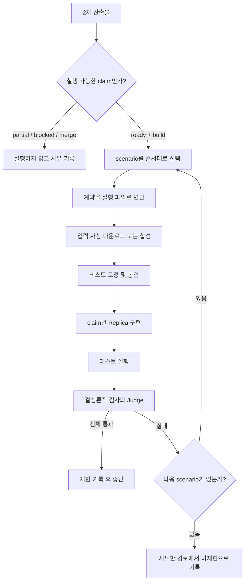

# 2차 산출물 이후 Replica 실행 설계

복제 완료 여부와 테스트 전용 구현의 제외 기준은
[`replica-completion-standard.md`](./replica-completion-standard.md)를 우선 적용한다.

## 목적

2차 산출물은 공개 근거, 복제 준비도, 구현 경로와 테스트 가능한 행동 계약을
확정한다. 실제 파일 다운로드, 합성 입력 생성, 실행 코드와 평가 결과는 2차에
추가하지 않고 사용자가 복제를 요청했을 때 별도의 실행 단계에서 만든다.

핵심 원칙은 다음과 같다.

- 2차 산출물은 수정하지 않는 동결된 계약이다.
- `ready`이면서 `build` handoff가 있는 claim만 실행한다.
- 공통화하는 것은 실행 순서와 입출력 인터페이스뿐이다.
- 실제 Replica 구현은 claim과 scenario에 맞춰 별도로 만든다.
- 테스트 기대값은 Replica 출력을 보기 전에 고정한다.
- 가장 자립적인 scenario부터 실행하고 하나가 재현되면 중단한다.

## 전체 흐름



## 1. 실행 대상 판별

다음 조건을 모두 만족하는 claim만 실행한다.

```text
status = confirmed 또는 refined
readiness.status = ready
handoff.action = build
replication_contract가 비어 있지 않음
```

`replicable.value = true`만으로는 실행하지 않는다. `partial`, `blocked`, `merged`,
`evidence_request`, `reject`는 각각의 사유를 기록하고 건너뛴다.

## 2. Scenario 선택

실행 단계는 scenario를 새로 만들지 않는다. 2차가 동결한
`replication_contract`를 그대로 사용하며, 구현 경로가 하나라면 계약도 하나만
두고 바로 구현한다. 복수 scenario는 기본값이 아니다.

여기서 scenario는 `프롬프트 구현`, `코드 구현` 같은 프로그램 형태가 아니라,
같은 공개 행동을 어떤 외부 의존성으로 달성하는지를 뜻한다.

| self-sufficiency | 의미 |
|---|---|
| `oss_only` | 오픈소스 모델·라이브러리와 무료 공개 API만 사용 |
| `commercial_api` | 상용 모델, OCR, 문서 처리 또는 enrichment API에 의존 |
| `proprietary_data` | 특정 비공개 데이터 접근이 있어야 성립 |

복수 경로는 이 의존성 차이가 실제 복제 가능성의 경계이고, 어느 지점에서 처음
재현되는지를 확인할 가치가 있을 때만 둔다. 단순히 사용할 모델 후보가 여러 개라는
이유로 scenario를 늘리지 않는다. 목표가 Replica 하나를 만드는 것이라면 2차가
가장 적절한 경로 하나를 추천하고 계약 하나만 남기는 것이 기본이다.

복수 계약이 실제로 존재할 때만 다음 순서를 사용한다.

```text
oss_only -> commercial_api -> proprietary_data
```

각 scenario는 독립된 run 디렉터리를 사용한다. 정상, 경계, 정보 부족 테스트가
모두 통과하면 재현된 것으로 기록하고 뒤의 scenario는 실행하지 않는다. 실패한
scenario의 결과와 보고서는 지우지 않는다.

## 3. 실행 디렉터리 생성

```text
work/<company>/runs/<claim-slug>/<scenario-id>/
├── evidence.json
├── spec.json
├── tests.json
├── assets.json
├── assets/
├── attempts/
│   ├── attempt-01/
│   │   ├── implementation/
│   │   ├── replica.json
│   │   ├── replica_outputs.jsonl
│   │   └── results.jsonl
│   ├── attempt-02/
│   └── attempt-03/
└── report.md
```

`assets.json`, `assets/`, `attempts/`는 실행 단계에서만 생성한다. 회사 조사 내용을
별도의 실행 보고서로 복제하지 않는다. 생성되지 않은 attempt 디렉터리는 만들지
않는다.

## 4. 2차 계약 변환

| 2차 산출물 | 실행 파일 또는 용도 |
|---|---|
| `scenario.sources` | `evidence.json.sources` |
| `scenario.evidence_level` | `evidence.json.evidence_level` |
| `scenario.input` | `spec.json.input_description` |
| `scenario.output` | `spec.json.output_description` |
| `scenario.acceptance_criteria` | `spec.json.acceptance_criteria` |
| `scenario.out_of_scope` | `spec.json.out_of_scope` |
| `scenario.tests` | `tests.json` |
| `findings.datasets_apis` | 실제 입력 자산 탐색과 준비 |
| `findings.access_license` | 사용 및 재배포 범위 확인 |
| `findings.impl_path` | Replica 구현 힌트 |
| `scenario.self_sufficiency` | 실행 순서 확인 |

변환 과정에서는 참조가 실제 source로 해석되는지, 필수 테스트 세 종류가 있는지,
placeholder가 남지 않았는지를 검증한다. 모호한 값을 임의로 보완하거나 2차 계약의
기대 동작을 다시 작성하지 않는다.

## 5. 입력 자산 준비

Execution Agent가 2차의 source와 테스트 입력 설명을 사용해 실제 실행 자산을
준비한다.

- 공개 파일은 `assets/`에 내려받는다.
- URL, 로컬 경로, 미디어 타입, 해시와 확인된 라이선스를 `assets.json`에 기록한다.
- 2차에 명시된 synthetic fallback이 필요하면 실행 전에 생성해 고정한다.
- 접근할 수 없거나 사용 조건이 해결되지 않은 자산은 임의의 다른 데이터로
  대체하지 않는다.
- 자산 준비 실패와 Replica 기능 실패를 구분해 기록한다.

`assets.json`은 2차 산출물의 새 필드가 아니라 특정 실행을 재현하기 위한 실행
메타데이터다.

## 6. 테스트 고정과 Builder 분리

2차의 `normal`, `boundary`, `insufficient-information` 테스트를 실제 자산과 연결해
`tests.json`으로 고정한다. 기대값은 Replica 결과를 본 뒤 변경하지 않는다.

Builder가 받는 정보:

- workflow와 scenario의 입력 및 출력 계약
- acceptance criteria와 out-of-scope
- 공개 source
- `findings.impl_path`
- 준비된 입력의 형식과 공통 runner 인터페이스

Builder에게 제공하지 않는 정보:

- `tests[].expected_behavior`
- `tests[].reference_facts`
- `tests[].original_output`
- 숨겨진 변형 테스트

현재 세 테스트는 최소 seed다. 샘플 하나를 하드코딩하는 구현을 걸러야 할 때는
Replica 구현 전에 변형 입력과 그 기대값을 추가로 생성해 봉인한다.

## 7. Claim별 Replica 구현

모든 claim을 하나의 프롬프트나 고정된 task-type 템플릿으로 처리하지 않는다.
각 scenario마다 계약을 만족하는 최소 실행 프로그램을
`attempts/<attempt-id>/implementation/` 아래에 만든다. 공통 runner는 입력
manifest를 전달하고 결과와 생성 파일을 회수하는 역할만 담당한다.

### 구현 형태와 scenario는 별개다

Replica의 구현 형태는 입력·출력과 `findings.impl_path`를 보고 가장 작은 것으로
정한다. 이를 위해 2차 스키마에 새 필드를 추가할 필요는 없고, 2차 worker가
`findings.impl_path`에 추천 형태와 필요한 의존성을 명확히 적으면 된다.

| 구현 형태 | 사용하는 경우 |
|---|---|
| `prompt_only` | 실제 입력과 출력이 텍스트이고 파일 처리, 외부 도구와 결정론적 검증이 필요하지 않을 때 |
| `code` | 파싱, 변환, 계산과 schema 검증만으로 기능을 완성할 수 있을 때 |
| `hybrid` | PDF·XLSX 처리, 검색, API 호출과 LLM 판단이 함께 필요할 때 |

구현 형태가 다르다고 자동으로 별도 scenario가 되는 것은 아니다. 반대로 같은
`hybrid` 구현이어도 오픈소스 모델만 쓰는 경로와 상용 API에 의존하는 경로는
의존성 차이가 중요할 때 서로 다른 scenario가 될 수 있다.

현재 Underwriting audit과 Complex SOV intake는 실제 파일 파싱과 검증이 필요하므로
기본적으로 `hybrid` 구현이다. 문자열을 모델에 전달하는 현재의 prompt-only
실행만으로는 이 두 계약의 전체 입력과 출력을 수행할 수 없다.

### Underwriting audit 예시

```text
guideline PDF 파싱
-> 실행 시점에 규칙 추출
-> submission 필드 추출
-> 규칙별 match / mismatch / referral / not_addressed 판정
-> 정확한 조항과 페이지 인용
-> 구조화된 audit JSON 생성
```

OSS와 commercial API scenario는 가능하면 같은 파이프라인을 사용하고 모델
adapter만 바꾼다. 특정 guideline의 규칙을 코드에 하드코딩하지 않는다.

### Complex SOV intake 예시

```text
workbook의 시트, 헤더와 데이터 영역 탐색
-> grouping / subtotal / data 행 분리
-> 필드 추출 및 정규화
-> 주소 검증과 지오코딩
-> 공개 OED schema로 매핑
-> ODS_Tools와 도메인 규칙으로 검증
-> location CSV와 exception JSON 생성
```

특정 workbook의 시트 순서나 행 번호를 코드에 하드코딩하지 않는다.

## 8. 평가

### 개발 테스트와 봉인 평가 분리

2차의 `normal`, `boundary`, `insufficient-information` 테스트는 Builder에게 공개되는
개발·계약 예시다. 이것만 통과해서는 재현 성공으로 인정하지 않는다.

최종 평가는 Builder가 볼 수 없는 봉인 테스트로 한다. 구현을 시작하기 전에 서로
다른 봉인 세트 세 개를 만들고 기대값까지 고정한다.

```text
holdout-01: normal + boundary + insufficient-information
holdout-02: normal + boundary + insufficient-information
holdout-03: normal + boundary + insufficient-information
```

봉인 세트는 2차 계약의 입력·출력, acceptance criteria와 reference facts에서
파생하되 개발 테스트의 값만 바꾼 복사본에 머물지 않아야 한다. 구현 결과를 본 뒤
조건이나 기대값을 변경하지 않는다.

Builder에게 주는 정보:

- 동결된 입력·출력 계약과 acceptance criteria
- 2차의 공개 개발 테스트
- 공개 source와 `findings.impl_path`
- 준비된 자산의 형식과 runner 인터페이스

Builder에게 주지 않는 정보:

- 봉인 테스트의 입력
- 봉인 테스트의 기대 동작과 reference facts
- 이전 봉인 테스트의 상세 결과

완전한 격리가 불가능한 환경에서는 이를 숨은 평가라고 단정하지 않고
`same-workspace`로 기록한다.

### Attempt 정의와 한도

Attempt는 코드 수정 횟수가 아니라 동결한 candidate를 봉인 평가에 제출한 횟수다.
Builder는 공개 개발 테스트로 구현을 확인한 뒤 candidate를 동결한다.

한 scenario에서 봉인 평가 제출은 최대 세 번이다.

```text
attempt-01 -> holdout-01
attempt-02 -> holdout-02
attempt-03 -> holdout-03
```

같은 봉인 세트를 다시 사용하지 않는다. 한 attempt가 실패하면 Builder에게는
다음과 같은 실패 분류만 전달하고 실제 봉인 입력, 정답과 상세 판정은 해당 scenario가
끝날 때까지 공개하지 않는다.

```text
schema_failure
workflow_incomplete
grounding_failure
invented_information
insufficient_information_failure
validator_failure
semantic_failure
runtime_failure
```

각 attempt의 구현, 출력과 결과는 덮어쓰지 않는다.

### 테스트 판정 순서

코드로 판정할 수 있는 항목을 먼저 검사한다.

- JSON 또는 CSV 구조와 필수 필드
- 허용된 enum 값
- 필수 workflow 단계의 수행 여부
- 인용이 실제 입력 원문에 존재하는지
- 입력에 없는 값이나 규칙을 생성하지 않았는지
- 누락된 값을 추정해 만들지 않았는지
- `out_of_scope` 행동을 수행하지 않았는지
- 행 개수, subtotal과 산술 값의 일치
- 공개 schema validator 통과 여부
- scenario가 정한 정확도와 실행 시간 기준

필수 결정론적 검사 하나라도 실패하면 해당 테스트는 즉시 실패다. 결정론적으로
판정하기 어려운 의미적 품질만 별도 Judge가 acceptance criterion별로 평가한다.
Judge의 `불확실`과 `근거 부족`도 실패로 처리한다.

Candidate와 Judge 실행은 분리한다. 같은 세션이 Judge를 맡으면 Judge 독립성을
`same-session`으로 기록하고 독립 Judge라고 표현하지 않는다.

### 실행 오류 재시도

- 잘못된 출력은 재실행하지 않고 기능 실패로 기록한다.
- timeout, HTTP 429와 일시적 네트워크 오류만 최대 두 번 재시도한다.
- 재시도한 모든 출력과 오류를 남긴다.
- 여러 출력 중 잘 나온 것만 선택하지 않는다.
- 자산 접근, 라이선스와 실행 환경 문제는 `execution_blocked`로 기능 실패와
  구분한다.

### Attempt와 scenario 통과 기준

한 봉인 세트의 `normal`, `boundary`, `insufficient-information`이 모두 통과해야
attempt가 통과한다. 하나라도 실패하면 candidate 전체가 실패다.

```text
세 attempt 안에 봉인 세트 전체 통과
-> reproduced

세 attempt 모두 실패
-> not_reproduced_on_this_path

실행 전제 해결 불가
-> execution_blocked
```

한 attempt가 통과하면 해당 scenario를 재현 경로로 확정하고 남은 attempt와 뒤의
scenario를 실행하지 않는다.

### 평가 산출물

- `replica_outputs.jsonl`: Replica가 생성한 원본 출력
- `results.jsonl`: 테스트별 통과 여부와 Judge 이유
- `report.md`: 실행 scenario, 통과 수, 한계와 결론

최종 보고서에는 평가 격리 수준도 기록한다.

- `blind`: Builder가 봉인 테스트와 상세 결과를 보지 못함
- `same-workspace`: 같은 작업 공간이라 완전한 격리를 보장하지 못함

## 9. 종료와 보고

세 테스트 종류가 모두 통과한 첫 scenario를 재현 경로로 보고한다. 예를 들어
`oss_only`에서 통과하면 공개 구성요소만으로 해당 공개 범위 기능을 재현했다는
의미이고, `commercial_api`에서 처음 통과하면 상용 모델 또는 API 의존성이 경계였다는
의미다.

모든 scenario가 실패했을 때는 다음처럼 표현한다.

> 조사에서 동결한 시나리오들은 해당 공개 범위 기능을 재현하지 못했다.

이를 기능 자체가 복제 불가능하다는 결론으로 확대하지 않는다. 성공한 경우에도
공개 범위의 행동 재현일 뿐 원제품의 비공개 모델, 코드, 데이터나 운영 환경과의
동일성을 주장하지 않는다.

## 구현 범위

다음 구현 단계에서 필요한 공통 구성요소는 네 가지다.

1. 2차 claim의 실행 가능 여부와 scenario 순서를 결정하는 run orchestrator
2. scenario를 `evidence.json`, `spec.json`, `tests.json`으로 변환하는 compiler
3. 실제 파일을 준비하고 `assets.json`을 만드는 materializer
4. claim별 프로그램을 실행하고 결정론적 검사와 Judge를 분리하는 runner

claim별 PDF, spreadsheet, OCR, retrieval, classification 코드는 공통 프레임워크에
미리 넣지 않고 실제 ready contract가 요청할 때 해당 run에만 구현한다.
