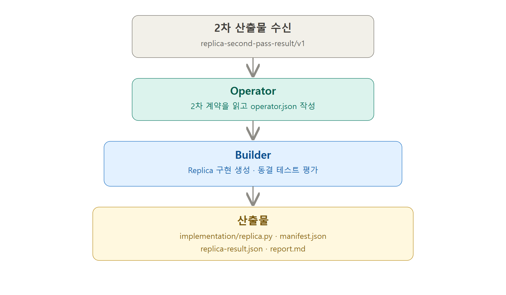

# 2차 JSON을 받으면 Replica는 어떻게 만들어질까?

2026-09-07 범위 안내: 아래 설명은 standalone JSON 전용 Component 경로다.
Sol/Terra 다중 파일 경로는 [번들 실행과 최종 평가](./replica-bundle-execution.md)를 따른다.
그 경로는 2차의 구현 경로를 보존하고 실제 번들을 별도로 실행·평가한 뒤 공개한다.
결과 보고서 개편은 현재 수정 범위에서 제외했다.

이 문서는 Replica가 만들어지는 과정을 쉽게 설명한다.

어려운 내부 기술보다 큰 흐름을 먼저 이해하는 것이 목적이다.

전체 과정은 네 단계다.

```text
2차 JSON 받기
→ Operator가 설계하기
→ Builder가 만들고 시험하기
→ 산출물 내보내기
```



---

## 먼저 알아둘 네 단어

### 1. 2차 JSON

2차 JSON은 **Replica를 만들기 위한 설계도**다.

어떤 입력을 받고, 무엇을 계산하고, 어떤 결과를 내야 하는지가 적혀 있다.

아직 실행할 수 있는 프로그램은 아니다.

### 2. Operator

Operator는 설계도를 읽고 **프로그램 제작 지시서**를 만든다.

그 지시서의 파일 이름이 `operator.json`이다.

### 3. Builder

Builder는 `operator.json`을 보고 실제 프로그램을 만든다.

그리고 미리 준비한 시험 문제로 프로그램이 제대로 작동하는지 검사한다.

### 4. 산출물

산출물은 Builder가 작업을 끝낸 뒤 내보내는 파일들이다.

가장 중요한 파일은 `implementation/replica.py`다. 이것이 실제 복제품 본체다.

---

## 1단계: 2차 JSON 받기

2차 조사까지 끝나면 `replica-second-pass-result/v1` 형식의 JSON 파일이 나온다.

이 파일에는 다음 내용이 들어 있다.

- 복제하려는 기능
- 입력 데이터의 모양
- 출력 결과의 모양
- 꼭 지켜야 할 동작
- 이번에 구현할 범위
- 구현하지 않을 범위
- 미리 정한 시험 문제

예를 들어 고객 점수 추천 기능이라면 다음과 비슷하다.

```text
입력: 고객 정보 목록
처리: 구매 고객과 비구매 고객의 특징 비교
출력: 추천할 고객 조건
```

시스템은 먼저 2차 JSON이 빠짐없이 작성됐는지 확인한다.

준비가 끝난 계약만 다음 단계로 넘긴다.

---

## 2단계: Operator가 설계하기

Operator는 2차 JSON을 그대로 프로그램으로 만들지 않는다.

먼저 공개해도 되는 내용과 시험 정답을 나눈다.

### 공개해도 되는 내용

- 기능 설명
- 입력과 출력의 모양
- 지켜야 할 조건
- 구현 범위와 한계

### 공개하지 않는 내용

- 시험 문제의 정답
- 사례별 기대 결과
- 시험 문제의 ID
- 이전 평가 결과

학교 시험으로 비유하면 이렇다.

> Operator는 문제의 출제 범위만 본다. 정답지는 보지 않는다.

이렇게 해야 정답을 그대로 외워서 통과하는 가짜 프로그램을 막을 수 있다.

Operator는 공개된 내용만 보고 `operator.json`을 작성한다.

`operator.json`에는 다음 내용이 들어 있다.

- 어떤 방식으로 프로그램을 만들지
- 어떤 JSON을 입력으로 받을지
- 어떤 JSON을 결과로 내보낼지
- 실제 처리 코드

현재는 주로 Python으로 `replicate(runtime_input)` 함수를 만든다.

이 함수가 JSON 입력을 받아 결과를 계산한다.

---

## 3단계: Builder가 만들고 시험하기

Builder는 `operator.json`을 받아 실제 Replica를 만든다.

### 3-1. 실행 코드 만들기

Builder는 다음 파일을 만든다.

```text
implementation/
├── replica.py
└── manifest.json
```

`replica.py`는 실제 기능을 수행하는 프로그램이다.

`manifest.json`에는 어떤 파일을 어떻게 실행할지 적혀 있다.

### 3-2. 위험한 코드 검사하기

Builder는 생성된 코드가 안전한지 검사한다.

- 인터넷에 몰래 접속하지 않는지
- 다른 파일을 함부로 읽지 않는지
- 다른 프로그램을 실행하지 않는지
- 너무 오래 실행되지 않는지
- 너무 많은 메모리를 사용하지 않는지

검사를 통과하지 못하면 프로그램을 고친다.

### 3-3. 미리 준비한 시험 보기

Replica는 네 종류의 시험을 본다.

| 시험 종류 | 쉽게 말하면 |
|---|---|
| `normal` | 평범한 입력 |
| `boundary` | 가장 작거나 큰 경계 입력 |
| `insufficient_information` | 정보가 부족한 입력 |
| `novel` | 구현할 때 보지 못한 새로운 입력 |

`novel` 시험이 중요한 이유는 정답 외우기를 막기 위해서다.

진짜 Replica라면 처음 보는 입력도 같은 규칙으로 처리해야 한다.

시험 과정은 다음과 같다.

```text
시험용 JSON 입력
→ replica.py 실행
→ JSON 결과 생성
→ 정답과 비교
→ 통과 또는 실패 결정
```

### 3-4. 실패하면 고치기

프로그램 제작은 최대 3번까지 시도할 수 있다.

하지만 Builder에게 정답을 보여주지는 않는다.

형식 오류인지, 실행 오류인지, 몇 문제를 통과했는지만 알려준다.

이것도 정답을 보고 코드를 맞추는 일을 막기 위한 규칙이다.

---

## 4단계: 완성 여부 판단하기

시험을 통과했다고 바로 완성으로 처리하지는 않는다.

시스템은 다음 내용을 한 번 더 확인한다.

- 공개 자료를 근거로 만든 기능인가?
- 실제 입력을 사용했는가?
- 고객에게 줄 최종 결과가 나왔는가?
- 새로운 입력도 처리했는가?
- 시험과 구현이 서로 분리되어 있는가?
- 평가받은 코드와 공개할 코드가 같은가?
- 최종 보고서가 실제 결과와 같은가?

최종 상태는 다음 중 하나다.

| 상태 | 쉬운 뜻 |
|---|---|
| `reproduced` | 필요한 조건을 모두 통과함 |
| `partially_reproduced` | 일부는 만들었지만 부족한 조건이 있음 |
| `not_reproduced_on_this_path` | 지금 선택한 방법으로는 재현하지 못함 |
| `execution_blocked` | 필요한 입력이나 실행 환경이 준비되지 않음 |

---

## 5단계: 산출물 내보내기

평가가 끝나면 사용자에게 공개할 파일을 만든다.

### 가장 중요한 네 파일

| 파일 | 역할 |
|---|---|
| `implementation/replica.py` | 실제 복제품 프로그램 |
| `implementation/manifest.json` | 프로그램 실행 방법 |
| `replica-result.json` | 최종 상태와 구현 범위 |
| `report.md` | 사람이 읽는 결과 보고서 |

그 밖에도 프로그램을 어떻게 만들었는지 기록한 JSON 파일들이 나온다.

하지만 시험 정답과 사례별 결과는 공개하지 않는다.

다음 파일은 비공개 평가 장소에만 남는다.

- 시험 문제 원문
- 시험 정답
- 사례별 Replica 출력
- 사례별 채점 결과

사용자는 실행 가능한 Replica와 결과 요약만 받는다.

---

## 완성된 Replica 실행하기

### 명령어로 실행

```text
replica-mvp run-replica RUN_DIR < INPUT.json
```

실행 흐름은 간단하다.

```text
JSON 입력
→ replica.py가 처리
→ JSON 출력
```

## 현재 만들 수 있는 Replica

현재 자동 구현기는 다음 형태에 가장 잘 맞는다.

```text
JSON 데이터 받기
→ 계산·분류·추천하기
→ JSON 결과 돌려주기
```

현재 구현 코드는 Python으로 만들어진다.

인터넷, 외부 파일, 로그인 정보, 외부 AI 모델 없이 실행되는 기능을 대상으로 한다.

이 범위 안에서는 처음 보는 새 JSON 입력도 실제로 처리할 수 있다.

---

## 한 문장으로 정리

> 2차 JSON은 설계도이고, Operator는 제작 지시서를 만들며, Builder는 실제 `replica.py`를 만들고 시험한 뒤 사용자에게 실행 코드와 결과 보고서를 전달한다.
